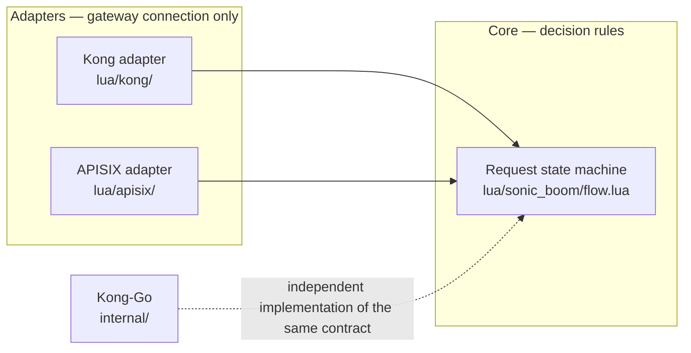

# Sonic Boom [](https://github.com/unchartedsky/sonic-boom/actions/workflows/ci.yml)

A response cache plugin for Kong Gateway 3.9.x OSS. It supports three cache strategies (in-memory, redis, redis-cluster), and the two implementations share the same core contract.

| Variant | Implementation | Location | Usage guide | Verdict |
|---------|----------------|----------|-------------|---------|
| Kong-Go | go-pdk external plugin server | `main.go` + `internal/` | [docs/usage-kong-go.md](./docs/usage-kong-go.md) | — |
| Kong-Lua | Gateway-neutral core + Kong adapter | `lua/sonic_boom/` + `lua/kong/` | [docs/usage-kong-lua.md](./docs/usage-kong-lua.md) | [docs/kong-lua-verdict.md](./docs/kong-lua-verdict.md) |
| APISIX-Lua | Same core + APISIX adapter | `lua/sonic_boom/` + `lua/apisix/` | [docs/usage-apisix.md](./docs/usage-apisix.md) | [docs/apisix-verdict.md](./docs/apisix-verdict.md) |

Product decisions such as filters, storage gates, and fill-lock all live in the core (`lua/sonic_boom/flow.lua`, `internal/` in Go); adapters only handle PDK (Plugin Development Kit) getters and setters and how requests short-circuit (Figure 1). [How it works](./docs/how-it-works.md) explains what this means and where a request gets decided.



*Figure 1. Decision rules live in one core and adapters only carry gateway connection, so all three variants behave the same.*

## Documentation map

- **Install and use** — [Kong-Go](./docs/usage-kong-go.md) · [Kong-Lua](./docs/usage-kong-lua.md) · [APISIX](./docs/usage-apisix.md)
- **Behavior and configuration** — [How it works](./docs/how-it-works.md) · [Configuration reference](./docs/configuration.md)
- **Troubleshooting** — [troubleshooting](./docs/troubleshooting.md)
- **Verification and records** — [testing.md](./docs/testing.md) (test SSOT) · [verification-2026-10-24.md](./docs/verification-2026-10-24.md) · [bench-kong-lua-vs-go](./docs/bench-kong-lua-vs-go.md) · [bench-apisix-vs-kong-lua](./docs/bench-apisix-vs-kong-lua.md) · [bench-five-caches](./docs/bench-five-caches.md)
- **Verdicts** — [kong-lua-verdict](./docs/kong-lua-verdict.md) · [apisix-verdict](./docs/apisix-verdict.md) · [bakeoff: API gateway caching gap analysis](./docs/bakeoffs/2026-10-18-api-gw-caching-gap-analysis.md)
- **Learnings** — [docs/solutions/](./docs/solutions/)

## Quick start

```bash
make test        # integration tests: starts redis and redis-cluster via compose, then go test -race
make e2e         # Go e2e: smoke tests for all three cache strategies
make e2e-lua     # Kong-Lua e2e (port 8010)
make e2e-apisix  # APISIX e2e (port 8020)
make stress      # cache stampede and CSC measured scenarios + automatic assertions
```

The e2e tests run without external internet access (mock upstream in `test/upstream/`). `PARITY_PAIR=go-lua|lua-apisix ./scripts/parity_replay.sh` replays the same requests against two gateways and proves that cache status, HTTP status, and body match. The three-layer test structure and the CI job boundary convention are in [docs/testing.md](./docs/testing.md).

`./run.sh` (air hot-reload dev server) and `./test.sh` (a single curl smoke run) are legacy tools.

## Build and install

```bash
make build   # cross-compile to bin/linux-${GOARCH}/sonic-boom
```

Installation, declarative configuration, and verification follow the usage guide of each variant: [Kong-Go](./docs/usage-kong-go.md) · [Kong-Lua](./docs/usage-kong-lua.md) · [APISIX](./docs/usage-apisix.md).

## Cache strategies

| Strategy | When |
|----------|------|
| `in-memory` | Single instance: node-local ristretto cache |
| `redis` | Multiple gateway instances share the cache |
| `redis-cluster` | Large-scale distribution: automatic sharding |

Each configuration uses exactly one strategy. Per-strategy fields and defaults are in the [configuration reference](./docs/configuration.md).

## Core behavior rules

These directly affect safety. Where each rule is decided is covered in [How it works](./docs/how-it-works.md); the full rule set is in the [configuration reference](./docs/configuration.md).

- The request-side `cache_control` guard is on by default. Requests carrying `Cache-Control: no-store/no-cache` or an `Authorization` header are excluded from the cache (matching RFC 9111 and the original Kong plugin). To turn it off, set `cache_control: false` on the route.
- Responses with `Set-Cookie`, or whose `Cache-Control` contains `private`, `no-store`, or `no-cache`, are not stored.
- `cache_ttl: 0` is rejected: with the redis stores it would become a permanent key.
- The default `cacheable_body_max_size` of 0 means unlimited. Routes that cache bodies must set an upper bound.
- The `X-Cache-Key` header exposes the internal cache key as is. This is accepted for debugging convenience; deployments concerned about external exposure remove the header in front of the gateway.
- Configuration validation runs on every request; on failure the request passes through with `X-Cache-Status: Bypass` instead of killing the process.

## Configuration

Configuration attaches to each route, and the minimal form is just the strategy and the store address; defaults cover the rest. Minimal examples are in each [usage guide](./docs/usage-kong-go.md), and every field, default, and variant difference is in the [configuration reference](./docs/configuration.md). Complete declarative examples that run under e2e are `config_v1.yml` (Kong-Go), `config_lua.yml` (Kong-Lua), and `config_apisix.yaml` (APISIX).

## Development

- Go 1.27+, Docker & Docker Compose
- Unit tests only, fast: `go test ./internal -run 'Test_InMemory|TestConfig|Test_'`
- Lint: `golangci-lint run ./...` (registered as a pre-commit hook)

## TODO

- [ ] Add a Kubernetes example
- [ ] Support [`ignore_uri_case`](https://github.com/Kong/kong/blob/a4c0b461345d431067a2bfb7645434212eed7e5b/kong/plugins/proxy-cache/handler.lua#L247) from Kong proxycache

## References

- [Feature request plugin instance lifecycle hooks · Issue 78 · Kong go-pdk](https://github.com/Kong/go-pdk/issues/78)
