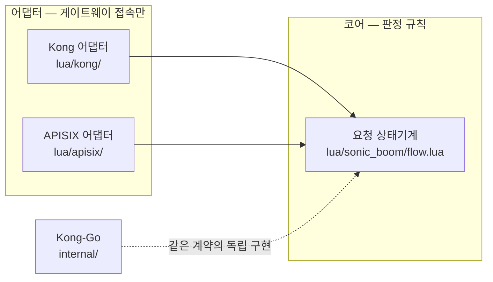

# Sonic Boom [](https://github.com/unchartedsky/sonic-boom/actions/workflows/ci.yml)

Kong Gateway 3.9.x OSS용 응답 캐시 플러그인. in-memory·redis·redis-cluster 세 캐시 전략을 지원하고 두 구현이 같은 코어 계약을 공유한다.

| 변종 | 구현 | 위치 | 사용 가이드 | 판정 자료 |
|------|------|------|-------------|-----------|
| Kong-Go | go-pdk external plugin 서버 | `main.go` + `internal/` | [docs/usage-kong-go.md](./docs/usage-kong-go.md) | — |
| Kong-Lua | 게이트웨이 중립 코어 + Kong 어댑터 | `lua/sonic_boom/` + `lua/kong/` | [docs/usage-kong-lua.md](./docs/usage-kong-lua.md) | [docs/kong-lua-verdict.md](./docs/kong-lua-verdict.md) |
| APISIX-Lua | 같은 코어 + APISIX 어댑터 | `lua/sonic_boom/` + `lua/apisix/` | [docs/usage-apisix.md](./docs/usage-apisix.md) | [docs/apisix-verdict.md](./docs/apisix-verdict.md) |

필터·저장 게이트·fill-lock 같은 제품 판정은 전부 코어(`lua/sonic_boom/flow.lua`, Go는 `internal/`)에 있고 어댑터는 PDK(Plugin Development Kit) 게터·세터와 단락 방식만 담당한다(그림 1). 무슨 뜻인지, 요청이 어디서 판정되는지는 [동작 방식](./docs/how-it-works.md)이 설명한다.



*그림 1. 판정 규칙은 코어 하나에 있고 어댑터는 게이트웨이 접속만 담는다 — 그래서 세 변종의 동작이 같다.*

## 문서 지도

- **설치·사용** — [Kong-Go](./docs/usage-kong-go.md) · [Kong-Lua](./docs/usage-kong-lua.md) · [APISIX](./docs/usage-apisix.md)
- **동작·설정** — [동작 방식](./docs/how-it-works.md) · [설정 레퍼런스](./docs/configuration.md)
- **문제 해결** — [troubleshooting](./docs/troubleshooting.md)
- **검증·기록** — [testing.md](./docs/testing.md)(테스트 SSOT) · [verification-2026-10-24.md](./docs/verification-2026-10-24.md) · [bench-kong-lua-vs-go](./docs/bench-kong-lua-vs-go.md) · [bench-apisix-vs-kong-lua](./docs/bench-apisix-vs-kong-lua.md) · [bench-five-caches](./docs/bench-five-caches.md)
- **판정 자료** — [kong-lua-verdict](./docs/kong-lua-verdict.md) · [apisix-verdict](./docs/apisix-verdict.md) · [bakeoff: API GW 캐싱 갭 분석](./docs/bakeoffs/2026-10-18-api-gw-caching-gap-analysis.md)
- **학습** — [docs/solutions/](./docs/solutions/)

## 빠른 시작

```bash
make test        # 통합 테스트 — compose로 redis·redis-cluster 기동 후 go test -race
make e2e         # Go판 e2e — 세 캐시 전략 스모크
make e2e-lua     # Kong-Lua e2e (포트 8010)
make e2e-apisix  # APISIX e2e (포트 8020)
make stress      # 스탬피드·CSC 실측 시나리오 + 자동 단언
```

e2e는 외부 인터넷 없이 도는다(목업 업스트림 `test/upstream/`). 게이트웨이 두 개에 같은 요청을 재생해 상태·status·본문 일치를 증명하는 건 `PARITY_PAIR=go-lua|lua-apisix ./scripts/parity_replay.sh`. 테스트 3층 구조와 CI 잡 경계 규약은 [docs/testing.md](./docs/testing.md).

`./run.sh`(air 핫리로드 개발 서버)과 `./test.sh`(curl 스모크 1회)는 이전 세대 도구다.

## 빌드 및 설치

```bash
make build   # bin/linux-${GOARCH}/sonic-boom 크로스컴파일
```

설치·선언형 설정·동작 확인은 각 변종의 사용 가이드를 따른다: [Kong-Go](./docs/usage-kong-go.md) · [Kong-Lua](./docs/usage-kong-lua.md) · [APISIX](./docs/usage-apisix.md).

## 캐시 전략

| 전략 | 언제 |
|------|------|
| `in-memory` | 단일 인스턴스 — 노드 로컬 ristretto 캐시 |
| `redis` | 여러 게이트웨이 인스턴스가 캐시를 공유 |
| `redis-cluster` | 대규모 분산 — 자동 샤딩 |

설정 하나는 정확히 하나의 전략을 쓴다. 전략별 필드·기본값은 [설정 레퍼런스](./docs/configuration.md).

## 핵심 동작 규칙

안전에 직결되는 것들. 각 규칙의 판정 위치는 [동작 방식](./docs/how-it-works.md), 전체 규칙은 [설정 레퍼런스](./docs/configuration.md).

- 요청측 `cache_control` 가드는 기본 on — `Cache-Control: no-store/no-cache` 요청과 `Authorization` 요청은 캐시에서 제외된다(RFC 9111·Kong 원본 정합). 끄려면 라우트에 `cache_control: false`.
- `Set-Cookie`가 있거나 `Cache-Control`에 `private`·`no-store`·`no-cache`가 있는 응답은 저장하지 않는다.
- `cache_ttl: 0`은 거부된다 — redis 저장소에서 영구 키가 되기 때문이다.
- `cacheable_body_max_size` 기본 0은 무제한이다. 본문을 캐시하는 라우트는 반드시 상한을 정한다.
- `X-Cache-Key` 헤더가 내부 캐시 키를 그대로 노출한다 — 디버깅 편의로 수용된 동작이며 외부 노출이 우려되면 게이트웨이 앞단에서 제거한다.
- 설정 검증은 요청마다 실행되고 실패해도 프로세스를 죽이지 않고 `X-Cache-Status: Bypass`로 통과한다.

## 설정

설정은 라우트마다 붙이고 최소 형태는 전략과 저장소 주소가 전부다 — 나머지는 기본값이 덮는다. 최소 예제는 각 [사용 가이드](./docs/usage-kong-go.md)에, 전 필드·기본값·변종 차이는 [설정 레퍼런스](./docs/configuration.md)에 있다. e2e를 도는 완전한 선언형 예제는 `config_v1.yml`(Kong-Go)·`config_lua.yml`(Kong-Lua)·`config_apisix.yaml`(APISIX).

## 개발

- Go 1.27+, Docker & Docker Compose
- 단위 테스트만 빠르게: `go test ./internal -run 'Test_InMemory|TestConfig|Test_'`
- 린트: `golangci-lint run ./...`(pre-commit 훅 등록)

## TODO

- [ ] Kubernetes 예제 추가
- [ ] Kong proxycache의 [`ignore_uri_case`](https://github.com/Kong/kong/blob/a4c0b461345d431067a2bfb7645434212eed7e5b/kong/plugins/proxy-cache/handler.lua#L247) 지원

## 참고

- [Feature request plugin instance lifecycle hooks · Issue 78 · Kong go-pdk](https://github.com/Kong/go-pdk/issues/78)
