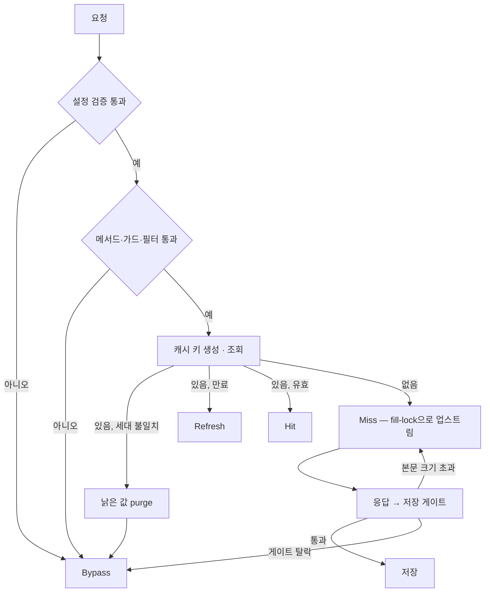
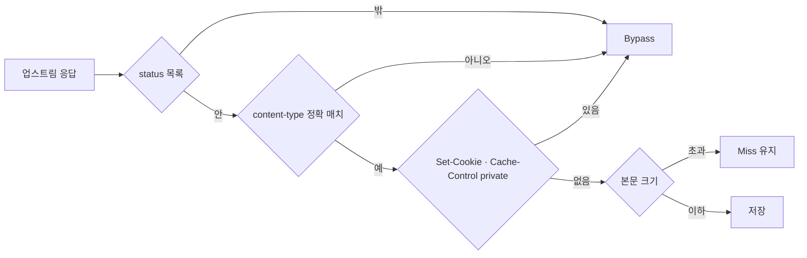

# sonic-boom 동작 방식

sonic-boom은 게이트웨이(Kong 또는 APISIX)에서 응답을 캐시하는 플러그인이다. 이 문서는 요청 하나가 판정되고 저장되기까지의 길, 그리고 그 결과를 읽는 방법을 설명한다. 설치·설정은 변종별 사용 문서([Kong-Go](./usage-kong-go.md)·[Kong-Lua](./usage-kong-lua.md)·[APISIX](./usage-apisix.md))를, 필드 하나하나의 의미는 [설정 레퍼런스](./configuration.md)를 본다. 상태 헤더가 이상하게 나올 때는 [문제 해결 가이드](./troubleshooting.md)가 먼저다.

## 요청 수명주기

요청은 두 단계를 지난다. **Access 단계**(게이트웨이가 업스트림 — 요청을 최종 처리하는 원본 서버 — 로 보내기 전)에서 "이 요청을 캐시할 수 있나, 캐시에 있나"를 판정하고 **Response 단계**(업스트림 응답이 돌아온 뒤)에서 "이 응답을 저장하나"를 판정한다. 각 단계는 정해진 순서로 심사하고 어느 관문에서 탈락했는지가 곧 `X-Cache-Status` 값이 된다(그림 1). 아래에서 단계별로 나눠 본다.

*그림 1. 요청은 정해진 관문을 차례로 지나며, 어느 관문에서 탈락했는지가 곧 X-Cache-Status 값이다.*

### Access — 캐시할 수 있는가, 캐시에 있는가

1. **설정 검증** — 라우트의 플러그인 설정을 검증한다. 실패해도 프로세스를 죽이지 않고 `Bypass`로 통과시키며 Error 로그를 남긴다. 잘못된 설정 하나가 게이트웨이 전체를 죽이지 않게 하려는 설계다.
2. **메서드** — `request_method` 목록에 없는 메서드는 `Bypass`.
3. **cache_control 가드**(요청측 캐시 제외 가드, 기본 on) — 요청이 `Cache-Control: no-store` 또는 `no-cache`를 담고 있거나 `Authorization` 헤더가 있으면 `Bypass`. 인증된 요청이 공용 캐시에 섞이는 것을 막는 가드로, RFC 9111과 Kong 내장 proxy-cache와 같은 기본값이다. 끄려면 라우트에 `cache_control: false`를 명시한다.
4. **필터** — 경로·헤더 정규식 규칙으로 캐시 대상을 좁힌다. 어느 필터에도 맞지 않으면 `Bypass`. 필터의 `cache_ttl`을 0으로 두면 전역 `cache_ttl`을 상속한다(즉시 만료 필터는 만들 수 없다).
5. **캐시 키 생성** — 통과한 요청의 성분으로 키를 만들고 `X-Cache-Key` 헤더에 노출한다. 구성은 아래 "캐시 키와 세대"에서.
6. **조회** — 캐시에서 키를 찾되 값이 있어도 바로 서빙하지 않고 두 번 본다. 저장된 세대(`cache_version`)가 현재와 다르면 낡은 값을 지우고(purge) 업스트림으로 간다. 유효 기간이 지났으면 `Refresh`로 업스트림에서 다시 받고 둘 다 아니면 `Hit` — 캐시된 응답을 그대로 돌려준다.
7. **fill-lock**(동시 미스 시 한 요청만 업스트림을 채우게 하는 방어) — 캐시에 없으면 락을 잡고 업스트림으로 간다. 같은 키에 요청이 몰려 있으면 한 요청만 업스트림을 호출하고 나머지는 승자의 저장을 기다렸다가 그 값을 받는다. 스탬피드 — 캐시 만료 순간에 요청이 원본으로 급증하는 현상 — 를 막는 장치다.

fill-lock의 남은 디테일: `fill_lock.enabled: false`면 방어가 꺼져 전원이 업스트림으로 간다. in-memory 전략은 저장소가 락을 지원하지 않아 구조적으로 항상 fail-open — 락 없이 전원 통과 — 이다. 승자가 장애로 락을 반납하지 못하는 경우를 대비해 락 자체에 TTL(기본 3000ms)이 걸려 있다.

### Response — 저장할 것인가

Access에서 판정을 통과한 요청만 캐시 시그널(캐시 키와 TTL만 담아 Response로 전달되는 요청 범위 메시지)을 남긴다. `Bypass` 판정은 시그널이 없으므로 저장을 시도하지 않는다.

시그널이 있으면 저장 게이트를 저렴한 검사부터 순서대로 통과시킨다.

1. **status** — `response_code` 목록 밖의 응답은 저장하지 않는다.
2. **content-type** — `content_type` 목록과 대소문자 무관 정확 매치. 파라미터 변형(`application/json;charset=utf-8`)도 목록에 명시해야 캐시된다.
3. **응답 헤더** — `Set-Cookie`가 있거나 `Cache-Control`에 `private`·`no-store`·`no-cache`가 있으면 저장하지 않는다. 개인화 응답이 공용 캐시에 오염되는 것을 막는다.
4. **본문 크기** — `cacheable_body_max_size`보다 크면 저장하지 않는다. 기본값 0은 무제한이므로 본문을 캐시하는 라우트는 반드시 상한을 정한다.

*그림 2. 저장 게이트는 저렴한 검사부터 순서가 있고, 마지막 관문(본문 크기)만 탈락해도 Miss 라벨을 유지한다.*

미묘한 점 하나: 게이트 1-3에서 탈락하면 `X-Cache-Status`가 `Bypass`로 바뀌지만 본문 크기 초과는 `Miss`를 유지한다. 캐시 대상이었고 조회도 미스였다는 사실을 그대로 두는 것이다.

전부 통과하면 응답 전체 — status·헤더·본문·저장 시각·TTL·세대 — 를 캐시에 저장한다. 저장 시점에 변종 차이가 하나 있다: Lua 변종의 redis·redis-cluster 저장은 로그 단계 타이머로 응답 반환 뒤에 일어난다. 응답을 받자마자 재요청하면 저장이 아직 끝나지 않은 `Miss`를 볼 수 있다. Go판은 Response 단계에서 저장하며 Lua의 in-memory 저장은 응답 완료 시점에 즉시 일어난다.

## 코어와 어댑터

판정 규칙은 전부 코어에 있고 어댑터는 게이트웨이 접속만 담는다 — 그래서 세 변종의 동작이 같다.

| 변종 | 구현 | 위치 |
|------|------|------|
| Kong-Go | go-pdk 외부 플러그인 서버 | `internal/` |
| Kong-Lua | 게이트웨이 중립 코어 + Kong 어댑터 | `lua/sonic_boom/` + `lua/kong/` |
| APISIX-Lua | 같은 코어 + APISIX 어댑터 | `lua/sonic_boom/` + `lua/apisix/` |

Lua판에서 판정 로직은 코어 `lua/sonic_boom/flow.lua` 하나에만 있다. Kong 어댑터와 APISIX 어댑터는 게이트웨이 API에서 값을 읽고·쓰고 캐시 응답으로 요청을 끝내는 일(단락)만 담는다. Go판은 같은 계약의 독립 구현이다.

"세 변종이 같다"는 주장은 재생 비교로 증명된다. `scripts/parity_replay.sh`가 같은 요청 묶음을 두 게이트웨이에 같은 순서로 재생해 `X-Cache-Status` 시퀀스, HTTP status, 본문(sha256)이 일치하는지 확인한다. CI가 이 비교를 게이트웨이 쌍마다 돌린다.

그래서 변종 차이는 발견되는 게 아니라 목록화되어 관리된다. 현재 목록 — 정규식 엔진(RE2 vs PCRE), 다중값 쿼리 정렬 순서, 세대 불일치 라벨 등 — 은 [docs/kong-lua-verdict.md](./kong-lua-verdict.md)와 [docs/apisix-verdict.md](./apisix-verdict.md)의 명시 차이 목록이 원천이다.

## 캐시 키와 세대

### 키 성분

캐시 키는 요청에서 캐시 의미가 있는 성분 전부를 모아 만든다: consumer(인증 주체 ID), principal(아래 "주체 키 분리"), service, route, 메서드, 경로(쿼리 제외), 쿼리, vary 헤더(`vary_headers`에 선언한 헤더의 값), 본문, 그리고 **유효 TTL**.

TTL이 키 성분이라는 점은 실무에서 자주 놓친다. 필터 TTL이 다른 두 라우트가 같은 경로를 다루면 키가 달라져 캐시가 나뉜다. 캐시 적중이 예상과 다를 때 먼저 의심할 지점이다.

각 성분은 `길이:값|` 형태로 이어붙인 뒤 sha256으로 요약된다. 길이 접두가 붙는 이유는 구분자 주입을 막기 위해서다 — 값 안에 `|`가 들어 있어도 성분 경계가 흐트러지지 않는다. 쿼리 성분은 정렬해 직렬화하는데 Go판은 값까지 정렬하고 Lua판은 원순서를 쓴다(명시 차이).

### 세대 — cache_version

`cache_version`은 캐시의 세대 마커다. 값을 바꾸면 이전 세대의 캐시가 무효가 된다. 수동으로 캐시를 비우는 대신 세대를 바꾸는 것이 무효화의 정석이다.

구현은 변종마다 다르다. Go판은 키에 세대를 넣지 않고 Hit 후보를 찾은 시점에 저장된 세대와 비교해 다르면 그 값을 지운다(purge). Lua 변종은 키 접두에 세대를 박아 넣어(`{접두}:{cache_version}:{sha256}`) 아예 다른 키 공간으로 갈아탄다. 결과는 같다 — 낡은 값을 서빙하지 않는다.

### 주체 키 분리 — credential_vary

consumer가 식별되지 않은 요청이 `Authorization` 헤더를 갖고 있으면 그 값이 principal 성분으로 키에 들어간다. 같은 URL이라도 자격증명마다 다른 캐시 슬롯을 쓰게 되는 것 — 익명 요청끼리만 응답이 공유되고 인증 요청은 각자의 슬롯에 저장된다. 이것이 기본 동작이고 `credential_vary: false`로 끄면 구 동작(익명 공용 슬롯)으로 돌아간다. `vary_headers`에 Authorization을 선언한 라우트는 그 헤더가 이미 vary 성분이므로 중복 추가하지 않는다.

## X-Cache-Status와 X-Cache-Key

응답 헤더 두 개가 판정 결과를 그대로 보여준다.

| 값 | 뜻 |
|----|-----|
| `Miss` | 캐시에 없어 업스트림으로 갔다. 저장될 예정 |
| `Hit` | 캐시된 응답을 그대로 돌려줬다 |
| `Bypass` | 캐시 대상이 아니거나(요청 판정 탈락) 저장하지 않았다(저장 게이트 탈락) |
| `Refresh` | 캐시에 있지만 유효 기간이 지나 업스트림에서 다시 받았다 |

판독 시 알아둘 미묘점: 본문 크기 초과는 `Bypass`가 아니라 `Miss`를 유지한다. 세대 불일치 라벨은 Go가 `Bypass`, Lua가 `Miss`다. `Hit`으로 재생할 때 원본 응답의 `Age` 헤더는 지우고 다시 계산한다.

`X-Cache-Key`는 캐시 판정을 통과한 요청 전부에 붙는다 — Hit 여부와 무관하다. 내부 키를 그대로 노출하는 것은 디버깅 편의를 위해 수용된 기본값이고 외부 노출이 우려되는 배포는 게이트웨이 앞단에서 이 헤더를 제거한다.

값 조합의 해석과 "왜 캐시가 안 되지"의 원인 찾기는 [문제 해결 가이드](./troubleshooting.md)가 전담한다.
