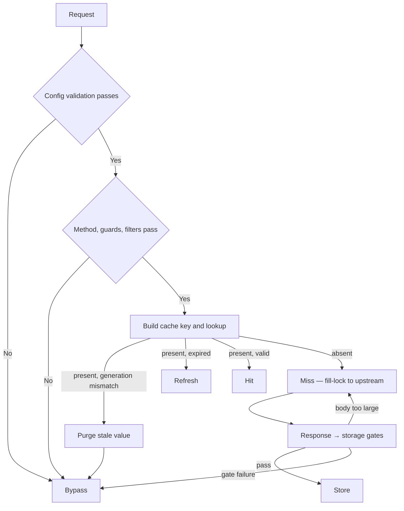
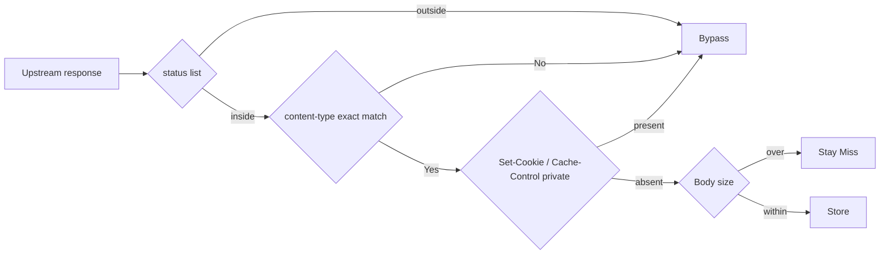

# How sonic-boom works

sonic-boom is a plugin that caches responses at the gateway (Kong or APISIX). This document describes how a single request travels from decision to storage, and how to read the outcome. For installation and configuration, see the usage docs for each variant ([Kong-Go](./usage-kong-go.md), [Kong-Lua](./usage-kong-lua.md), [APISIX](./usage-apisix.md)); for the meaning of each field, see the [configuration reference](./configuration.md). If a status header looks wrong, start with the [troubleshooting guide](./troubleshooting.md).

## Request lifecycle

A request passes through two phases. In the **Access phase** (before the gateway sends the request to the upstream, the origin server that ultimately handles the request), the plugin decides whether the request is cacheable and whether it is in the cache. In the **Response phase** (after the upstream response returns), it decides whether to store the response. Each phase runs its checks in a fixed order, and the gate where a request fails becomes the `X-Cache-Status` value (Figure 1). The sections below cover each phase.

*Figure 1. A request passes through fixed gates in order, and the gate it fails at becomes the X-Cache-Status value.*

### Access — is it cacheable, and is it in the cache?

1. **Config validation** — Validates the route's plugin configuration. On failure the request passes through as `Bypass` with an Error log instead of killing the process. The design keeps one bad configuration from taking down the whole gateway.
2. **Method** — Methods outside the `request_method` list get `Bypass`.
3. **cache_control guard** (request-side cache exclusion guard, on by default) — If the request carries `Cache-Control: no-store` or `no-cache`, or has an `Authorization` header, it gets `Bypass`. The guard keeps authenticated requests out of the shared cache, with the same defaults as RFC 9111 and Kong's built-in proxy-cache. To disable it, set `cache_control: false` on the route.
4. **Filters** — Path and header regex rules narrow what gets cached. A request matching no filter gets `Bypass`. A filter `cache_ttl` of 0 inherits the global `cache_ttl` (an instantly expiring filter cannot be created).
5. **Cache key** — Builds a key from the components of the request that passed and exposes it in the `X-Cache-Key` header. The composition is under "Cache key and generation" below.
6. **Lookup** — The plugin looks the key up in the cache, but a found value is not served immediately; it is checked twice. If the stored generation (`cache_version`) differs from the current one, the stale value is purged and the request goes upstream. If the entry has expired, it is fetched from upstream again as `Refresh`. Otherwise it is a `Hit`, and the cached response is returned as is.
7. **fill-lock** (a defense that lets only one request fill from upstream on a concurrent miss) — On a cache miss the plugin takes the lock and goes upstream. When requests pile up on the same key, only one calls upstream; the rest wait for the winner to store and then read its value. This prevents a cache stampede, the surge of requests to the origin at the moment a cache entry expires.

Remaining fill-lock details: with `fill_lock.enabled: false` the defense is off and every request goes upstream. The in-memory strategy is structurally always fail-open (everyone passes without a lock) because its store does not support locks. The lock itself carries a TTL (default 3000ms) for the case where the winner fails and never releases it.

### Response — store it or not

Only requests that passed the Access phase leave a cache signal (a request-scoped message that carries just the cache key and TTL into the Response phase). A `Bypass` decision leaves no signal, so no storage is attempted.

When a signal exists, the response passes through the storage gates, ordered from the cheapest check first (Figure 2).

1. **status** — Responses outside the `response_code` list are not stored.
2. **content-type** — Exact match against the `content_type` list, case-insensitive. Parameter variants (`application/json;charset=utf-8`) must be listed explicitly to be cached.
3. **Response headers** — Not stored if `Set-Cookie` is present, or if `Cache-Control` contains `private`, `no-store`, or `no-cache`. This keeps personalized responses from polluting the shared cache.
4. **Body size** — Not stored if larger than `cacheable_body_max_size`. The default of 0 means unlimited, so routes that cache bodies must set an upper bound.

*Figure 2. The storage gates are ordered from the cheapest check, and failing only the last gate (body size) still keeps the Miss label.*

One subtlety: failing gates 1-3 changes `X-Cache-Status` to `Bypass`, but exceeding the body size limit keeps `Miss`. The record still shows that the request was a cache candidate and the lookup was a miss.

Once everything passes, the whole response is stored in the cache: status, headers, body, storage time, TTL, and generation. There is one variant difference in storage timing: in the Lua variants, the redis and redis-cluster stores write on a log-phase timer, after the response has returned. A re-request right after a response can therefore see a `Miss` from a store that has not finished. The Go implementation stores in the Response phase, and the Lua in-memory store happens immediately when the response completes.

## Core and adapters

All decision rules live in the core, and adapters only carry gateway connection, so the three variants behave the same.

| Variant | Implementation | Location |
|---------|----------------|----------|
| Kong-Go | go-pdk external plugin server | `internal/` |
| Kong-Lua | Gateway-neutral core + Kong adapter | `lua/sonic_boom/` + `lua/kong/` |
| APISIX-Lua | Same core + APISIX adapter | `lua/sonic_boom/` + `lua/apisix/` |

In the Lua implementations, the decision logic lives only in the core `lua/sonic_boom/flow.lua`. The Kong and APISIX adapters only read and write values through the gateway API and end requests with a cached response (short-circuit). The Go implementation is an independent implementation of the same contract.

The claim that the three variants behave the same is proven by parity replay. `scripts/parity_replay.sh` replays the same bundle of requests to two gateways in the same order and checks that the `X-Cache-Status` sequence, HTTP status, and body (sha256) match. CI runs this comparison for every gateway pair.

Variant differences are therefore not discovered ad hoc; they are cataloged and managed. The current list, covering the regex engine (RE2 vs PCRE), multi-value query ordering, the generation mismatch label, and more, has its source in the documented difference lists of [docs/kong-lua-verdict.md](./kong-lua-verdict.md) and [docs/apisix-verdict.md](./apisix-verdict.md).

## Cache key and generation

### Key components

The cache key combines every request component with cache meaning: consumer (authenticated principal ID), principal (see "Principal key isolation" below), service, route, method, path (without the query), query, vary headers (the values of the headers declared in `vary_headers`), body, and the **effective TTL**.

That TTL is a key component is easy to miss in practice. Two routes covering the same path with different filter TTLs get different keys and separate caches. This is the first thing to suspect when hits do not match expectations.

Each component is concatenated in the form `length:value|` and then summarized with sha256. The length prefix prevents delimiter injection: even if a value contains `|`, the component boundaries hold. The query component is serialized in sorted order; the Go implementation sorts the values as well, while the Lua implementations keep the original order (a documented difference).

### Generation — cache_version

`cache_version` is the generation marker of the cache. Changing the value invalidates the previous generation. The standard way to invalidate is to switch generations instead of clearing the cache manually.

The implementation differs per variant. The Go implementation does not put the generation in the key; when it finds a Hit candidate it compares the stored generation and purges the value on mismatch. The Lua variants bake the generation into the key prefix (`{prefix}:{cache_version}:{sha256}`) and switch to an entirely different key space. The outcome is the same: stale values are never served.

### Principal key isolation — credential_vary

If an unidentified request carries an `Authorization` header, its value enters the key as the principal component. The same URL then uses a different cache slot per credential: responses are shared only among anonymous requests, and each authenticated request is stored in its own slot. This is the default behavior; turning it off with `credential_vary: false` returns to the old behavior (the shared anonymous slot). Routes that declare Authorization in `vary_headers` do not add it again, since it is already a vary component.

## X-Cache-Status and X-Cache-Key

Two response headers show the decision outcome as is.

| Value | Meaning |
|-------|---------|
| `Miss` | Not in the cache; the request went upstream. It will be stored |
| `Hit` | The cached response was returned as is |
| `Bypass` | Not a cache candidate (failed the request-side decision) or not stored (failed a storage gate) |
| `Refresh` | In the cache but expired; fetched again from upstream |

Subtleties worth knowing when reading: exceeding the body size limit keeps `Miss` rather than becoming `Bypass`. The generation mismatch label is `Bypass` in Go and `Miss` in Lua. On a `Hit`, the `Age` header of the original response is dropped and recomputed.

`X-Cache-Key` is attached to every request that passes the cache decision, Hit or not. Exposing the internal key as is is the accepted default for debugging convenience; deployments concerned about external exposure strip this header in front of the gateway.

The [troubleshooting guide](./troubleshooting.md) covers how to interpret combinations of these values and find the cause of a "why is this not cached" case.
