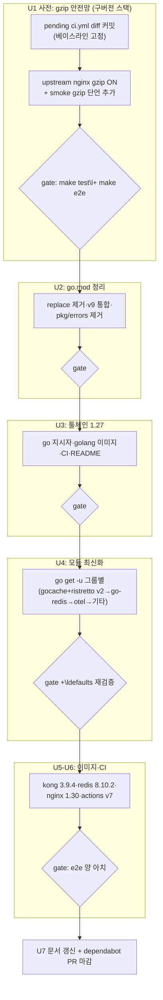

# 의존성·툴체인 일괄 최신화와 gzip 압축 트래픽 안전망

> 작성 위치 참고: 플랜 모드 제약으로 이 파일(`~/.claude/plans/golang-kong-composed-riddle.md`)에 작성했다. 승인 후 실행 첫 단계에서 `docs/plans/2026-10-18-HHMM-chore-dependency-upgrade-gzip-safety-plan.md`으로 복사해 저장한다(CE artifact root는 `docs/`).

## Goal Capsule

- **Objective:** sonic-boom이 2026년 10월 기준 무료로 쓸 수 있는 최신 스택(Go 1.27, Kong 3.9.4, 최신 라이브러리·도구)에서 기존 캐시 동작을 그대로 유지한다. 업그레이드로 인한 캐시·압축 회귀가 있으면 테스트 게이트가 잡아내는 상태가 완성 상태다.
- **Means:** gzip 압축 트래픽 테스트를 포함한 안전망을 먼저 확보하고(기존 3층 테스트 체계에 얹음), go.mod 정리 → Go 툴체인 1.27 → Go 모듈 최신화 → 컨테이너 이미지·CI 순으로 단계별로 올리며 각 단계에서 `make test` + `make e2e`를 통과해야 다음으로 간다.
- **Stop conditions:** 모든 직접 의존성이 최신이고(ristretto는 `/v2` 이행 포함), 세 캐시 전략의 gzip 단언(응답+요청)을 포함한 전체 게이트가 양 아치 CI에서 통과하면 완료. 게이트가 반복적으로 깨지는 단계는 원인 분석 후 해당 항목만 현행 유지로 후퇴하고 근거를 계획에 기록한다.

---

## Product Contract

### Summary

gzip 압축 트래픽 단언을 기존 3층 테스트(unit/integration/e2e)에 추가해 업그레이드 전 안전망을 만들고, 그 위에서 Go 툴체인·Kong 베이스 이미지·주요 라이브러리·주변 도구(Redis 8.10, nginx 1.30, GitHub Actions v7)를 최신으로 올린다. 죽은 go-pdk replace 지시자와 낡은 임포트를 정리한다.

### Problem Frame

sonic-boom은 2025년 중반 기준 버전에 머물러 있다: `go.mod` `go 1.25`, Kong 베이스 이미지 `kong:3.9.1-ubuntu`, gocache 4.2.x, go-redis 9.14.1 등. dependabot이 주간으로 보고 있지만 열린 PR 10건이 방치돼 있다. 캐시 플러그인은 게이트웨이의 심장부라 업그레이드 실패가 곧 운영 장애다.

더 큰 문제는 검증 공백이다. compose에 `KONG_NGINX_HTTP_GZIP=on` 설정이 있음에도(단 `GZIP_TYPES` 주석 처리로 JSON은 미압축) 압축 트래픽을 단언하는 테스트가 전무하다. 코드 조사 결과 `internal/sonic_boom.go`에는 Content-Encoding/Vary/Accept-Encoding 정규화가 전혀 없어서, 압축 응답의 캐시 저장·재생 동작은 지금 "우연히 그렇게 동작"하는 상태다. 이 상태로 버전을 올리면 압축 관련 회귀를 아무도 잡지 못한다.

외부 조사로 확인된 상한 하나: Kong 무료 OSS 이미지는 **3.9.4가 마지막**이고 3.10부터는 Konnect/Enterprise 전용(`kong/kong-gateway`, 라이선스 필요)이다. 따라서 "Kong 최신"은 3.9.1→3.9.4 패치 최신화를 뜻하며, 3.10+ 이행은 별도 제품 결정으로 남는다.

### Requirements

**압축 트래픽 안전망**

- R1. gzip 응답 캐시 동작이 단언된다: Accept-Encoding을 보낸 클라이언트의 Miss→Hit, 히트 응답의 Content-Encoding 정합성, 압축 여부에 따른 캐시 키 분리(vary).
- R2. gzip 요청 바디 처리가 단언된다: `Content-Encoding: gzip` 요청의 캐시 키 포함·저장·재생 동작을 현재 구현 그대로 고정한다(characterization — 버그가 아니라 현재 동작의 안정성을 보는 것이다).
- R3. 압축 단언은 세 캐시 전략(in-memory, redis, redis-cluster) 공통 검증으로 돈다.

**의존성·툴체인 최신화**

- R4. 모든 직접 의존성이 최신 안정 버전으로 올라가고, 죽은 replace 지시자(`replace github.com/Kong/go-pdk v0.8.0 => ...`, 그래프에 v0.8.0 선택된 적 없음)가 제거된다. gocache store/ristretto 최신화에 따르는 ristretto `/v2` 임포트 이행을 포함한다. 최신화가 불가능하거나 권장되지 않는 항목은 구형 의존성 보고(Appendix A1)의 근거로 남는다.
- R5. Go 툴체인이 1.27로 통일된다: `go.mod` go 지시자, compose `golang:` 이미지, ci.yml, build.yml, README. 최신 모듈(go-redis v9.23.0은 Go ≥1.26 요구)의 선행 조건이기도 하다.
- R6. Kong 베이스 이미지를 3.9.4로 올리고 주변 도구를 최신화한다: Redis 8.10(태그 고정), nginx 1.30 이미지 고정, GitHub Actions 메이저(v7). 미고정 이미지 태그(`redis`, `nginx:alpine`)는 고정 태그로 바뀐다.

**프로세스·문서**

- R7. 업그레이드는 단계별 게이트 아래 진행된다: 각 단계 종료 시 `make test`와 `make e2e`가 모두 통과해야 다음 단계로 간다.
- R8. README의 stale 정보(`go build -o sonic-boom ./cmd` — `cmd/`는 빈 디렉터리로 커밋돼 있지 않다, Go 버전 표기)와 `docs/testing.md`(gzip 단언 추가)이 실상과 일치해 갱신된다.

### Key Decisions

- KD1. 테스트 선행·단계별 게이트: 업그레이드 전에 안전망을 확보하고 단계마다 게이트를 통과한다. (Governs R7)
- KD2. Redis 8 업그레이드 포함 + 모든 이미지 태그 고정으로 재현성 확보. (Governs R6)
- KD3. 압축 검증은 응답과 요청 둘 다 본다. (Governs R1, R2)
- KD4. 구형 의존성은 교체하지 않고 버전만 최신화한다. 단 validator v9→v10 통합, pkg/errors 제거, ristretto `/v2` 임포트 이행은 기계적 정리 수준이라 이번에 포함한다. 나머지는 Appendix A1 보고서 근거로 유지한다. (Governs R4)
- KD5. Kong은 무료 OSS 마지막 라인인 3.9.4까지 올리고, 3.10+(Konnect/Enterprise) 이행은 이 계획 밖 제품 결정으로 남긴다. (Governs R6)

### Success Criteria

- 업그레이드 이후 세 전략 gzip 단언(응답+요청) 포함 `make e2e`가 맥 로컬과 CI(amd64, arm64) 모두 통과한다.
- `go list -m -u all`에서 직접 의존성에 업데이트 표시가 없다(전부 최신).
- 열린 dependabot PR 10건이 흡수·마감된다(내용 반영 또는 중복·후속 supersed로 close).
- 벤치마크(`sonic_boom_bench_test.go`)가 업그레이드 후에도 수치 급락 없이 통과한다(ristretto `/v2` 이행의 성능 확인).

### Scope Boundaries

**범위 밖(`### Deferred to Follow-Up Work`):**

- 구형 라이브러리 교체(hashstructure → 다른 해시, regexpcache → 표준 regexp 등) — Appendix A1 보고서 참조
- Kong 3.10+(Konnect/Enterprise) 이행 — KD5
- 조사 중 발견한 기존 결함 수정(nil rawBody 시 body 크기 검사 우회 `internal/sonic_boom.go:749`, `conf` 재검증 `:776`, ContentTypes 불일치 시 true `internal/sonic_boom_test.go:193` 문서화) — 단, gzip 테스트가 이 결함을 직접 건드리면 그때만 이번에 고친다
- `Access`/`Response` 함수의 단위 테스트화(pdk 목 레이어 확장)
- 운영 배포·릴리스 파이프라인(ghcr 이미지 태그 갱신 등)

#### Deferred to Follow-Up Work

위 범위 밖 목록 전부가 후속 작업 후보다. 그중 권장 순위: (1) Kong Konnect/EE 이행 검토(KD5), (2) 기존 결함 3건 최소 수정, (3) hashstructure/vendor 검토, (4) regexpcache 표준 교체.

---

## Planning Contract

### Key Technical Decisions

- KTD1. 업그레이드 순서는 (1) go.mod 정리 → (2) Go 툴체인 1.27 → (3) Go 모듈 최신화 → (4) 컨테이너 이미지·CI다. 툴체인이 모듈보다 먼저인 이유: go-redis v9.23.0이 Go ≥1.26을 요구해 1.25에서는 올릴 수 없다. 단계마다 변경 변수를 제한해 게이트 실패 시 원인 특정이 쉽다.
- KTD2. Kong 3.9.1→3.9.4에서 go-pdk는 v0.11.2(현재 최신)에 유지하고 플러그인 프로토콜 코드는 건드리지 않는다. 근거: 외부 조사로 3.9→3.16 구간에 `KONG_PLUGINSERVER_*` env·go-pluginserver 프로토콜·`KONG_NGINX_HTTP_GZIP*` 브레이킹 없음을 확인. 죽은 replace(v0.8.0 fork)는 그래프에 영향이 없으므로 게이트 없이 제거 가능하다(제거 후 빌드로 확인). go-pdk #78(라이프사이클 훅 부재)은 2021년 종료된 요청이므로 현행 Init-per-phase 우회 구조는 유지한다.
- KTD3. gzip 유발은 목업 업스트림 nginx에서 결정적으로 만든다: `test/upstream/nginx.conf`에 `gzip on; gzip_types application/json; gzip_min_length 0;`를 켜고, compose의 `KONG_NGINX_HTTP_GZIP_TYPES`는 계속 주석(압축 지점을 하나로 유지). 클라이언트 측은 `curl --compressed`/`-H 'Accept-Encoding: gzip'` + Content-Encoding 헤더 단언 + 해제 후 본문 비교. 캐시 키 분리는 `config_v1.yml`의 `/ex` 라우트(vary에 Accept-Encoding 포함)를 활용한다.
- KTD4. dependabot 열린 PR 10건은 이번 통합 업그레이드로 흡수한다: `go get -u`가 gocache/otel/go-redis PR의 내용을 포함하므로 해당 PR은 중복 close, actions PR은 v7 직접 반영 후 superseded close한다. QEMU PR(#80)은 build.yml 컨테이너 잡의 `docker/setup-qemu-action` v3→v4 범프로 흡수 후 superseded close한다 — ci.yml의 스텝만 삭제됐고 build.yml에는 buildx 멀티플랫폼 빌드용 스텝이 남아 있다.
- KTD5. gzip 요청 바디 단언은 현재 동작 고정이다: `kong.Request.GetRawBody()`(`internal/sonic_boom.go:299`)가 압축 바디를 어떻게 주는지 실행 시점에 확인하고 그 동작을 단언으로 못박는다. 예상과 다른 동작이 나오면 그 자체가 업그레이드 회귀 신호다.
- KTD6. ristretto는 gocache 스택을 따라 `/v2`로 이행한다: store/ristretto v4.3.8이 `dgraph-io/ristretto/v2` v2.3.0을 요구(실측)하므로, 직접 의존도 `/v2`(최신 v2.4.2)로 임포트 경로를 옮긴다. API 델타는 in-memory 단위·통합 테스트와 벤치마크가 게이트한다.
- KTD7. defaults v1.11의 동작 변화(포인터+unmarshaler 조건에서 기본값 생략, 실패 시 부분 기본값 제거)는 Config 기본값 주입(`defaults.Set`, `CanUpdate`)에 직접 닿는다. 모듈 업그레이드 단계에서 Config 기본값 관련 기존 단위 테스트가 전부 통과하는지 게이트로 삼고, 필요 시 기본값 시나리오 테스트를 보강한다.
- KTD8. 실행 병렬화(요청 사항): 게이트 체인 U1→U6은 KTD1대로 직렬을 유지하되, 게이트와 무관한 작업은 서브에이전트에 병렬로 위임한다 — U7 문서 초안(내용 근거는 Appendix A1/A2에 확정돼 있음), dependabot PR 트리아지·마감 준비, U4(a) 직전 벤치마크 베이스라인 수집, `smoke_lib.sh` 공통 gzip 함수 확정 후 세 전략 스크립트 적용. 각 병렬 결과는 해당 단계 게이트 직전에 취합한다.

### Risks & Dependencies

- Kong 무료 상한 3.9.4(KD5) — 2026년 보안 패치(nginx CVE 대응)까지 흡수된다.
- go-redis v9.23 + Redis 8 조합은 upstream이 "동작하지만 공식 지원 아님(7.0+ 대상)"으로 표기 — e2e 3전략 게이트로 실증으로 대체.
- Redis 8.10.2는 클러스터 버스 미인증 시 경고 로그 추가(기본 동작 변화 없음) — e2e 로그에서 경고가 단언 실패로 오인되지 않게 주의.
- Go 1.27은 TLS 1.2 미만 사용 불가(제거된 GODEBUG) — OTLP grpc 엔드포인트가 레거시 TLS를 쓰는 운영 환경이 있다면 배포 전 확인. 테스트 환경(compose)은 해당 없음.
- ristretto `/v2` 이행 시 `NewCache`/`LoadOrStore` 공유 로직(`internal/sonic_boom.go:201-220`)의 API 호환 — 벤치마크와 동시성 테스트가 급락을 잡는다.

### Assumptions

- Redis 8.10이 3노드 cluster-mode(`redis-cli --cluster create`, 고정 IP announce)와 기존 e2e 구성에서 동작한다(외부 조사: 관련 브레이킹 없음).
- 로컬 개발 맥(Apple Silicon)과 CI 양 아치에서 게이트가 동일하게 적용된다(make 진입점 단일 경로 유지).
- zerolog v1.35.1은 문서화된 브레이킹이 없으나 f2e9ef6(전역 CallerMarshalFunc race 수정) 이력이 있어 `-race` 게이트가 재발을 잡는다고 본다.

### High-Level Technical Design

게이트 실패 시: 실패 지점의 단계만 조사하고, 고칠 수 없으면 해당 항목을 현행 버전으로 후퇴시켜 커밋하고 계획의 Open Questions에 기록한다. 한 단계도 게이트 없이 넘어가지 않는다.

---

## Implementation Units

### U1. gzip 압축 트래픽 테스트 안전망 (구버전 스택에서 선행)

**Goal:** 업그레이드 이전에, gzip 응답·요청 처리 동작을 현재 스택에서 단언으로 고정한다. 이 단위가 끝나면 "업그레이드 전후로 압축 동작이 같다"를 증명할 수 있다.

**Requirements:** R1, R2, R3, R7(첫 게이트)

**Dependencies:** 없음. 단, 시작 전 작업 트리에 남은 ` M .github/workflows/ci.yml`(QEMU 스텝 제거)을 먼저 커밋해 베이스라인을 고정한다.

**Files:**

- `test/upstream/nginx.conf` — gzip on, gzip_types application/json, gzip_min_length 0
- `docker-compose.yaml` — 필요시 주석 갱신(GZIP_TYPES는 유지 주석)
- `scripts/smoke_lib.sh` — gzip 단언 함수(공통)
- `scripts/smoke_in_memory.sh`, `scripts/smoke_redis.sh`, `scripts/smoke_rediscluster.sh` — 공통 함수 호출(얇게)
- `config_v1.yml` — 전략별 복제 라우트 3개 추가(`/in-memory-vary`, `/redis-vary`, `/redis-cluster-vary`, `vary_headers`에 `Accept-Encoding` 포함). 기존 전략 라우트와 `/ex`는 vary 수정 없이 유지
- `internal/` 관련 단위 테스트(헤더 저장/재생 동작 고정)

**Approach:**

1. upstream nginx에서 JSON을 gzip으로 내려주게 한다(압축 지점 단일화, KTD3). `gzip on; gzip_types application/json; gzip_min_length 0; gzip_proxied any;` — `gzip_proxied` 기본값 off면 프록시 경유 요청에서 압축이 발화하지 않아 단언 자체가 막힌다.
2. gzip 단언은 기존 단언과 **다른 쿼리스트링**(예: `page=gz1`)을 쓴다 — `smoke_lib.sh`가 `page=2`로 키를 고정하고 있어 같은 URL에 gzip 요청을 얹으면 첫 요청이 Miss가 아니라 Hit이 된다(거짓 게이트 방지).
3. **단언-라우트 배정을 명시적으로** 둔다(라우트 행렬): 기존 세 전략 라우트(`/in-memory`, `/redis`, `/redis-cluster`)는 vary를 건드리지 않는다 — gzip 응답 단언(Miss→Hit, `Content-Encoding: gzip` 존재, `curl --compressed` 해제 본문이 `response.json`과 바이트 일치)과 **교차 오염 단언**(같은 URL에 Accept-Encoding 없이 재요청 → gzip 엔트리가 그대로 재생되는 현재 동작을 바이트 수준으로 고정)을 세 저장소 모두에서 돌린다. 대신 `config_v1.yml`에 **전략별 복제 라우트**(`/in-memory-vary`, `/redis-vary`, `/redis-cluster-vary`)를 추가하고 여기에만 `vary_headers`에 `Accept-Encoding`을 넣어, gzip×vary 키 분리 단언(세 전략 공통)이 이 라우트에서 돌게 한다. 기존 `/ex` 라우트는 filters가 Authorization 자격증명을 요구해 단언용으로 부적합하므로 건드리지 않는다. 세 저장소 커버가 필요한 이유: 교차 오염·히트 재생 경로가 저장소별로 다르고, in-memory는 U4의 ristretto `/v2` 이행이 다시 쓰는 바로 그 코드다.
4. `smoke_lib.sh`의 공통 gzip 함수는 대상 라우트와 추가 헤더를 파라미터로 받는다(전략 prefix 균일 가정 금지).
5. gzip 요청 바디 단언: `Content-Encoding: gzip` + 압축된 JSON POST → 캐시 키·Miss/Hit 동작을 현재 구현대로 고정(KTD5. 실행 시점에 실제 동작 확인 후 단언 확정).
6. 단위 층: bridgetest(`internal/kong_ctx_ex_test.go`의 `MockStep` 패턴)로 응답 헤더 셋의 저장·재생에서 Content-Encoding이 보존되는지 고정. 헤더 재생 메커니즘은 두 갈래다 — `hopByHopHeaders`(`internal/sonic_boom.go:560-572`, content-length·transfer-encoding 포함 → 재생 시 덮어쓰지 않음)와 `headersToDelete`(`:577-579`, x-cache-status·age만). 단언은 내부 목록이 아니라 **클라이언트가 관측하는** 헤더/본문을 기준으로 쓴다.

**Execution note:** characterization-first — 버그를 고치는 게 아니라 현재 동작을 고정한다. gzip 단언이 기존 결함(nil rawBody 크기 검사 우회 등)에 걸리면 그때만 최소 수정.

**Test scenarios:**

- gzip 응답(각 전략 기본 라우트, `page=gz*` 고유 URL): Accept-Encoding: gzip 첫 요청 `X-Cache-Status: Miss`, 재요청 `Hit`
- gzip 히트 응답: `Content-Encoding: gzip` 헤더 존재, `curl --compressed` 본문이 `response.json`과 바이트 일치, 클라이언트 관측 Content-Length 값 고정(gzip 엔트리 Hit 시 Kong이 내놓는 실측값)
- 교차 오염(각 전략 기본 라우트): gzip으로 키를 데운 뒤 Accept-Encoding 없는 요청이 같은 키 Hit — 재생 본문·헤더를 바이트 수준으로 고정. 세 저장소(in-memory 포함 — ristretto `/v2` 이행 대상) 모두에서
- gzip×vary(각 전략 `-vary` 복제 라우트): gzip 요청으로 데운 키에 identity(헤더 없음)·`Accept-Encoding: identity` 재요청 → 각각 다른 vary 값으로 Miss 분리; identity 명시와 헤더 부재가 서로 다른 키인지도 고정
- HEAD: gzip GET으로 데운 키에 HEAD 재요청 — nil rawBody 경로(`sonic_boom.go:745-753`)와의 상호작용을 포함해 현재 동작 고정
- gzip POST 바디: 압축 요청 2회 동일 바디 → 같은 키 Hit; 비압축 동일 의미 바디와 키 관계 고정
- 단위(bridgetest): 캐시된 헤더 셋 재생에서 content-encoding 보존·hop-by-hop(content-length/transfer-encoding) 비재생
- 기존 6단언(Miss/Hit/Bypass/vary 3종)이 gzip·vary 변경 이후에도 여전히 통과

**Verification:** 구버전 스택(변경 없는 go.mod)에서 `make test` + `make e2e`가 gzip 단언 포함 통과. 게이트 통과 커밋이 업그레이드 전 비교 기준이 된다.

### U2. go.mod 정리: 죽은 replace 제거 + 임포트 최소 통합

**Goal:** 그래프에 영향 없는 replace 지시자를 없애고, validator v9→v10 통합·pkg/errors 제거로 낡은 모듈 2개를 내린다. 본격 업그레이드 전 go.mod를 깨끗하게 만든다.

**Requirements:** R4(KD4의 기계적 정리 부분)

**Dependencies:** U1

**Files:**

- `go.mod`, `go.sum` — replace 제거(주석 2줄 포함), v9·pkg/errors 제거
- `internal/sonic_boom.go` — validator 임포트 v10 경로로(31, 589, 592, 776 사용부는 API 동일), `errors.New` 1줄 표준으로(658)
- `internal/in_memory_config.go` — v9→v10(사용부가 없는 dead code면 함수 삭제 검토)
- `internal/cache_signal_test.go` — 임포트 갱신

**Approach:**

1. replace 제거 후 `go build ./...` + `go mod tidy`로 무영향 확인(v0.8.0은 그래프에 없음을 이미 확인).
2. validator v9 임포트 3곳을 `/v10`으로 전환. 사용 태그(`required`, `gte`, `oneof`)와 `RegisterStructValidation` API는 v10에서 동일하다.
3. `pkg/errors`는 `errors.New(x.Error())` 1곳만 — 표준 `fmt.Errorf`/`errors`로 교체.

**Test scenarios:**

- 기존 단위·통합 테스트 전부 통과(v9→v10 전환에서 검증 태그 해석이 바뀌지 않음을 기존 테스트가 증명)
- `go mod tidy` 후 `go.mod`에 `gopkg.in/go-playground/validator.v9`와 `github.com/pkg/errors`가 없음

**Verification:** `make test` 통과, `grep -c "validator.v9\|pkg/errors" go.mod` = 0.

### U3. Go 툴체인 1.27 통일

**Goal:** 언어·툴체인 버전을 1.27로 맞춰 최신 모듈(go-redis 9.23 등)의 선행 조건을 만들고, 모든 빌드 경로가 동일 버전을 쓰게 한다.

**Requirements:** R5, R7

**Dependencies:** U2

**Files:**

- `go.mod` — `go 1.27`(필요시 `toolchain` 지시자)
- `docker-compose.yaml` — go-test 서비스 `golang:1.25`→`golang:1.27.2`(패치 고정, KD2와 일치)
- `.github/workflows/ci.yml` — `go-version: '1.25'`→`'1.27'`
- `.github/workflows/build.yml` — 매트릭스 `'1.25.0'`→`'1.27'`
- `README.md` — "Go 1.25+" 표기 갱신(R8의 일부, 여기서 같이)

**Approach:** 로컬은 이미 go1.27.2다. 지시자·이미지·CI를 한 커밋으로 올리고 게이트. 1.25→1.27 사이 정적 검사 경고(`go vet`, golangci-lint)가 있으면 이 단계에서 정리. golangci-lint가 아직 Go 1.27을 지원하지 않으면 build.yml의 lint 액션을 1.27 지원 버전으로 고정(pin)하고, 지원이 늦으면 lint 잡만 임시 `continue-on-error` 후 주석으로 추적 남긴다(build.yml은 PR 트리거가 없어 푸시 전에 로컬 `golangci-lint run`으로 먼저 확인).

**Test scenarios:**

- 1.27로 `make test`(`-race` 포함) + `make e2e` 통과
- `go vet ./...` 경과, golangci-lint(build.yml) 통과

**Verification:** 모든 버전 표면(`grep -rn "1\.25" go.mod docker-compose.yaml .github/workflows/ README.md`)에 잔존 없음.

### U4. Go 모듈 최신화 (게이트 그룹별, ristretto /v2 이행 포함)

**Goal:** 직접 의존성 전부를 최신 안정 버전으로 올린다. 그룹별 게이트로 원인을 고립시킨다.

**Requirements:** R4, R7

**Dependencies:** U3(go-redis 9.23이 Go ≥1.26 요구)

**Files:**

- `go.mod`, `go.sum`
- `internal/sonic_boom.go`, `internal/sonic_boom_inmemory_test.go` 등 — ristretto `/v2` 임포트 경로 이행(KTD6) 및 API 델타 대응
- 대상(현재→최신, 외부 조사·`go list -m -u` 확정): eko/gocache lib 4.2.2→4.4.0, store/redis 4.2.5→4.2.12, store/rediscluster 4.2.2→4.2.9, store/ristretto 4.2.2→4.3.8, ristretto v0.2.0→`/v2` v2.4.2, go-redis 9.14.1→9.23.0, otel 계열 1.38.0→최신(1.39+, `go get -u`로 확정), validator/v10 10.28.0→10.30.5, defaults 1.8.0→1.11.0, zerolog 1.34.0→1.35.1, testify 1.11.1→1.12.1, protobuf 최신, klauspost/compress 등 간접 최신화
- 빌드가 깨지는 시그니처 변경이 있을 때만 코드 수정(최소)

**Approach:**

1. 그룹순 `go get -u` + `go mod tidy`: (a) gocache family + ristretto `/v2` 이행 → gate(단위·통합·벤치), (b) go-redis → gate, (c) otel family → gate, (d) validator/zerolog/testify/protobuf 및 잔여 → gate, (e) **defaults 단독** → gate. defaults는 유일하게 문서화된 동작 변화(KTD7)가 있어 원인 규명을 위해 별도 커밋·게이트로 분리한다(비용은 `make test` 1회 추가).
2. defaults v1.11 동작 변화(KTD7): Config 기본값 단위 테스트(`in_memory_config_test.go`, `checkConfig` 계열)가 전부 통과하는지 게이트에 명시적으로 포함. Config는 값 구조체 + `default:"..."` 태그로 unmarshaler를 쓰지 않아 v1.11의 포인터+unmarshaler 변화는 발화하지 않을 것으로 보이나, 게이트로 확인한다.
3. 그룹 게이트는 `make test` + `make e2e`(3전략+gzip).
4. U4 착지 직후 go.mod 계열 dependabot PR(#68, #75, #76, #78, #79)을 중복 close한다 — 이후 단계에서 리베이스 충돌이 쌓이는 것을 막는다. actions PR은 U6에서 처리.

**Test scenarios:**

- 그룹별 게이트: `make test` + `make e2e` 통과(기존 + U1 gzip 단언 전부)
- ristretto `/v2` 이행 후 in-memory put/get·TTL(기한 리트라이)·동시성·eviction·marshal 왕복·`LoadOrStore` 재사용/격리 테스트 통과
- 벤치마크 회귀: `Benchmark_InMemory_*` 수치 급락 없음(직전 커밋 대비 스모크 비교)
- go-redis 9.23 + Redis 7(현행) 조합에서 TTL·동시성·격리·연결 실패 통합 테스트 통과 — Redis 8은 U5
- Config 기본값: `defaults.Set`/`CanUpdate` 경로 기존 테스트 통과(KTD7)
- `go list -m -u all | grep '\['`에 직접 의존성 없음

**Verification:** 각 그룹 커밋 시점 게이트 통과, 최종 `go list -m -u all` 직접 의존성 클린.

직렬화 비고: redis 계열 CacheValue 직렬화에 쓰이는 간접 의존 msgpack이 함께 올라간다 — 구·신 플러그인 버전이 혼재하는 실배포 순간 디코딩 실패가 가능하나 cache_ttl 15초 + CacheVersion(`internal/sonic_boom.go:102-110,369`) 가드로 사실상 무시 가능하다.

### U5. Kong 베이스 이미지·주변 도구 최신화

**Goal:** 게이트웨이 런타임과 주변 인프라 이미지를 최신으로 올리고 태그를 고정해 재현성을 확보한다.

**Requirements:** R6, R2(Kong 버전에 따른 요청 바디 동작 재확인), R7

**Dependencies:** U4

**Files:**

- `Dockerfile` — `kong:3.9.1-ubuntu`→`kong:3.9.4-ubuntu`(KD5). subvars 0.1.5는 최신 확인(레포 TekthonOps 이전, 변경 없음)
- `docker-compose.yaml` — `redis`→`redis:8.10.2-alpine`(고정), `redis:7-alpine` 4곳→`redis:8.10.2-alpine`, `nginx:alpine`→`nginx:1.30.6-alpine`(패치 버전까지 고정 — 마이너 태그는 패치 드리프트로 U1 압축 거동이 흔들릴 수 있다)

**Approach:**

1. Kong 3.9.4 점프 단독 게이트(e2e가 pluginserver 구성·선언형 설정 호환을 즉시 검증).
2. Redis 8.10 전환 단독 게이트(클러스터 bootstrap, MOVED 리다이렉트, 통합 테스트. 8.10.2 클러스터 버스 경고 로그는 무시 기준).
3. nginx 1.30 고정.

**Test scenarios:**

- Kong 3.9.4에서 e2e 3전략 + gzip 전 단언 통과(플러그인 로드, `KONG_PLUGINSERVER_*` env 동일 구성)
- Redis 8.10.2 3노드 클러스터 bootstrap 성공(cluster-init healthcheck) + 통합·e2e 통과
- gzip 요청 바디 단언(U1) 재확인 — Kong 버전에 따라 GetRawBody의 압축 처리가 달라질 수 있는 지점(KTD5)
- 미고정·유동 태그 잔존 없음: `docker-compose.yaml`의 모든 `image:` 값이 major.minor.patch 수준 태그를 가진다(태그 없음/`alpine` 단독/마이너 플로트 전부 실패 처리)

**Verification:** `make e2e` 통과, compose config에 모든 이미지가 고정 태그.

### U6. CI 액션 정리·dependabot PR 마감

**Goal:** 워크플로우 액션을 최신 메이저로 맞추고 열린 dependabot PR 10건을 흡수해 마감한다.

**Requirements:** R6, R7

**Dependencies:** U3, U5(내용 흡수 후 마감)

**Files:**

- `.github/workflows/ci.yml` — checkout v4→v7, setup-go v5→v7
- `.github/workflows/build.yml` — checkout v5→v7, setup-go v6→v7, `docker/setup-qemu-action` v3→v4(PR #80 흡수), `docker/login-action`·`docker/metadata-action`·`docker/build-push-action`·`docker/setup-buildx-action` 최신 메이저 확인 후 범프, cache v5(최신 확인 후 갱신), upload-artifact v4→v5, download-artifact v5→v6
- `gh pr close` 대상(잔여 actions PR): #69, #70, #71, #72, #80(superseded·중복)

**Approach:** checkout/setup-go는 외부 조사로 확인된 최신 메이저 v7로 직접 올린다(dependabot PR #69/#71의 v5/v6은 한 세대 뒤 — superseded). upload-artifact v5, download-artifact v6은 dependabot이 검증한 조합. `actions/create-release@v1`·`upload-release-asset@v1`은 폐기·아카이브돼 v1이 마지막 메이저라 범프 대상이 아니며(존재하지 않는 신규 메이저를 찾게 하지 말 것), 교체는 릴리스 파이프라인 재설계를 동반하므로 후속으로 남긴다. actions·이미지 태그의 "최신"은 계획 작성 시점(2026-10-18) 확정값이므로 이 단계 실행 시점에 한 번 재확인한다. PR 마감은 커밋에 "흡수" 근거를 남긴다.

**Test scenarios:**

- Test expectation: none — CI 설정 변경. 검증은 게이트 자체(CI 실행 통과)가 담당.

**Verification:** push 후 CI 전 잡(test, smoke-test 양 아치, build, codeql) 녹색.

### U7. 문서 갱신

**Goal:** 문서를 최신 스택 실상과 일치시킨다.

**Requirements:** R8

**Dependencies:** U1(gzip 단언 내용), U3~U6(버전 실상)

**Files:**

- `README.md` — `./cmd` 빌드 명령 정정(`cmd/` 없음 → `go build -o sonic-boom .`), Go 1.27 표기, config_v1/v2 안내 정리(config_v2는 미사용 레거시 표기)
- `docs/testing.md` — 스모크 검증 항목에 gzip 단언 추가, 버전 관련 문구 갱신

**Approach:** 각 문서의 해당 절만 갱신(재작성 아님).

**Test scenarios:**

- Test expectation: none — 문서. grep으로 stale 표기(`1.25`, `./cmd`) 잔존 없음 확인이 검증.

**Verification:** `grep -rn "1\.25\|./cmd" README.md docs/` 결과 0건(의도적 이력 언급 제외).

---

## Verification Contract

| 게이트 | 명령 | 적용 단계 |
|---|---|---|
| 단위+통합 | `make test` | 모든 단계 종료 시 |
| e2e(3전략+gzip) | `make e2e` | 모든 단계 종료 시 |
| 단위만 빠르게 | `go test ./internal -run 'Test_InMemory\|TestConfig\|Test_'` | 반복 디버깅 중 |
| 의존성 최신 확인 | `go list -m -u all \| grep '\['` | U4, U5 종료 시 직접 의존성 클린 |
| 정적 | `go vet ./...`, golangci-lint(build.yml) | U3 |
| CI 양 아치 | push 후 CI 전 잡 | U6, 최종 |
| 벤치마크 회귀 | `go test ./internal -bench 'Benchmark_' -benchtime=1x -run '^$'` 스모크 수준 | U4(a) |

각 단계는 게이트 통과 커밋으로 마감한다(Conventional Commits, 한국어). 벤치마크 판정 기준: 직전 게이트 통과 커밋(메시지에 베이스라인 수치 기록) 대비 처리량 30% 이상 하락이면 게이트 실패로 본다.

## Definition of Done

- 전역: 모든 직접 의존성·이미지·액션이 최신이며 U1~U7 게이트가 전부 통과 커밋으로 남아 있다. dependabot PR 10건 마감. 실패 후퇴 항목은 Open Questions에 근거와 함께 기록.
- 단위별: 각 U의 Verification 조건 충족. U1의 gzip 단언은 업그레이드 완료 후 최종 게이트에서 한 번 더 통과(전후 동일성 증명).
- 정리: 폐기 시도·실험 코드가 diff에 남지 않는다. `git stash` 백업본 정리.

## Open Questions

- 압축 인코딩 범위: 요청 원문은 "gzip 등 압축 트래픽"이었으나 이 계획은 gzip(응답+요청)만 단언한다. 세션에서 확정된 것도 gzip 양방향이라 deflate/brotli 제외가 의도된 축소인지는 확인되지 않았다. deflate 시나리오 1개 추가(U1에 확장) 또는 "비-gzip 인코딩은 범위 밖"으로 Scope Boundaries에 명시 중 하나로 확정 필요 — 기본값은 후자(nginx gzip 모듈의 gzip가 사실상 deflate 인코딩을 사용하므로 gzip 단언이 deflate 채널을 이미 부분적으로 검증함).
- (실행 중 발생 시 기록) 게이트 실패로 후퇴한 항목과 근거 — 현재는 없음.

---

## Appendix

### A1. 구형 의존성 보고 (KD4의 근거)

요청에 따라 문제·대안·장단점을 정리한다(외부 조사 + 코드 사용 지도 기반). 기본 방침은 "이번엔 버전만 최신, 교체는 후속"(KD4)이며, "이번 계획" 열이 예외다.

| 의존성 | 현재 상태와 문제 | 대안 | 장단점 | 이번 계획 |
|---|---|---|---|---|
| `github.com/pkg/errors` v0.9.1 | 유지보수 모드(README 명시, 마지막 릴리스 2020). 사용은 `internal/sonic_boom.go:658`의 `errors.New` 1줄뿐 | 표준 `errors`/`fmt.Errorf`(+`%w`) | 교체: 5분 작업, 모듈 제거, 표준 wrapping 사용 가능. 유지: 기능 문제 없음(고정 상태) | **교체 포함**(U2) |
| `gopkg.in/go-playground/validator.v9` v9.31.0 | v10에 완전히 대체된 구버전. frozen. 임포트 3곳(sonic_boom.go, in_memory_config.go, cache_signal_test.go). 같은 저장소의 v10을 이미 병행 사용 중 | v10으로 통일 | 통일: 모듈 1개 제거, 태그 문법 동일(`required`/`gte`/`oneof`). 유지: 두 버전 병행 혼란 지속 | **통일 포함**(U2) |
| `github.com/dgraph-io/ristretto` v0.2.0 | 저장소는 활동 중이나 최신은 `/v2` 모듈 경로(v2.4.2, 2026-07). gocache store/ristretto v4.3.8이 `/v2` v2.3.0 요구(실측) — gocache 스택 최신화가 이행을 강제 | `/v2`로 임포트 이행 / 현행 v0.2.0 고정(store 4.2.2 유지) | 이행: 전체 최신화 가능, import 경로+API 델타만(벤치·동시성 테스트가 게이트). 고정: 무변화지만 store가 영구 뒤처짐 | **이행 포함**(U4, KTD6) |
| `github.com/mitchellh/hashstructure/v2` v2.0.2 | 2024-07 아카이브, v2.0.2(2021)가 마지막, 공식 후속 없음. 캐시 키 해시(`internal/cache_key.go:151`) | 유지(아카이브돼도 순수 Go 라이브러리라 위험 낮음) / vendor·fork / 직렬화 형태 자체 해시로 교체 | 유지: 키 포맷 불변(운영 캐시 무효화 없음). 교체: **전 캐시 무효화 발생**(CacheVersion 메커니즘 `sonic_boom.go:102-110,369`으로 완화 가능하나 배포 조정 필요) | 유지(후속) |
| `github.com/umisama/go-regexpcache` (2015) | 11년 방치(3커밋). `MustCompile` 캐시 목적 3곳 사용 | 표준 `regexp` + 소형 map 캐시 / 유지 | 교체: 표준만 남음, 패턴 수가 적어 성능 영향 사실상 없음. 유지: 동작 안정, 교체 동기는 의존 정리뿐 | 유지(후속) |
| `gopkg.in/natefinch/lumberjack.v2` v2.2.1 | 사실상 표준, 유지보수 느림(2023 마지막 릴리스). `internal/log.go`의 FileLogConfig와 필드 1:1 | 유지 / 커스텀 로테이션 | 유지가 압도적 저비용 | 유지 |
| `github.com/creasty/defaults` v1.8.0→v1.11.0 | 활동 중. v1.11에 문서화된 동작 변화(포인터+unmarshaler 시 기본값 생략, 실패 시 부분 기본값 제거) — Config 기본값 주입에 직접 영향 | 버전만 최신 + 테스트 강화 / 고정 | 최신: 보안·버그 픽스 흡수, KTD7 게이트로 위험 통제. 고정: 무위험 현재 유지 | 버전만 최신(U4) |

### A2. 조사 근거 요약 (2026-10-18 확인)

- `go mod graph`: go-pdk v0.8.0을 요구하는 모듈 없음(replace 사실상 무효). `go list -m -u`: go-pdk v0.11.2가 최신.
- 외부 조사 확정 버전: `kong:3.9.4-ubuntu`(무료 마지막, 2026-10-17 push), `redis:8.10.2-alpine`, `nginx:1.30-alpine`(stable 1.30.6), actions checkout v7.0.1/setup-go v7.0.0, subvars v0.1.5(최신 유지), Go 1.27.2.
- gocache store/ristretto v4.3.8 go.mod 실측: `require github.com/dgraph-io/ristretto/v2 v2.3.0`.
- Kong 3.9→3.16 브레이킹 체인지 페이지: `KONG_PLUGINSERVER_*`·go-pluginserver 프로토콜·`KONG_NGINX_HTTP_GZIP*` 변경 없음(3.14 DB-less tls_verify 기본 전환은 EE 해당).
- go-redis v9.23.0: Go ≥1.26 요구, 클러스터 키 라우팅 수정 다수(3노드 클러스터에 유익).
- dependabot 열린 PR(#68~#80)로 교차 검증: checkout v5·setup-go v6·upload-artifact v5·download-artifact v6 제안(본 계획은 v7 직행으로 supersede).
- 로컬 툴체인 go1.27.2 설치 확인.
