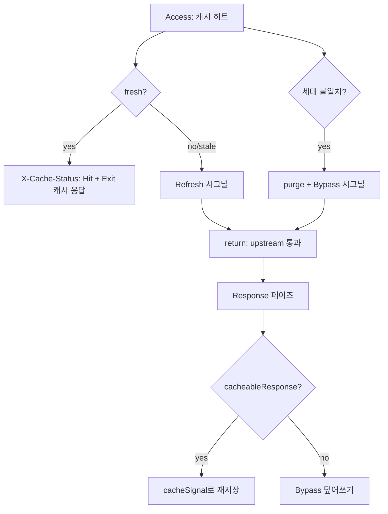

# go-pdk 캐시 플러그인 검증된 결함 수정 - Plan

## Goal Capsule

- **Objective**: sonic-boom의 검증된 결함 9종(요구 R1–R6이 정의하는 수정 집합)이 수정되어, 만료·세대 불일치 캐시가 낡은 값을 서빙하지 않고, 설정 오류나 패닉이 플러그인 프로세스를 종료시키지 않으며, 필터·content_type·cache_ttl 설정이 실제 캐시 동작을 지배한다. 운영자는 X-Cache-Status 4상태와 설정이 지배하는 동작만 보고 확인할 수 있다.
- **Means**: bake-off 판정안의 구조 보존 수정 — 원본 Kong proxy-cache Lua 시맨틱 복원 + go-pdk external plugin 규율 준수(KTD1–KTD5).
- **Authority**: 세션 채택 결정(bake-off) > 본 계획 KTD > 구현 재량. 충돌 시 규율 문서(`docs/solutions/architecture-patterns/go-pdk-external-plugin-runtime-constraints.md`) 규칙이 구현 재량에 우선한다.
- **Stop conditions**: 검증 사다리(단위→통합→e2e) 실패 시 진행 중단, 원인 정리 후 재개.
- **Execution profile**: 표준 코드 실행 — 구현 → 검증 사다리 → Conventional Commits(한국어) 커밋. ce-work 또는 사용자가 완료·출시한다.

---

## Product Contract

### Summary

캐시 플러그인의 검증된 결함 9종 — bake-off §4.1의 G1(cache_control Fatal)·G2(필터 TTL 무시)·G3(return 누락)·G4(TTL 0 영구 키)·G7(Response recover 부재)와, 조사로 확정된 정확성 4종(content_type 폴스루, nil body 크기 검사 우회, validate 오대상, no-op 필터 TTL 루프) — 을 구조 보존 방식으로 수정한다: TTL 해석 단일화, Lua `return` 시맨틱 복원(+재저장 경로 개통), cache_ttl 기본값·검증 상시화, 프로세스 방어, 응답 게이팅 정합, 죽은 코드 제거. 성능·보안 보강(G5·G6·G8·G9 등 P1+)과 무효화·메트릭(P2+)은 본 계획 밖이다.

### Problem Frame

2026-10-18 bake-off(독립 후보 + 독립 평가 + 원본 소스 검증)가 결함 25건을 파일:라인 수준으로 확정했고, 이 계획은 그중 9종(§4.1 G1–G4·G7 + 정확성 4종)을 수정한다. 결함의 공통 뿌리는 Lua 포팅 시맨틱 누락(return, 재저장)과 go-pdk external plugin 런타임 제약 위반이다. 일부는 요청 경로에서 프로세스 사망·영구 키 적재로 이어지는 부류라, e2e가 초록이어도 운영에서 터진다. 근거: `docs/bakeoffs/2026-10-18-api-gw-caching-gap-analysis.md` §4.1, `docs/solutions/architecture-patterns/go-pdk-external-plugin-runtime-constraints.md`.

### Requirements

**TTL 정합**

- R1. 필터별 `cache_ttl`이 실제 저장 만료와 stale 판정에 적용된다. 미설정 필터 TTL은 전역 `cache_ttl`을 상속하며, 상속은 읽기 시점 해석으로 구현한다(Init 변이 금지).
- R2. `cache_ttl` 기본값은 300초이고 명시적 `0`은 거절된다. 거절의 요청 경로 표현은 Error+Bypass다(프로세스 유지). `Filter.CacheTTL`의 0은 상속 의미로 유지된다.

**프로세스 방어**

- R3. 어떤 설정 상태나 패닉도 플러그인 프로세스를 종료시키지 않는다 — `cache_control` 히트 경로, 설정 검증 실패 경로, Response 페이즈 패닉을 포함한다.

**정합성**

- R4. 만료(stale)·세대 불일치 캐시 히트는 낡은 값을 서빙하지 않는다 — 원본 Lua 시맨틱대로 시그널 후 upstream으로 통과하고, upstream 응답이 캐시 가능하면 재저장한다.
- R5. `content_type` 목록이 캐시 게이팅에 실제로 적용된다 — 미일치 content type은 캐시하지 않는다(Kong과 동일한 정확 매치, 대소문자 무시).
- R6. 죽은 코드·죽은 검사가 제거된다 — reqBody 파이프라인(`internal/sonic_boom.go:346`, `:759-763`), responseData 블록(`:399-414`), no-op 필터 TTL 루프(`:117-121`), validate 대상 오류(`:776`)이다.

### Acceptance Examples

- AE1. Covers R1. 필터 `cache_ttl: 30`·전역 15 라우트에서 첫 저장 후 16초 시점 재요청 → `Hit`(수정 전에는 전역 15초에 만료). eventual 단언(규율 6).
- AE2. Covers R4. 캐시 히트 후 cache_ttl 경과(15초+여유) 재요청 → `Refresh` 라벨로 upstream 통과, 이후 요청 `Hit`(새 값 저장 확인). 수정 전: 낡은 값이 `Hit` 라벨로 서빙.
- AE3. Covers R5. `content_type` 목록 밖 응답 → `Bypass`, 재요청도 미스(저장 없음).
- AE4. Covers R3. `cache_control: true` 설정 라우트 → 프로세스 생존, 첫 요청 `Miss`(저장 발생 — cache_control 분기는 히트 뒤에만 도달), 이후 모든 요청 `Bypass` + Error 로그.
- AE5. Covers R2. `cache_ttl: 0` 명시 배포 → 검증 실패 → Error+Bypass, 프로세스 생존, Redis에 영구 키 신규 적재 없음.

---

## Planning Contract

### Key Technical Decisions

- KTD1. **TTL 단일 해석 경로.** `filtered()`에서 읽기 시점에 필터 TTL 상속을 해석하고(`ttl := filter.CacheTTL; if ttl == 0 → conf.CacheTTL`), `CacheValue.TTL` 채움·stale 판정·저장 만료가 모두 이 값을 쓴다. `Init()`의 no-op 필터 루프(`:117-121`)는 삭제한다 — 변이가 사라져 go-pdk #78 동시성 모델에서 데이터 경합을 만들지 않는다. 근거: 규율 5·bake-off §4.1 G2. 명시적 필터 TTL 0 = 상속 의미가 고정된다(문서화).
- KTD2. **return 복원과 reqBody 파이프라인 제거를 한 묶음으로.** 게이트(`:759-763`)만 남기면 통과 후 재저장이 `GetPluginAny(kong, "reqBody")` 에러로 조용히 실패한다. `:346` reqBody 저장, `:759-763` 게이트, `CacheValue.ReqBody` 필드(`internal/cache_value.go:16`)를 함께 제거하고 `cache_value_test.go:145-146` 계약을 갱신한다. msgpack 구조가 바뀌지만 TTL-in-key로 키스페이스가 이미 갱신되어(KTD4) 구버전 호환이 필요 없다.
- KTD3. **checkConfig 상시화 + 실패 시 fail-open.** 검증을 isDebug 게이트(`:278-282`) 밖으로 이동하고, `sync.Once` 필드로 인스턴스당 1회만 실행해 결과를 재사용한다(요청마다 `validator.New()` 비용 회피). 실패 시 Error 로그 + Bypass(저장·서빙 스킵, 프록시는 계속). `(session-settled: user-approved — Fatal→Error+Bypass 방향은 bake-off 판정을 사용자가 채택: 대안은 설정 오류 시 프로세스 사망 유지였다)`
- KTD4. **키스페이스 갱신 수용.** TTL이 키 해시 입력(`internal/cache_key.go:20`)이라 KTD1/3 적용 배포 시 전면 콜드 캐시 + 기존 TTL 0 영구 키가 참조 불가 상태로 Redis에 잔존한다. 릴리스 노트(콜드 캐시 예고, 수동 정리 절차)로 관리하고 키 프리픽스 도입은 P2로 연기한다. `(session-settled: user-approved — bake-off 로드맵에서 무효화 개선을 P2로 채택)`
- KTD5. **content_type 정확 매치 유지.** Kong 원본과 동일한 목록 정확 매치(`strings.EqualFold`)를 유지한다. `application/json;charset=utf-8`(공백 없음) 같은 파라미터 변형은 미일치로 Bypass된다 — 기존 배포의 히트율 하락은 릴리스 노트로 운영자에게 알린다. media-type 파라미터 무시 매칭은 고려 후 보류(considered-not-built).

### Assumptions

- 요청 경로 설정 검증 실패를 fail-open(Error+Bypass)으로 처리한다 — 팀 fail-fast 선호는 프로그램 논리 오류 대상이고, 요청 경로 프로세스 종료는 규율 1 위반이다. 잘못됐으면 U3의 정책만 바꾸면 된다.
- 버전 불일치 통과 후 재저장 성공 시 클라이언트 라벨이 `Bypass`인 점(라벨-동작 불일치)을 수용한다 — CONCEPTS의 Bypass 정의(세대 불일치 포함)와 정합.
- Response 페이즈 recover 후 클라이언트 응답은 불완전할 수 있다(잘린 본문) — 프로세스 생존이 목적이며 완전한 응답 보장은 아니다.
- 캐시되지 않던 트래픽이 기본 TTL 300 전환으로 히트율이 정상화되는 것은 개선으로 기록한다.

---

## Implementation Units

### U1. TTL 단일 해석 경로 정비

- **Goal:** 필터 TTL이 저장·판정에 실제 적용되고 상속은 읽기 시점 해석으로 통일된다.
- **Requirements:** R1, R6
- **Dependencies:** 없음
- **Files:** `internal/sonic_boom.go`(filtered(), CacheValue 채움 `:771`, stale 판정 `:389`, 루프 삭제 `:117-121`), `internal/sonic_boom_test.go`(필터 TTL 테스트)
- **Approach:**
  1. `filtered()`에서 필터 미설정 TTL(0)을 전역값으로 상속 해석해 반환
  2. `CacheValue.TTL` 채움을 `int64(cacheSignal.CacheTTL)`로 교체(`:771`)
  3. stale 판정을 Access에서 구한 cacheTTL로 교체(`:389`)
  4. `Init()`의 no-op 루프 삭제
- **Execution note:** TTL 단언은 기한 있는 eventual 단언으로. in-memory 스토어 공유 피하려면 테스트마다 고유 설정을 쓴다(규율 5·6).
- **Patterns to follow:** 기존 `filtered()`/`cacheableRequest` 시그니처와 테이블 주도 테스트 관례(`TestConfig_*`).
- **Test scenarios:**
  - 필터 TTL 30·전역 15 → 저장 후 16초 경과 재조회 → Hit(eventual).
  - 미설정 필터(0) → 전역 상속 저장 → 16초 경과 후 미스.
  - 필터 없는 라우트 → 전역 TTL 적용(기존 동작 유지).
  - 필터 미매치 → (false, 0) 유지.
- **Verification:** 단위 → `make test`.

### U2. return 복원과 reqBody 파이프라인 제거

- **Goal:** 만료·세대 불일치 경로가 낡은 값을 서빙하지 않고 upstream 재검증 후 실제로 재저장한다.
- **Requirements:** R4, R6
- **Dependencies:** U1 (TTL 시맨틱 정합 후)
- **Files:** `internal/sonic_boom.go`(`:368-378`, `:386-395`, `:346`, `:759-763`, `:775-780`), `internal/cache_value.go`(ReqBody 필드 제거), `internal/cache_value_test.go`(계약 갱신), `internal/sonic_boom_test.go`
- **Approach:**
  1. 버전 불일치 purge 분기 뒤 `return`(원본 Lua :293-296 시맨틱)
  2. stale 판정 분기 뒤 `return`(원본 Lua :316-318 시맨틱)
  3. `:346` reqBody 저장·`:759-763` reqBody 게이트 제거
  4. `:775-780`의 `validate.Struct(conf)` 죽은 검사 제거(checkConfig 상시화(U3) 후 중복 — R6)
  5. `CacheValue.ReqBody` 필드 제거 + 관련 테스트 계약 갱신
- **Patterns to follow:** Access의 early return 패턴, `cache_value_test.go`의 `newValidator()` 패턴.
- **Test scenarios:**
  - cacheValue 검증이 ReqBody 없이 통과(계약 갱신 확인).
  - e2e stale 재저장 단언: TTL 만료 후 재요청 → `Refresh` 라벨 → 다음 요청 `Hit`(AE2).
  - 기존 smoke 전 단언 통과(characterization 보존).
- **Verification:** e2e(`make e2e`) + 통합.

### U3. cache_ttl 기본값·검증 상시화

- **Goal:** 기본 TTL 300, 명시적 0 거절, 검증이 운영에서도 실행된다.
- **Requirements:** R2
- **Dependencies:** 없음
- **Files:** `internal/sonic_boom.go`(`:56` 태그, `:278-282` 게이트 이동, `:280` Fatal 소멸, checkConfig 메모이즈), `internal/sonic_boom_test.go`, `config_v1.yml`(cache_ttl 0 검증 거절 라우트), `scripts/smoke_lib.sh` 또는 전략 smoke(AE5 단언)
- **Approach:**
  1. `Config.CacheTTL` 태그 `default:"300"` + `validate:"gt=0"` (`Filter.CacheTTL` 태그는 불변 — 0=상속)
  2. checkConfig 호출을 isDebug 게이트 밖으로 이동 + `sync.Once` 필드 메모이즈
  3. 실패 정책: Access에서 Error+Bypass, Response에서 저장 스킵(프록시 계속)
- **Patterns to follow:** creasty/defaults 태그 관례, `checkConfig`의 `RegisterStructValidation` 패턴.
- **Test scenarios:**
  - `cache_ttl: 0` → checkConfig 실패(단위).
  - 필터 `cache_ttl: 0` → 상속 의미 유지(U1과 공유 단언).
  - 검증 실패 정책은 Assumptions의 fail-open 결정에 의존 — 단위로는 checkConfig 반환값까지, 정책은 코드 검토 + AE5 e2e 라우트 단언.
- **Verification:** 단위 → 통합 → e2e(AE5 라우트 단언).

### U4. 프로세스 방어 (cache_control Fatal 강등 + Response recover)

- **Goal:** 어떤 설정·패닉도 프로세스를 종료시키지 않는다.
- **Requirements:** R3
- **Dependencies:** U3 (checkConfig 재설계 후 잔여 Fatal만 남음)
- **Files:** `internal/sonic_boom.go`(`:381-384`, `:664` 선두), `config_v1.yml`(cache_control 라우트 추가), `scripts/smoke_lib.sh` 또는 전략 smoke(AE4 단언)
- **Approach:**
  1. `:381-384` Fatal → Error 로그 + Bypass 통과
  2. Response 선두에 recover defer(Access `:232-241` 패턴 복제)
- **Execution note:** e2e가 Access/Response 흐름의 유일 자동 검증이라는 관례를 따른다 — 회귀 단위 테스트를 억지로 만들지 않는다.
- **Patterns to follow:** Access recover defer(`:232-241`).
- **Test scenarios:**
  - AE4 e2e: cache_control 라우트 → 첫 요청 Miss(저장) 이후 모든 요청 Bypass + Kong 생존.
  - grep done-signal: `internal/sonic_boom.go`에서 `logger.Fatal` 부재 확인.
  - `Test expectation: none -- recover 자체는 페이즈 흐름 단위 테스트 금지 관례상 코드 구조로 보장(e2e 회귀로 커버)`
- **Verification:** e2e + grep.

### U5. 응답 게이팅 정합 (content_type 폴스루 + nil body)

- **Goal:** content_type 목록이 실제 게이팅에 적용되고 nil body 검사가 정리된다.
- **Requirements:** R5, R6
- **Dependencies:** 없음
- **Files:** `internal/sonic_boom.go`(`:854`, `:744-752`), `internal/sonic_boom_test.go`(`:193-196` 기대값 반전)
- **Approach:**
  1. `:854` → `return false`
  2. nil body 크기 검사를 else 밖으로 통일(`len(nil)==0`, 행동 불변)
- **Patterns to follow:** 기존 `cacheableResponse*` 테이블 테스트 구조.
- **Test scenarios:**
  - 폴스루 테스트 기대값 반전: 미일치 content type → false(기존 문서화 테스트가 fix의 검증이 된다).
  - 파라미터 변형(`application/json;charset=utf-8`) → 미일치 → false(KTD5 한계 문서화).
  - nil body + 상한 1 → 통과(행동 불변).
- **Verification:** 단위 → e2e 전체 통과(enc_suite 정적 location 영향 없음 확인).

### U6. 죽은 코드 제거 (responseData 블록)

- **Goal:** 도달 불가 코드가 제거되고 문서화 의무(README·릴리스 노트)가 이 묶음에 배정된다.
- **Requirements:** R6
- **Dependencies:** U1, U3, U5 (기록되는 기본값·매치 변화가 문서 내용을 결정)
- **Files:** `internal/sonic_boom.go`(`:399-414`), `README.md`(설정 예시 갱신), 릴리스 노트 작성(System-Wide Impact 항목 (a)–(e))
- **Approach:**
  1. responseData 상수·블록 제거(`proxy_cache_hit` ctx 설정은 사실상 도달 불가였음)
  2. README에 cache_ttl 기본값 300·필터 TTL 상속 의미(명시적 0=상속)·content_type 정확 매치 반영
  3. 릴리스 노트에 System-Wide Impact (a)–(e) + 영구 키 정리 절차(PTTL −1 판별 기준) 기록
- **Test scenarios:** `Test expectation: none -- 도달 불가 코드 제거, 행동 변화 없음(회귀는 e2e 전체 통과로 커버)`
- **Verification:** 컴파일 + e2e 전체 통과.

---

## High-Level Technical Design

수정 후 Access 히트 경로와 재저장 흐름(방향성 그림):

---

## Verification Contract

| 층 | 명령 | 서버 | 이 계획에서 증명하는 것 |
|---|---|---|---|
| 단위 | `go test ./internal -run 'Test_InMemory\|TestConfig\|TestCacheValue' -skip 'Test_Redis\|Test_RedisCluster'` | 없음 | TTL 해석, 폴스루 반전, checkConfig 검증, CacheValue 계약 |
| 통합 | `make test` | redis·redis-cluster (compose) | -race, TTL eventual 단언, 스토어 3종 put/get |
| e2e | `make e2e` | compose 전체 | AE2 stale 재저장, AE4 cache_control, AE5 cache_ttl 0 거절, 기존 smoke characterization 보존 |

- 품질 게이트: golangci-lint(pre-commit), Conventional Commits 한국어.
- 검증 사다리는 단위 → 통합 → e2e 순서(fail-fast). 서버 필요 테스트는 스킵하지 않고 실패시킨다.

---

## Scope Boundaries

**이번 묶음 밖 (Deferred to Follow-Up Work)** — bake-off 로드맵 P1+: 설정 경합 제거(G6: conf.Init 로거 재할당·전역 로그레벨 변경), Redis 클라이언트 재사용(G5), Authorization·Set-Cookie 가드(G8·G9), 캐시 메트릭, PURGE 무효화+키 프리픽스, Cache-Control 구현, storage_ttl·stale-if-error, 요청 병합, ETag 재검증, 키 구성 옵션군. 근거와 순서는 `docs/bakeoffs/2026-10-18-api-gw-caching-gap-analysis.md` §5.

**Considered and not built** — 키 프리픽스(KTD4: 문서화로 관리, P2에서), media-type 파라미터 무시 매칭(KTD5: Kong 정합 우선), SWR(go-pdk 제약으로 불가 — stale-if-error까지가 계약, 규율 7), 요청 경로에서 검증 실패 시 프로세스 종료(규율 1 위반).

---

## System-Wide Impact

- **릴리스 노트 필수**: (a) TTL-in-key로 인한 전면 콜드 캐시(KTD4), (b) 기존 TTL 0 영구 키의 Redis 잔존 + 수동 정리 절차(SCAN 후 `PTTL == -1` 키 판별·DEL, 또는 FLUSHDB), (c) cache_ttl 기본 0→300 동작 변화, (d) content_type 정확 매치 강화로 일부 트래픽 Bypass 전환, (e) 만료·세대 불일치 히트가 낡은 값 Hit 서빙에서 upstream 재검증(Refresh/Bypass)으로 전환 — TTL 경계에서 히트율 하락·upstream 부하 증가는 회귀가 아닌 의도된 정합화(KTD2).
- **테스트 자산**: smoke에 stale 재저장 단언(AE2)과 cache_control 라우트 단언(AE4)이 추가되어 smoke 시간이 1전략당 약 +16초 늘어난다. 기존 characterization 단언(교차 오염·HEAD·Content-Length)은 보존한다.
- 문서 갱신: README·testing.md의 테스트 방법은 불변. cache_ttl 기본값·content_type 매치·필터 TTL 상속 의미를 README 설정 예시에 반영.

---

## Definition of Done

**전역 완료 조건**

- 검증 사다리 3층 전부 통과: 단위(-run/-skip 교정본) → `make test`(-race) → `make e2e`(AE1–AE5 단언 포함, 기존 characterization 보존).
- `internal/sonic_boom.go`에 `logger.Fatal` 부재(grep 확인).
- 릴리스 노트 (a)–(e)와 README 설정 예시가 U6에서 갱신됨.
- 시도하다 버린 접근의 잔여 코드가 diff에 남지 않음.

**단위별 완료 조건**

- U1: 필터 TTL 30 단언(16초 Hit) 통과, no-op 루프 삭제.
- U2: stale·버전 재저장 e2e 단언 통과, ReqBody 필드·reqBody 파이프라인·`:775-780` 죽은 검사 제거.
- U3: cache_ttl 0 거절 단위 테스트 + AE5 e2e 단언, checkConfig 상시화·메모이즈.
- U4: AE4 e2e 단언 통과, Response recover 추가.
- U5: 폴스루 기대값 반전 테스트 통과, nil body 검사 통일.
- U6: responseData 블록 제거, 문서화(README·릴리스 노트) 완료.

---

- `docs/bakeoffs/2026-10-18-api-gw-caching-gap-analysis.md` — 결함 목록 G1–G25·로드맵 P0–P3(이 계획의 수정 대상은 §4.1 G1–G4·G7과 정확성 4종).
- `docs/solutions/architecture-patterns/go-pdk-external-plugin-runtime-constraints.md` — 규율 8항(이 계획의 KTD 근거).
- `internal/sonic_boom.go`, `internal/cache_key.go`, `internal/cache_value.go` — 파일:라인은 본문 참조.
- go-pdk #78(인스턴스 동시성), Kong/kong `proxy-cache/handler.lua`(3.9.4 태그 — return 시맨틱 원본).
