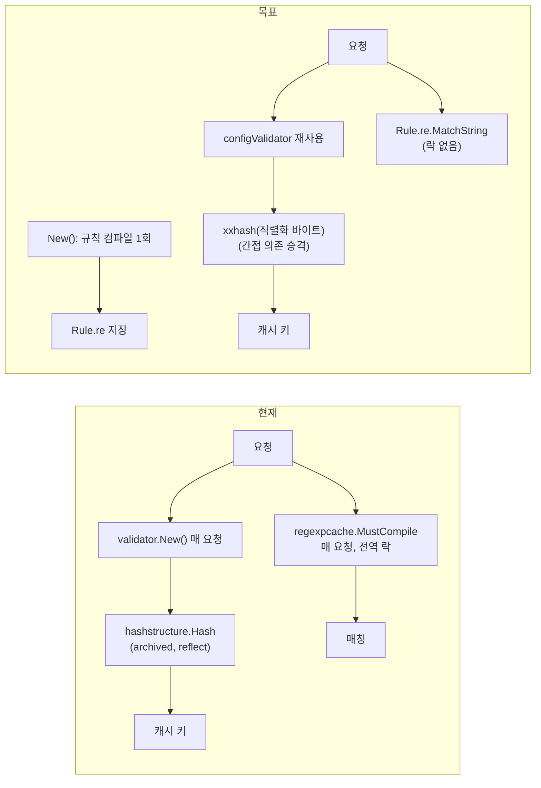

# 구형 의존 교체 — hashstructure 제거와 정규식 설정 시 컴파일

## Goal Capsule

- **Objective:** sonic-boom이 archived 의존 2개(`mitchellh/hashstructure/v2`, `umisama/go-regexpcache`) 없이 동일한 캐시 동작을 하고, 요청 핫패스에서 정규식 캐시 락과 reflect 해셔가 사라진다.
- **Means:** 캐시 키는 `CacheKey`의 결정론적 직렬화 + xxhash(이미 간접 의존)로 바꾸고(무효화 수용 — CacheVersion 상승), 정규식은 `New()`에서 한 번 컴파일해 Rule에 저장한다.
- **Stop conditions:** 두 의존이 go.mod에서 사라지고, 기존 필터·캐시 키 테스트 전부 통과, 양 아치 CI 녹색.

---

## Product Contract

### Summary

archived 의존 2개를 표준 라이브러리·기존 의존으로 대체한다. 캐시 키 알고리즘이 바뀌므로 배치 시점에 운영 캐시가 한 번 무효화된다(사용자 결정: 수용 — CacheVersion 상승으로 명시화). 정규식은 요청마다 전역 캐시를 찾는 대신 설정 로드 시점에 컴파일한다.

### Problem Frame

`hashstructure/v2 v2.0.2`는 2024-07 아카이브됐고 마지막 릴리스는 2021년이다. 캐시 키 생성(`internal/cache_key.go:151`)의 심장으로, reflect 기반 전체 구조 해시라 요청마다 상당한 CPU를 쓴다. `go-regexpcache`(2015, 87줄)는 전역 `map+Mutex`라 모든 요청의 필터 판정(`internal/sonic_boom.go:590,616`)이 하나의 락에 직렬화된다 — 수천 동접 설계의 유일한 전역 병목. 둘 다 기능 문제는 없지만 유지보수가 끊겼고, 대체가 도달 가능한 범위다.

이전 조사에서 확정된 제약: 캐시 키 포맷 변경은 운영 캐시 전체 무효화를 수반한다. 사용자가 이번에 수용을 결정했다(개인 프로젝트 — 예열 비용만).

### Requirements

- R1. `hashstructure/v2`가 go.mod와 코드에서 사라진다. 캐시 키는 `CacheKey`의 결정론적 직렬화 바이트의 xxhash로 생성된다(같은 입력 → 같은 키, 필드 추가·변경 시 키도 바뀜).
- R2. 알고리즘 전환을 명시화한다: 기본 `CacheVersion`에 구분 마커를 넣어(또는 상수 버전 상승) 신구 키가 섞이지 않게 한다. `CACHE_VERSION` env 사용자는 영향 없다.
- R3. `go-regexpcache`가 go.mod와 코드에서 사라진다. 정규식은 `New()` 시점에 컴파일돼 Rule에 저장되고, 요청 핫패스는 컴파일된 Regexp의 `MatchString`만 호출한다.
- R4. 설정의 정규식이 잘못됐으면 로드(`New()`) 시점에 실패한다 — 요청 도달 시점 panic에서 배포 시점 오류로 이동한다(fail-fast).
- R5. 기존 캐시 동작은 유지된다: 필터 매칭 결과·캐시 히트/미스·vary 처리가 기존 테스트 전부와 e2e 스모크를 통과한다.

### Key Decisions

- KD1. 캐시 키 전면 무효화를 수용한다 — 이중 읽기 호환 계층은 만들지 않는다. (Governs R2)
- KD2. 정규식은 요청 도중 컴파일하지 않는다 — 설정 시 컴파일이 유일 경로다. (Governs R3, R4)

### Success Criteria

- `go.mod`에 두 의존 잔존 0, `grep -r "hashstructure\|regexpcache" --include="*.go"` 0건.
- 필터 단위 테스트(`TestConfig_filtered` 등)·캐시 키 단위 테스트·통합·e2e 전부 통과.
- 벤치마크(`Benchmark_InMemory_*` + 캐시 키 생성 벤치가 있다면) 급락 없음 — xxhash 전환은 개선 방향이지만 수치 주장은 측정 후에만.

### Scope Boundaries

**범위 밖(후속):** 운영 배치 절차(무효화 공지 등 — 개인 프로젝트라 해당 없음), 캐시 키 생성 벤치 신설(선택), lumberjack/defaults 등 타 구형 의존.

---

## Planning Contract

### Key Technical Decisions

- KTD1. 키 직렬화는 `fmt.Sprintf`가 아니라 바이트 결합이다: consumer·service·route·method·url은 길이 접두 구분자로, QueryArgs는 키 정렬 후 `k=v` 결합(**현재 hashstructure도 맵 순회가 비결정적이 아닌지 확인 필요 — v2는 정렬한다. 직렬화에서 반드시 동일하게 정렬**), Headers 동일, Body는 원본 바이트, CacheTTL 10진수. 이 바이트열에 `cespare/xxhash/v2`(이미 간접 의존 — go.sum:11) `Sum64`. 결정론성 테스트: 같은 CacheKey → 같은 키, 맵 삽입 순서를 뒤섞어도 같은 키, 필드 하나만 달라도 다른 키.
- KTD2. `CacheKey`에 `Body []byte`가 있다 — 직렬화에 원본 바이트를 넣으면 대용량 바디가 키 생성 비용을 지배한다. hashstructure도 내부적으로 동일 비용이었으므로 동작 유지다(변경 아님). 다만 BodyLen 대신 Body 전체를 쓰는 현재 구조(`cache_key.go:137`)는 그대로 둔다 — 이 계획에서 키 입력을 바꾸면 무효화 외 회귀 분석이 늘어난다.
- KTD3. 정규식 컴파일 저장 위치는 `Rule` 구조체다(exported 필드 `Regexp` 문자열은 유지 — 스키마 노출용). 비exported `re *regexp.Regexp` 필드를 추가하고 go-pdk 스키마 생성기가 이를 무시하는지 확인한다(int/string만 다루므로 포인터 필드는 스킵될 것 — 실측). `New()`에서 `defaults.Set` 뒤 모든 Rule을 순회 컴파일, 오류 수집 후 한 번에 반환.
- KTD4. `filtered()`의 요청 시점 해석 구조(go-pdk #78 주석, `sonic_boom.go:162`)는 유지한다 — 컴파일은 `New()` 1회, 매칭은 요청 시점. 설정 슬라이스 변이 없음.
- KTD5. `cache_key.go:141`의 요청마다 `validator.New()`는 이 기회에 `configValidator` 싱글턴(`sonic_boom.go:51-57`) 재사용으로 바꾼다 — 같은 파일의 실비용 중복이고 라인 2줄 변경이다(범위 확장이 아니라 인접 정리).

### Assumptions

- hashstructure v2의 맵 직렬화가 정렬됨(문서상 "map keys are sorted" — 실행 단계에서 결정론성 테스트로 재확인). 신규 직렬화가 이를 따르므로 이전 키와의 동등성은 보장 안 함(무효화 수용).
- go-pdk 스키마 생성기(`getSchemaDict`)가 비exported 포인터 필드를 무시한다(소스 실측: string/int/bool/slice/map/struct만 처리, 포인터는 elem 처리라 *regexp.Regexp는 nil 반환으로 스킵 추정 — U2에서 `sonic-boom -dump`로 확인).

### High-Level Technical Design

---

## Implementation Units

### U1. 캐시 키 xxhash 전환 + CacheVersion 마커

**Goal:** hashstructure를 제거하고 결정론적 직렬화+xxhash로 캐시 키를 만든다.

**Requirements:** R1, R2, R5

**Dependencies:** 없음

**Files:**

- `internal/cache_key.go` — `generateCacheKeyID` 교체, hashstructure 임포트 제거
- `internal/sonic_boom.go` — `cacheVersion()` 기본값에 전환 마커(예: 반환 접두 "2-")
- `go.mod`, `go.sum` — hashstructure 제거
- `internal/cache_key_test.go` (신규) — 결정론성 테스트

**Approach:**

1. 테스트 먼저(빨간): `Test_GenerateCacheKeyID_Deterministic` — 동일 CacheKey 2회 동일 키, QueryArgs/Headers 삽입 순서 뒤섞기 동일 키, 각 필드 1개 변경 시 상이 키, nil 맵 vs 빈 맵 동일 키.
2. `serializeCacheKey(cacheKey) []byte` 작성 — 길이 접두 필드 + 정렬된 맵 항목 + Body 원본 + TTL. `xxhash.Sum64`로 64비트 키, `strconv.FormatUint` 유지(기존 키 형식과 문자열 호환).
3. `cacheVersion()` 기본 반환에 "2-" 접두(캐시 값의 Version 불일치 → 기존 레이지 purge가 신구 혼재를 정리. env 사용자는 그대로).
4. hashstructure 제거 + `go mod tidy`.

**Test scenarios:**

- 결정론성 4종(위 1번)
- 기존 캐시 키 관련 단위·통합 테스트 전부 통과(키 "값"은 바뀌어도 형식·고유성 계약은 동일)
- `go.mod`에 hashstructure 없음

**Verification:** `make test` + `make e2e` 통과, grep 잔존 0.

### U2. 정규식 설정 시 컴파일

**Goal:** regexpcache를 제거하고 Rule별 컴파일 Regexp를 설정 시점에 만든다.

**Requirements:** R3, R4, R5

**Dependencies:** 없음(U1과 병렬 가능 — 파일 경합 없음)

**Files:**

- `internal/sonic_boom.go` — Rule에 `re` 필드, `New()` 컴파일 루프, `cacheablePath/Header`가 `rule.re` 사용, regexpcache 임포트 제거
- `internal/sonic_boom_test.go` — 잘못된 정규식 설정 실패 테스트
- `go.mod`, `go.sum` — regexpcache 제거

**Approach:**

1. 테스트 먼저(빨간): 잘못된 정규식을 넣은 Config로 `New()` → 오류 반환(panic 아님). 유효 정규식 매칭은 기존 `TestConfig_filtered`가 담당.
2. `Filter`·`Rule` 순회 컴파일 함수 작성 — 오류는 "filter[i].rules[j]: bad pattern: ..." 처럼 위치를 알려주는 wrapped error. `New()`에서 `defaults.Set`/검증 뒤 호출.
3. `cacheablePath/Header`의 `regexpcache.MustCompile` 호출을 `rule.re.MatchString`로. nil 가드(컴파일 실패 시 New가 이미 실패하므로 도달 불가 — 방어 주석 없이 패닉 허용).
4. `-dump` 스키마 확인: `go run . -dump | grep -c regexp` — `re` 필드가 스키마에 새로 나타나면 비exported 재확인(이미 비exported라 무시될 것).
5. regexpcache 제거 + `go mod tidy`.

**Test scenarios:**

- 잘못된 정규식 설정 → `New()` 오류(메시지에 필터 위치 포함)
- 유효 정규식 경로/헤더 매칭 — 기존 `TestConfig_filtered` 전부 통과
- `-dump` 출력에 `re` 필드 부재
- `go.mod`에 regexpcache 없음

**Verification:** `make test` + `make e2e` 통과, grep 잔존 0.

### U3. 인접 정리 + 최종 게이트

**Goal:** 같은 파일의 요청마다 `validator.New()` 중복을 싱글턴으로 통일하고 전체를 닫는다.

**Requirements:** R5

**Dependencies:** U1, U2

**Files:**

- `internal/cache_key.go:141` — `configValidator` 사용(2줄)
- `internal/in_memory_config.go:16` — 동일 검토(사용처가 테스트 전용이면 그대로 두고 기록)

**Approach:** `validator.New()` → `configValidator` 교체. 이후 전체 게이트.

**Test scenarios:**

- 기존 전체 스위트 통과(검증 태그 해석 불변을 기존 테스트가 증명 — U2와 동일 패턴)

**Verification:** `make test` + `make e2e` + `make stress`(단언 3종 PASS), 양 아치 CI 녹색.

---

## Verification Contract

| 게이트 | 명령 | 적용 단계 |
|---|---|---|
| 단위+통합 | `make test` | 모든 단계 |
| e2e | `make e2e` | 모든 단계 |
| 의존 잔존 | `grep -rn "hashstructure\|regexpcache" go.mod internal/ --include="*.go"` | U1, U2 종료 시 0건 |
| 스키마 | `go run . -dump \| grep re` | U2 |
| 스트레스 | `make stress` | U3(3단언 PASS) |
| CI 양 아치 | push 후 | 최종 |

각 단계는 게이트 통과 커밋으로 마감한다(Conventional Commits, 한국어).

## Definition of Done

- 전역: 두 의존 제거, R1~R5 충족, U1~U3 게이트 통과 커밋.
- 정리: 실험 코드 잔존 없음.

## Open Questions

- 없음 — 무효화 수용(KD1)과 컴파일 시점(KD2)은 사용자가 확정했다. 실행 중 발견 시 여기에 기록.
