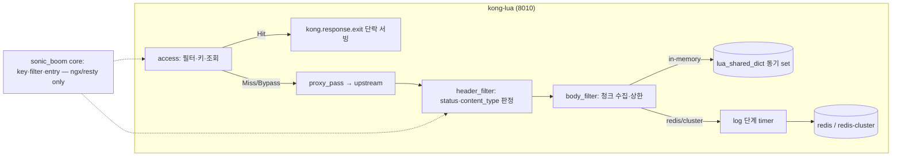

# Kong Lua sonic-boom 포팅 PoC - Plan

## Goal Capsule

- **Objective:** sonic-boom의 기능을 Lua/OpenResty로도 지금 수준으로 구현할 수 있다는 것을, 익숙한 환경(Kong 3.9.4)에서 동작하는 Lua 플러그인으로 증명한다. 증명 결과는 APISIX 확장 착수 여부의 판정 자료가 된다.
- **Means:** Kong 네이티브 Lua 플러그인(`sonic-boom-lua`)을 게이트웨이 중립 코어 + 어댑터 구조로 포팅하고, 같은 compose 안의 Go판과 나란히 재생 비교한다 (KTD1, KTD2).
- **Authority:** 본 계획의 제품 행동은 Go판 `dc9c909`(검증된 결함 9종 수정본)이 기준이다 (KTD6). 이 계획 밖: APISIX 어댑터, push·PR, Go판 변경.
- **Stop conditions:** 정의된 종료 기준 6항목 판정 완료 시. 루프 정지 조건(같은 단위 3틱 연속 실패, compose 자체 실패)에 걸리면 사람 판단 대기.
- **실행 방식:** 루프가 한 틱에 구현 단위 하나를 `ce-work`로 실행·검증·커밋한다. 진행 상태는 계획이 아니라 git에서 도출한다(`ce-work` 계약).

## Product Contract

### Summary

sonic-boom Go 플러그인을 Kong 네이티브 Lua 플러그인으로 포팅한다. `sonic-boom-lua`는 같은 compose에서 Go판과 나란히 떠서 동일 요청에 대한 응답·`X-Cache-Status` 시퀀스 비교로 동등성을 증명한다. 저장소 3전략(in-memory, redis, redis-cluster)과 부하 비교까지 마치면 종료 기준 6항목으로 판정한다.

### Problem Frame

APISIX 이전의 최대 미확인 항목은 "팀이 Lua/OpenResty로 Go 라이브러리 수준의 기능을 낼 수 있는가"다. APISIX에서 바로 검증하면 게이트웨이 변수와 언어 변수가 섞여 원인을 가리기 어렵다. Kong은 sonic-boom의 원조(proxy-cache Lua)가 있고 compose·스모크 자산이 갖춰져 있어, 언어 변수만 분리해 검증할 수 있다. 저장소 세계는 이 검토로 정리됐다 — 필요 부품이 OpenResty/Kong에 이미 있다(`docs/plans` 트레이드오프 표 참조, Appendix).

### Key Decisions

- **네이티브 Lua 포팅을 Go 러너보다 먼저** (session-settled: user-directed — Go 러너(ext-plugin) 대안과 그 제약을 보고 선택: post-resp가 route 전체 프록시 품질을 떨어뜨림). Governs R1–R10.
- **별개 제품이라 Kong과 캐시 공유·전환 마이그레이션 없음** (session-settled: user-directed — 공유 호환 구현 비용 대비 가치 없음). Governs R3.
- **동등성 기준은 현재 Go 코드(`dc9c909`)** (session-settled: user-approved — 세션 초반 스냅샷의 quirk 목록은 결함 9종 수정 머지로 낡음; 합성에서 확인받음). Governs R4, R7.
- **신기능(fill-lock, CSC, 메트릭 파이프라인)은 이 계획 밖** (session-settled: user-approved — PoC 무게 유지, 판정 후 이식 백로그). Governs R8, 범위 경계.
- **`Set-Cookie`·`Cache-Control: private/no-store` 응답은 미저장** (session-settled: user-approved — Go판이 저장하는 것과의 명시적 차이, 개인화 응답 오염 방지; hit율 감소 감수). Governs R4, R7.
- **`cache_control`은 미구현 유지, `true`는 스키마 거부** (session-settled: user-approved). Governs R4.
- **식별 상수: plugin id `sonic-boom-lua`, 텔레메트리 `sonic_boom.product=kong-lua`, 키 접두어 `sbl:`, 버전 0.1.0부터** (session-settled: user-approved). Governs R3, R8.

### Requirements

- R1. compose에 `kong-lua` 서비스(포트 8010, compose profile `lua`로 격리)가 `sonic-boom-lua`를 로드하고, 전략별 라우트를 가진 선언형 설정을 쓴다. 기존 `kong`(Go판, 8000) 서비스와 백엔드(redis, redis-cluster, mock-upstream)를 공유하되, `make e2e`(Go판)의 compose 조작은 kong-lua를 건드리지 않는다.
- R2. 코어 모듈(`lua/sonic_boom/`)은 `kong.*` API를 참조하지 않는다. `ngx.*`/`resty.*`만 쓴다. 어댑터(`lua/kong/plugins/sonic-boom-lua/`)만 게이트웨이 API를 호출한다.
- R3. 캐시 키는 `sbl:{cache_version}:{sha256-hex}` 형식이고, 정규화 직렬화 입력은 consumer, route, service, method, path, query(다중값·정렬, 상한 1000), vary 헤더 지정값, raw body, 유효 TTL을 포함한다.
- R4. 캐시 판정이 Go판(`dc9c909`)과 같다: 메서드 허용 목록, 필터(모든 룰 매치, 경로=정규화 path+query, 헤더=지정 헤더 regex, 필터별 TTL 우선·없으면 전역 TTL), 응답 status·content_type 목록 매치(폴스루 없음), `cacheable_body_max_size` 초과 미저장. 단 세 가지 명시 차이: `Set-Cookie`·`private/no-store` 응답 미저장, `cache_control: true` 스키마 거부, 정규식 엔진 RE2→PCRE 전환(선형 시간 보장 상실 — 완화는 U2의 match limit 설정, 지원 여부는 U9 실측).
- R5. Hit는 저장된 status·headers·body로 단락 서빙한다. `Age` 갱신, hop-by-hop 헤더·`*ratelimit-remaining*` 제거, `X-Cache-Status` 4상태(Miss/Hit/Bypass/Refresh)를 Go판과 같은 조건으로 낸다. Refresh는 Go판과 마찬가지로 저장 만료 직전 경합 창에서만 관측되는 상태다(안정 단언 대상이 아님).
- R6. 3 저장소 전략이 동작한다. in-memory는 `lua_shared_dict`(body_filter에서 동기 저장), redis/redis-cluster는 log 단계 `ngx.timer.at`에서 저장, worker별 keepalive 풀, 설정 타임아웃 매핑. redis는 `lua-resty-redis`(이미지 번들 아님 — vendoring), redis-cluster는 Kong fork(`kong-redis-cluster` 1.6.1)를 우리 네임스페이스로 vendoring해 쓴다.
- R7. 같은 순차 요청 묶음을 Go 라우트와 Lua 라우트에 재생하면 `X-Cache-Status` 시퀀스·HTTP status·body가 일치한다. R4의 명시 차이는 묶음 안에서 문서화된 분기로 검증한다. 재생 비교는 수행된 전략 범위(기본 redis)의 동등성만 증명한다 — 전략 전체 동등성은 아니다.
- R8. 코어가 내보내는 로그에 `sonic_boom.product=kong-lua` 속성이 붙는다. span 속성 부착은 이 계획 밖(범위 경계 참조).
- R9. Go판과 Lua판의 게이트웨이 수준 부하 비교표(p50/p99, RPS, hit/miss 구분)가 문서로 남는다.
- R10. 종료 기준 6항목(기능·라이브러리 충분성·성능·관측성·이식성·팀 감당) 대조표와 신기능 이식 백로그가 문서로 남는다.

### Success Criteria

- 스모크 6단언 + 인코딩 스위트(gzip·deflate·brotli)가 3전략 모두 Lua 라우트에서 통과한다.
- 재생 비교에서 일치율 100%(명시 차이 제외).
- 부하 비교의 유의미 판정 기준(회귀 문턱)을 측정 전에 선등록하고, Lua hit 경로가 문턱 안에 든다(판정은 사람).
- 코어에서 `kong.*` 참조 grep 결과 0건.

### Scope Boundaries

- **미포함(판정 후 백로그):** fill-lock(스탬피드 완화), 클라이언트 사이드 캐싱(CSC), 캐시 판정 메트릭 파이프라인, PURGE 무효화, storage_ttl/stale-if-error, ETag, **span 속성 부착**(R8은 로그 한정).
- **미포함(이 계획의 정체성 밖):** APISIX 어댑터 작성, Kong Go판 코드 변경, push·PR(완료 후 승인받아 진행), `cache_control` 시맨틱 구현.
- Go판의 fill_lock 기본값이 켜짐(true)이므로, 동시 트래픽에서 Go와 Lua의 미스 병합 동작은 다르다. 재생 비교는 순차 묶음이라 영향 없고, 병렬 스탬피드 비교는 백로그다.
- Go `Config`의 미포함 동작 필드(`fill_lock`, `client_side_cache` 등)는 Lua schema에 선언하지 않는다. 설정 시 알 수 없는 필드로 거부된다(fail-fast) — 받아 놓고 무시하는 침묵의 차이를 만들지 않는다.

### Risks & Dependencies

- **Kong 컨테이너의 Lua 플러그인 로딩 실측 전.** `KONG_LUA_PACKAGE_PATH` + `kong.plugins.<name>` 디렉터리 관례가 3.9.4-ubuntu 이미지에서 그대로 동작하는지 U1에서 처음 확인한다. 실패하면 U1이 막힌다(루프 정지 조건). 마운트는 Kong 기본 Lua 트리(`/usr/local/share/lua/5.1`) 밖(`/kong-lua`)으로 해서 번들을 섀도잉하지 않는다.
- **이미지 번들 부재(실측 확정).** `lua-resty-redis`와 `resty.xmodem`은 kong:3.9.4-ubuntu에 없다 — 둘 다 우리 네임스페이스로 vendoring한다(U5, U7). `resty.sha256`도 없다 — 해시는 `resty.openssl.digest`(번들 확인)를 쓴다. `lua_regex_match_limit`의 이미지 지원은 U9에서 실측한다.
- **Kong fork vendoring 충돌 가능성.** 모듈 이름을 `sonic_boom.vendor.*`로 바꿔 `resty.rediscluster` 충돌을 피한다. fork가 의존하는 `resty.openssl.digest`는 Kong 번들에 있다.
- **비동기 저장과 스모크 즉시 Hit 단언.** redis/cluster 저장은 timer 비동기라 `smoke_lib.sh`의 "Miss 직후 Hit"가 경합한다. `HIT_RETRY_TIMEOUT` 선택 인자로 기한 있는 재시도만 허용하고 Go 경로는 기본값 그대로 둔다.
- **스모크 재실행 멱등성.** smoke_lib의 "첫 요청 Miss" 전제는 빈 캐시다. Go판은 `down -v`로, Lua 스모크는 `SMOKE_RUN_ID`(실행마다 고유한 쿼리 접두)로 같은 전제를 만든다. 루프의 재시도 틱이 가짜 실패로 틱을 소모하지 않게 한다.
- **shared dict slab 단편화.** 값이 크면 `no memory`로 저장 실패할 수 있다. 실패는 로그·카운터로 남기고 요청은 정상 진행한다(fail-open).
- **루프 실행 중 Docker 중단.** compose 실패는 재시도하지 않고 루프를 정지한다(합의된 정지 조건).

### Sources

- `docs/plans/2026-10-18-2126-fix-verified-cache-bugs-plan.md` — 동등성 기준이 된 결함 9종 수정 내역
- `docs/solutions/architecture-patterns/go-pdk-external-plugin-runtime-constraints.md` — 포팅 규율 8종(return 시맨틱, TTL 0, 저장소 TTL 고정, 비동기 존중 등). 본 계획의 KTD3·KTD5·스모크 경합 대응이 이 규율의 Lua 적용이다.
- `docs/bakeoffs/2026-10-18-api-gw-caching-gap-analysis.md` — 갭 G1–G25·로드맵 P0–P3. P2/P3가 이식 백로그의 원 출처.
- `internal/sonic_boom.go`(dc9c909) — 포팅 기준 구현. Config 구조(필드·기본값), X-Cache-Status 4상태 전환 지점.
- `scripts/smoke_lib.sh` — 재사용 스모크 자산. stale_suite 주석(만료 후 Miss 관측, Refresh는 경합 창)이 U4·U6 단언의 근거.
- 세션 내 APISIX/Kong Lua 조사(2026-10-18~21) — 확장 메커니즘 비교, Lua 라이브러리 대응표, shared dict 의미론. 요약은 Appendix.

---

## Planning Contract

### Key Technical Decisions

- KTD1. **네이티브 Lua 플러그인 단일 구현.** Kong 표준 `handler.lua`+`schema.lua` 구조(Kong 3.9.4 `proxy-cache`와 동일 배치). 대안 Go 러너(ext-plugin post-req/post-resp)는 post-resp가 업스트림 경로를 lua-resty-http로 대체해 route 전체 품질을 떨어뜨리므로 기각 (session-settled: user-directed).
- KTD2. **코어/어댑터 분리.** `lua/sonic_boom/{key,filter,entry,store/*}.lua`는 `ngx.*`·`resty.*`만 사용한다. `lua/kong/plugins/sonic-boom-lua/{handler,schema}.lua`는 PDK 호출·응답 단락·스키마만 담는다. APISIX 어댑터가 같은 코어를 쓰는 것이 분리 목적이다. 어댑터/코어 줄 수 비율을 U9 판정 자료(예비 신호)로 남긴다 (session-settled: user-approved).
- KTD3. **단계 배치는 APISIX 이식형으로.** access(조회·Hit 단락) → header_filter(판정·헤더 스냅샷) → body_filter(수집) → 저장. Kong `response` 페이즈(전체 버퍼링, 동기 저장)는 APISIX에 대응이 없어 쓰지 않는다. 대가: 저장이 최종 응답 직후(timer)로 미뤄진다. **Hit 단락 메커니즘은 어댑터 소유다** — Kong 어댑터는 `kong.response.exit(status, body, headers)`(Kong 표준 단락 API), APISIX 어댑터는 `return status, body`(엔진이 단락 처리). APISIX의 `return` 관용구를 Kong에 그대로 쓰면 단락이 안 된다 (session-settled: user-approved).
- KTD4. **저장소 매핑.** in-memory=`lua_shared_dict`(노드 내 worker 공유, 설정은 `nginx_http_lua_shared_dict` 선언), redis=`lua-resty-redis`(이미지 번들 아님 → `sonic_boom.vendor`로 vendoring, worker별 keepalive), redis-cluster=Kong fork `kong-redis-cluster` 1.6.1 vendoring(ACL username 지원 — 런타임 실증은 U9에서 문자열 조립 수준으로 강등, 실측은 백로그). `max_retries`·backoff는 lua-resty-redis에 해당 기능이 없어 제외하고 재시도 없는 fail-open(조회 실패=Miss, 저장 실패=로그)로 간다 (session-settled: user-approved).
- KTD5. **엔트리 직렬화와 키.** 값은 cjson 메타(길이 접두) + raw body 이어붙임. 압축(gzip/deflate/brotli) 응답은 Go판처럼 받은 bytes·headers 그대로 저장·재생한다(압축 해제 없음). 키는 R3 형식, 해시 계산은 `resty.openssl.digest`(번들 확인; `resty.sha256`은 이미지에 없음 — 실측). Go판 키(직렬화+xxhash)와는 상이 — 별개 제품, 공유 없음 (session-settled: user-approved).
- KTD6. **동등성 기준 스냅샷 = `dc9c909`.** 요구는 이 커밋의 관측 동작에 묶는다. 재생 비교의 Go 쪽 기준은 기본 설정 라우트(`route-redis`, fill-lock 켬)다 — 순차 재생에서 fill-lock은 관측되지 않으므로 비기본 변형을 기준으로 삼을 근거가 없다. 재생 시점의 main이 이후 움직이면 비교 대상 커밋을 고정하고 결과에 명시한다 (session-settled: user-approved).
- KTD7. **스키마는 Kong typedefs로 재작성.** 필드명·기본값은 구현된 동작의 Go `Config` 필드 전체(`cache_ttl` 기본 300·`gt=0`, `filters[].cache_ttl` 0=상속 등)를 그대로 옮긴다. 미포함 동작의 필드는 선언하지 않는다(범위 경계). `defaults`/`validator` 태그 의미를 `schema.lua`가 대체한다.
- KTD8. **코어 자기검증은 골든 벡터.** Lua 테스트 러너(busted) 도입 없이, 고정 입력→고정 키 해시 기대값을 단언하는 자기검증을 Nginx 런타임 컨텍스트에서 돌린다(bare luajit엔 `ngx.re`가 없어 필터 단언이 불가 — 실측). 스모크가 주 검증, 자기검증은 키 파생 회귀 방지 (session-settled: user-approved — PoC는 스모크만).

### High-Level Technical Design

- 어댑터가 완성된 body·헤더를 넘기고 코어는 판정·직렬화만 한다. body 수집은 어댑터 소유(Kong은 `ngx.arg` 청크, APISIX는 `hold_body_chunk`) — `hold_body_chunk`는 APISIX core 전용이라 코어에 두지 않는다.
- 상한 초과 시 수집을 중단하고 저장하지 않는다(잘린 body 저장 금지). 경계 비교는 Go판과 같은 `>`.

---

## Implementation Units

### U1. compose 환경 — kong-lua 서비스와 no-op 플러그인 로딩

- **Goal:** `docker compose --profile lua up kong-lua`가 `sonic-boom-lua`를 로드하고 요청을 목업 업스트림으로 통과시킨다. `make e2e`(Go판)는 kong-lua 없이도 그대로 돈다.
- **Requirements:** R1
- **Files:** `docker-compose.yaml`(kong-lua 서비스, profile `lua`, 8010, `./lua:/kong-lua:ro` 마운트, `KONG_LUA_PACKAGE_PATH=/kong-lua/?.lua;;`, `KONG_PLUGINS=bundled,sonic-boom-lua`), `config_lua.yml`(전략별 라우트 뼈대 + 스모크 전제용 플러그인 없는 프로브 라우트), `lua/kong/plugins/sonic-boom-lua/{handler,schema}.lua`(no-op), `Makefile`(`e2e-lua` 타깃, `--profile lua`)
- **Approach:** 기존 `kong` 서비스 정의를 복제해 포트·프로필·플러그인 목록만 바꾼다. 백엔드(redis, redis-cluster, mock-upstream)는 기존 서비스를 재사용한다. 마운트 대상은 Kong 기본 Lua 트리 밖으로 둔다(번들 섀도잉 방지, `;;` 폴스루로 `kong.plugins.*`는 번들 우선 매칭).
- **Test Scenarios:**
  - kong-lua 기동 후 플러그인 없는 프로브 라우트 `GET`이 200으로 통과한다
  - 로그에 `sonic-boom-lua` 로드 확인
  - 기존 `make e2e`(Go판)가 kong-lua 상태와 무관하게 통과한다(프로필 격리 확인)
- **Verification:** `docker compose --profile lua up -d kong-lua && curl -s -o /dev/null -w '%{http_code}' :8010/…` → 200; `make e2e` 통과
- **Dependencies:** 없음

### U2. 코어 — 키 파생·필터 판정·엔트리 코덱 + 골든 벡터 자기검증

- **Goal:** 게이트웨이 중립 코어 모듈이 키·판정·직렬화를 담당하고 자기검증을 통과한다.
- **Requirements:** R2, R3
- **Files:** `lua/sonic_boom/key.lua`, `lua/sonic_boom/filter.lua`, `lua/sonic_boom/entry.lua`, `lua/sonic_boom/selfcheck.lua`, `config_lua.yml`(selfcheck 실행 라우트)
- **Approach:** 정규화 직렬화(키 정렬, 다중값 순서 유지, body 길이 접두) 후 `resty.openssl.digest` SHA-256 hex. 필터는 설정 로드 시 `ngx.re` "jo"로 사전 컴파일(Go `c28b548`와 동일 원칙). 엔트리는 cjson 메타+raw body 프레이밍. **자기검증은 bare luajit이 아니라 Nginx 런타임에서** — selfcheck 라우트(응답 코드로 판정)로 돌린다(`ngx.re`·openssl FFI 모두 nginx 컨텍스트 필요, bare luajit 불가 — 실측). kong-lua Nginx 설정에 `lua_regex_match_limit` 상한을 명시한다(RE2→PCRE 완화, 이미지 지원 여부는 기동 로그로 확인).
- **Test Scenarios:**
  - 고정 입력 3종(vary 포함, body 포함, query 다중값)의 키 해시가 기대값과 일치
  - 필터 매치: 경로 룰 path+query 매치, 헤더 룰 매치, 한 룰이라도 실패 시 필터 전체 실패, 필터 없음=전역 TTL
  - 엔트리 인코딩→디코딩 왕복이 headers·body·status·timestamp 보존
  - 코어 전 파일에서 `kong\.` 참조 0건
- **Verification:** selfcheck 라우트 `GET /selfcheck` → 200; `grep -r "kong\." lua/sonic_boom/` → 0건
- **Dependencies:** U1

### U3. 어댑터 — access 조회·Hit 단락·상태 헤더

- **Goal:** 캐시 가능 요청의 조회와 Hit 단락, Miss/Bypass 헤더가 Go판과 같은 조건으로 동작한다(저장은 U4 이후 관측).
- **Requirements:** R4, R5(단락·헤더 부분), R8
- **Files:** `lua/kong/plugins/sonic-boom-lua/handler.lua`(access), `schema.lua`
- **Approach:** schema는 KTD7(구현된 필드만). access에서 메서드·필터 판정(코어 호출) → 키 → 저장소 get → Hit면 저장 헤더 재생(hop-by-hop·ratelimit 제거, Age 갱신) 후 **`kong.response.exit(status, body, headers)`로 단락**(KTD3). Miss/Bypass는 `X-Cache-Status` 예약. 로그에 `sonic_boom.product=kong-lua` 필드 부착. debug 로그는 vary 헤더 값·응답 헤더 전체를 평문으로 남기지 않는다(헤더명·값 길이만) — Go판의 평문 로그 습관을 이식하지 않는다.
- **Test Scenarios:**
  - 캐시 불가 메서드(DELETE) → `Bypass`
  - 필터 매치 실패 라우트 → `Bypass`
  - 캐시 가능 첫 요청 → `Miss` + `X-Cache-Key` 존재(`sbl:` 접두 확인)
  - `cache_control: true` 설정 → 선언형 설정 로드 거부
  - `cache_ttl: 0` 설정 → 스키마 거부(Go `gt=0` 정합). 이 두 거부 시나리오는 "무효 설정으로 kong-lua 기동 거부" 형태로 별도 검증한다(스모크 라우트 아님)
- **Verification:** `BASE_URL=:8010 ROUTE=… SKIP_SCHEMA_ASSERT=1 scripts/smoke_lib.sh`의 Bypass·Miss 단언 통과(Hit 단언은 U4 전까지 보류 표시)
- **Dependencies:** U2

### U4. 어댑터 — header_filter/body_filter 판정·수집, in-memory 저장

- **Goal:** in-memory 전략이 끝까지 동작한다. 스모크 6단언+인코딩 스위트 통과.
- **Requirements:** R4, R5, R6(in-memory)
- **Files:** `lua/kong/plugins/sonic-boom-lua/handler.lua`(header_filter·body_filter), `lua/sonic_boom/store/memory.lua`, `docker-compose.yaml`(lua_shared_dict 선언), `scripts/smoke_lua_in_memory.sh`
- **Approach:** header_filter에서 status·content_type 판정(R4 명시 차이: Set-Cookie·private/no-store 미저장), `kong.response.get_headers` 스냅샷. body_filter에서 `ngx.arg` 청크 수집, 상한 `>` 초과 시 폐기·미저장, eof에서 shdict 동기 set(타임스탬프·버전 포함). 버전 불일치는 purge 후 Miss 경로. 저장 만료는 freshness TTL과 동일하게(Go 관측 동작) — Refresh는 저장 만료 직전 경합 창 상태로, 단언 대상이 아니다.
- **Test Scenarios:**
  - 스모크 6단언: Miss→Hit, DELETE Bypass, vary 자격증명별 키 분리
  - gzip·deflate·brotli 인코딩 스위트 통과(받은 bytes 그대로 저장·재생)
  - content_type 목록 밖 응답 → Bypass(저장 안 됨)
  - Set-Cookie 응답 라우트 → Bypass(명시 차이)
  - `cacheable_body_max_size` 경계(초과 → 미저장, 상한 내 → 저장)
  - stale 관측은 재사용 자산의 stale_suite와 동일하게: TTL 경과 후 요청 → `Miss`(저장소 소멸이 먼저), 재요청 → `Hit`(재저장)
  - shdict `no memory`(강제 소형 zone) → 요청 정상, 경고 로그
- **Verification:** `SKIP_SCHEMA_ASSERT=1 SMOKE_RUN_ID=<id> scripts/smoke_lua_in_memory.sh` 전체 통과
- **Dependencies:** U3

### U5. redis 전략 — store와 timer 저장

- **Goal:** redis 전략이 스모크를 통과한다. 저장은 log 단계 timer 비동기.
- **Requirements:** R6(redis)
- **Files:** `lua/sonic_boom/vendor/redis.lua`(lua-resty-redis 단일 파일 vendoring, require 재작명 — 이미지 번들 아님 실측), `lua/sonic_boom/store/redis.lua`, `handler.lua`(log 페이즈), `scripts/smoke_lua_redis.sh`, `scripts/smoke_lib.sh`(선택 인자 3종 추가: `HIT_RETRY_TIMEOUT`·`SKIP_SCHEMA_ASSERT`·`SMOKE_RUN_ID`, 모두 기본 off/빈 값으로 Go 경로 무변경)
- **Approach:** worker별 keepalive, 타임아웃 설정 매핑(초→ms). timer 한도 초과 시 저장 포기+카운터. 조회 실패 fail-open(Miss). `SKIP_SCHEMA_ASSERT=1`이면 ttl-zero·cache-control 런타임 단언을 건너뛴다(Lua는 스키마 거부로 그 두 시나리오가 성립하지 않음 — config_lua.yml에 해당 라우트 없음).
- **Test Scenarios:**
  - 스모크 6단언(Hit는 `HIT_RETRY_TIMEOUT` 기한 재시도로)
  - 재다이렉트·재시도 없음: redis 중단 시 요청 정상(Bypass/Miss) + 오류 로그
  - keepalive 재사용 확인(로그의 reused times)
- **Verification:** `SKIP_SCHEMA_ASSERT=1 SMOKE_RUN_ID=<id> HIT_RETRY_TIMEOUT=5 scripts/smoke_lua_redis.sh` 통과
- **Dependencies:** U4

### U6. 재생 비교 — Go판과 Lua판 동등성 게이트

- **Goal:** 동일 순차 요청 묶음에 대한 `X-Cache-Status` 시퀀스·status·body가 양쪽 일치(명시 차이 제외)함을 증명한다.
- **Requirements:** R7
- **Files:** `scripts/parity_replay.sh`(신규), `test/upstream/nginx.conf`(Set-Cookie·private 응답 경로 추가), `config_lua.yml`·`config_v1.yml`(대응 라우트)
- **Approach:** Go 쪽 기준은 기본 설정 라우트(`route-redis`, fill-lock 켬 — KTD6). 묶음: 스모크 6단언형 + POST body 키 분리 + 필터 경계 + content_type 게이트 + stale(만료 후 Miss→재저장 Hit) + Set-Cookie 분기(기대: Go 저장/Lua Bypass) + 자격증명 두 개가 같은 경로를 요청하는 vary 분리. 비교 판정은 스크립트가 exit code로.
- **Test Scenarios:**
  - 기본 묶음: 전 단언 일치
  - Set-Cookie 묶음: 문서화된 분기 외 불일치 0건
  - `X-Cache-Key`는 비교 제외(제품별 파생). `Age`는 값이 실행 시점 파생이지만 갱신 조건은 R5의 Go 정합 대상이다 — Hit 응답의 Age 존재·증가 여부로 조건 정합을 확인한다
  - 결과 문서에 "재생 비교 = redis 전략 범위의 동등성"임을 명시(R7)
- **Verification:** `scripts/parity_replay.sh` exit 0
- **Dependencies:** U5

### U7. redis-cluster 전략 — Kong fork vendoring

- **Goal:** cluster 전략이 스모크를 통과한다.
- **Requirements:** R6(redis-cluster)
- **Files:** `lua/sonic_boom/vendor/rediscluster.lua` + `lua/sonic_boom/vendor/xmodem.lua`(이미지 번들 아님 — 실측; 내부 require 경로 재작명), `lua/sonic_boom/store/rediscluster_store.lua`, `scripts/smoke_lua_rediscluster.sh`, `config_lua.yml`(cluster 라우트)
- **Approach:** `kong-redis-cluster` 1.6.1을 `sonic_boom.vendor.*` 네임스페이스로 복사해 require 경로만 고친다(라이선스·출처 커밋 표기). slot lock용 shared dict 선언. ACL username 지원은 코드 조립(`AUTH user pass`) 수준만 자기검증한다 — 런타임 실증은 백로그(compose 클러스터가 무인증이라 왕복이 성립하지 않음).
- **Test Scenarios:**
  - 스모크 6단언(Hit 재시도 사용)
  - MOVED 리다이렉트 경로(기존 3마스터 클러스터)
  - `AUTH user pass` 형태 자기검증(유닛 레벨 문자열 조립 확인)
  - vendored 모듈 로드 후 `resty.rediscluster`·`resty.xmodem` 미참조 grep 0건
- **Verification:** `SKIP_SCHEMA_ASSERT=1 SMOKE_RUN_ID=<id> HIT_RETRY_TIMEOUT=5 scripts/smoke_lua_rediscluster.sh` 통과
- **Dependencies:** U5

### U8. 부하 비교 — 게이트웨이 수준 벤치

- **Goal:** Go 대비 Lua의 hit·miss 경로 p50/p99·RPS 비교표를 만든다.
- **Requirements:** R9
- **Files:** `scripts/bench_gw.sh`(wrk 또는 hey, 실행 시점 선택), `docs/bench-kong-lua-vs-go.md`(결과)
- **Approach:** 측정 규율: (1) 양쪽 **같은 저장소 전략끼리** 비교한다(hit 비교는 in-memory 라우트 권장 — 공유 redis가 병목을 대신 잼), (2) old/new 교차 3회 이상 반복해 대표값과 편차를 함께 기록, (3) 클라이언트(wrk)는 별도 컨테이너로 배치, 두 게이트웨이는 한 번에 하나만 측정. compose 리소스(cpus 고정)로 공정 조건을 명시한다. 유의미 회귀 문턱(권장 시작값: p99 회귀 >20%, RPS 저하 >10%)을 측정 전 문서에 선등록한다.
- **Test Scenarios:**
  - hit: 두 게이트웨이 p50/p99·RPS 수치 기록(교차 3회)
  - miss: 동일
  - 결과 문서에 조건(CPU·연결 수·지속·전략)·해석·선등록 문턱 대비 결과 기록
- **Verification:** 결과 문서 존재 + 수치 채움. 정량 기준은 판정(U9)이 소유
- **Dependencies:** U6, U7

### U9. 판정 자료 — 종료 기준 대조와 이식 백로그

- **Goal:** 종료 기준 6항목 대조표·어댑터/코어 줄 수 비율·신기능 이식 백로그를 한 문서로 남긴다.
- **Requirements:** R10
- **Files:** `docs/kong-lua-verdict.md`
- **Approach:** 항목: 기능(스모크·재생 비교 결과, 재생 범위 명시), 라이브러리 충분성(cluster ACL은 문자열 조립 수준·런타임 미실측, 타임아웃, shdict, `lua_regex_match_limit` 이미지 지원 실측), 성능(U8, 선등록 문턱 대비), 관측성(로그 속성 — span은 백로그), 이식성(코어 중립 grep·줄 수 비율은 **예비 신호** — APISIX 연동 자체는 미검증임을 명시), 팀 감당(루프 틱 로그는 자동화 마찰을 보여줄 뿐 팀 능력 증거가 아님 — 판정 회의에서 팀 소유 Lua 과제(리뷰·디버깅 1건)를 증거로 요구할지 결정). 백로그: fill-lock·CSC·메트릭·P2(PURGE)·P3·span 속성을 APISIX 확장과 함께 순서 제안.
- **Test Scenarios:** 각 항목이 근거(스크립트 결과·문서 링크)와 짝을 이룸
- **Verification:** 문서 완성 — 사람 판정 회의가 소비
- **Dependencies:** U8

---

## Verification Contract

- **환경:** `make e2e`(Go판 무회귀, 매 틱 배경 확인 — 프로필 격리로 kong-lua 상태와 무관), `make e2e-lua`(kong-lua 전체 스위트, `--profile lua`)
- **스모크:** `scripts/smoke_lua_{in_memory,redis,rediscluster}.sh` — `smoke_lib.sh` 재사용(BASE_URL·ROUTE 인자 + `SKIP_SCHEMA_ASSERT`·`SMOKE_RUN_ID`·`HIT_RETRY_TIMEOUT` 선택 인자). 인코딩 스위트(gzip·deflate·brotli) 포함
- **동등성:** `scripts/parity_replay.sh` exit 0(명시 차이 제외, redis 전략 범위)
- **자기검증:** selfcheck 라우트(U2 벡터, U7 AUTH 조립) — Nginx 런타임 컨텍스트
- **정적 게이트:** `grep -rn "kong\." lua/sonic_boom/` 0건(코어 중립, R2), vendored `resty.rediscluster`·`resty.xmodem`·`resty.redis` 미참조
- **품질 게이트:** 각 단위 커밋 시 `make test`(Go 유닛+통합)도 초록이어야 한다 — Go 코드는 안 바꾸지만 환경 분리·compose 변경의 무회귀 확인
- **성능:** U8 결과 문서(선등록 문턱 포함)

## Definition of Done

- 전 단위가 `andromedarabbit/kong-lua` 브랜치에 각자 atomic 커밋(한국어 Conventional Commits)으로 존재한다
- 스모크 3전략·재생 비교·자기검증·정적 게이트 모두 초록
- 판정 문서(`docs/kong-lua-verdict.md`)가 6항목 근거와 함께 존재하고, 사람 판정 회의 대기 상태로 보고됨
- 버려진 시도·실험 코드가 diff에 남지 않는다(루프의 폐기물 청소 기준)
- push·PR는 이 계획 밖 — 승인받아 진행

## Appendix

- 세션 리서치 요약(2026-10-18~21): APISIX 확장 메커니즘 4종 비교(bake-off 3후보+독립평가), Lua 라이브러리 대응표(Go 의존성 → OpenResty/Kong 부품, 유지보수 지표 실측), shared dict·cosocket 제약 원문 확인, Kong 3.9.4 proxy-cache 구조. 상세는 세션 기록 및 `docs/bakeoffs/` 참조.
- 문서 리뷰(2026-10-21, 비대화형): 프로세스 내 5인(코히런스·실행가능성·스코프가디언·어드버샬·시큐리티) + codex 교차 모델 3건(어드버샬·시큐리티·전체 문서, independence_verified). 반영: stale Refresh 단언 불가(3인 독립 중복), 이미지 번들 부재 3종 실측(resty.sha256·lua-resty-redis·xmodem), Kong 단락 API 정정(`kong.response.exit`), 마운트 경로 섀도잉, 스모크 재실행 멱등성 등. 미반환(사람 결정 대기): 인증 주체 키 분리 강화(쿠키 인증·consumer 부재 요청의 캐시 가능 조건) — codex 시큐리티 제안, 현재 Go 동등성과 충돌하는 새 제품 행동이라 채택 여부는 판정 회의 전 사용자 결정으로 남김.
- 루프 운영 계약(실행 지시, 계획 본체 아님): 한 틱 = 미실행 단위 1개를 `ce-work`로 실행·검증·커밋. 정지 조건: 계획 완료 / 같은 단위 3틱 연속 실패 / compose 자체 실패(재시도 없음). Docker는 세션 동안 유지. 완료·막힘 시 보고 후 대기.
