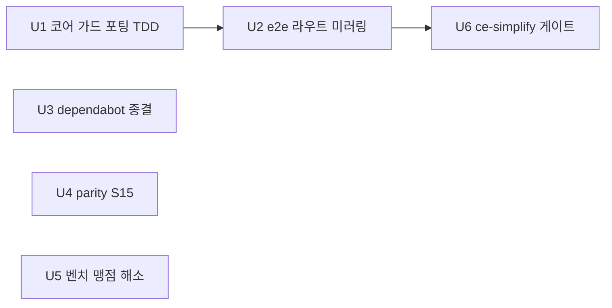

# 남은 작업 병렬 정리 — Lua cache_control 가드 포팅과 백로그

## Goal Capsule

**Objective:** Kong-Lua·APISIX 라우트 운영자가 Go판과 같은 기본 보호(요청층 cache_control 가드 기본 on)를 받고, 이번 세션에서 밀린 저장소 관리·측정·단순화 과제가 전부 끝난다. 운영자가 보는 것: Kong-Lua·APISIX 라우트에 Authorization 요청이 기본으로 캐시되지 않고, 명시적 `cache_control: false`로 끌 수 있다.

**Means:** 가드 판정을 코어 `lua/sonic_boom/flow.lua`에 단일 구현하고 두 Lua 스키마가 `cache_control`을 노출하게 한다 (KTD2). dependabot은 PR 머지로, 측정은 기존 bench_gw suite 재사용으로 (KTD4·KTD5).

**Authority:** Go판 구현(`internal/sonic_boom.go` cacheableRequest 가드)과 이번 세션의 확정 결정이 계약이다. 본 플랜이 Go 시맨틱을 Lua로 이식하며, 새 제품 판단을 만들지 않는다.

**Stop conditions:** Kong-Lua 선언형 스키마가 cache_control 수용 후 기존 설정 로드를 깨면(미선언 라우트까지 검증에 걸침 — 2026-10-24 실측) 중단하고 보고한다. APISIX YAML 배치에서 라우트 로드가 깨지면 중단하고 보고한다.

**Execution profile:** 사용자가 "가급적 병렬로 빠르게"를 지시 — ce-work가 유닛 의존 그래프대로 병렬 웨이브를 구성한다. TDD(selfcheck RED→GREEN)가 U1의 실행 방향이다. 완료 후 사용자가 최종 발송을 지시한다(세션 패턴: main 직접 푸시).

## Product Contract

### Summary

세 변종 공유 캐시의 요청층 가드를 Lua로 포팅해 변종 간 보호 격차를 닫고, dependabot·벤치 맹점·parity 잠재 차이·단순화 게이트라는 네 백로그를 한 번에 정리한다.

### Problem Frame

2026-10-24 Go판이 cache_control 가드를 기본 on으로 전환했으나(옵트아웃 계약), Lua 두 변종은 필드 자체가 미선언이라 요청층 가드가 없다 — 변종 간 보호 수준 격차가 명시 차이로 기록돼 있는 상태다. 동시에 dependabot PR(#92)이 열려 있고, 벤치는 노드 로컬 메모리만 측정하는 맹점이 있으며, parity는 다중값 쿼리 순서의 잠재 차이를 커버하지 못한다.

### Requirements

**가드 포팅**

- R1. Kong-Lua·APISIX 라우트는 요청층 cache_control 가드를 Go와 같은 시맨틱(기본 on, `Cache-Control: no-store/no-cache` 요청·`Authorization` 요청 제외, 판정 오류 fail-closed)으로 제공한다. (KTD1·KTD2)
- R2. 두 Lua 스키마가 `cache_control`을 부울 필드(기본 true)로 수용하고, 명시적 false가 존중된다. (KTD1)
- R3. 가드 동작이 selfcheck 벡터와 e2e로 검증된다 — Kong-Lua 스키마 거부 무검증 갭을 닫는다.

**저장소 관리**

- R4. dependabot PR #92(actions/upload-artifact 5→7)가 CI 초록 후 머지되고, main에 병합된 구 dependabot 로컬 브랜치 2종(golangci-lint-action-7·gocache redis 4.2.4)이 삭제된다. (KTD4 — 머지까지 사용자 승인 완료 2026-10-26)

**측정**

- R5. 큰 본문 HIT의 shm→Lua 복사 비용이 실측 기록된다(벤치 라우트·스크립트 확장 포함).
- R6. redis·redis-cluster 전략의 HIT 핫패스 수치가 기록된다.
- R7. parity_replay에 다중값 쿼리 순서 시나리오가 추가되어 Go(정렬)·Lua(원순서)의 키 분리 차이를 명시적으로 고정한다.

**단순화**

- R8. 세션 누적 코드가 ce-simplify-code(mode:pipeline) 게이트를 통과한다 — 30줄 이상 실질 코드 변경 클러스터가 대상이다.

### Scope Boundaries

- Kong EE 이행 없음(기존 결정 유지).
- Lua 가드의 새 판정 조건 추가 없음 — no-store/no-cache/Authorization 세 가지는 Go와 동일.
- 벤치 프레임워크 신설 없음 — bench_gw suite 재사용(KTD5).

## Planning Contract

### Key Technical Decisions

- KTD1. **Lua 가드 기본 on, 옵트아웃 계약** — Go 앵커(2026-10-24 전환)를 따른다. `session-settled: user-directed — chosen over Lua만 기본 off: 변종 간 보호 격차를 다시 만들지 않는다.`
- KTD2. **판정은 코어 flow.lua 단일 구현** — Go `cacheableRequest` 가드 미러. 어댑터는 스키마 선언만 추가하고 판정 중복을 만들지 않는다.
- KTD3. **스키마 기본값은 Lua 스키마가 진다** — `default = true`(Kong)·`default = true`(APISIX). flow는 `conf.cache_control` 진위만 읽는다(진실=가드 on). selfcheck 벡터는 값을 명시해 플랫폼 기본값 경로와 코어 판정 경로를 분리 테스트한다.
- KTD4. **dependabot은 PR 머지로 종결** — `session-settled: user-directed — chosen over 재베이스 후 유지만: 2026-10-26 머지까지 승인.`
- KTD5. **측정은 bench_gw suite 재사용** — 새 벤치 프레임워크 금지. 신설 라우트는 config 3종 게이트웨이 현실(라우트 3종 + 스모크 2종 + Makefile)에 맞춘다.
- KTD6. **U2 e2e 라우트는 Go 이주 패턴을 정확히 미러링** — 가드 기본 on이 되면 Lua vary 스위트도 Authorization vary 키 분리를 검증 못 하므로, Authorization vary를 검증하는 Lua e2e 라우트(메인 3전략 + vary 3종)에 `cache_control: false`를 명시한다(Go 커밋 ee88806의 이주 패턴).

### Assumptions

- PR #92는 workflow 파일만 건드린다(업로드 아티팩트 버전) — 플러그인 런타임 무영향.
- 벤치 신설 라우트의 목업 응답 크기(큰 본문)는 test/upstream nginx fixture 확장으로 충족한다.
- 세션 패턴상 완료 후 main 직접 푸시가 기대된다 — ce-work 발송 후 사용자 최종 지시로 이중 확인한다.

## High-Level Technical Design

유닛 의존 그래프 — ce-work 웨이브 구성의 기준이다.

웨이브 1: U1·U3·U4·U5 (단, U5의 config_lua·apisix 편집은 U2와 겹치므로 U2 뒤 또는 파일 합의).
웨이브 2: U2. 웨이브 3: U6.

## Implementation Units

### U1. 코어 가드 포팅과 스키마 노출 (TDD)

**Goal:** flow.lua가 요청층 cache_control 가드를 판정하고 두 스키마가 필드를 노출한다.
**Requirements:** R1·R2·R3
**Files:** `lua/sonic_boom/flow.lua`, `lua/sonic_boom/selfcheck.lua`, `lua/kong/plugins/sonic-boom-lua/schema.lua`, `lua/apisix/plugins/sonic-boom-lua.lua`, `docs/kong-lua-verdict.md`, `docs/solutions/architecture-patterns/proxy-cache-principal-key-isolation.md`
**Approach:** flow.lua access의 cacheable_method(:131)와 core_filter.match(:138) 사이에 가드 삽입 — `conf.cache_control`이 참이면 `env.req_header(ctx, "Cache-Control")`·`env.req_header(ctx, "Authorization")`로 no-store/no-cache/Authorization을 검사해 Bypass 시그널(Go cacheableRequest 미러). Kong 스키마에 `cache_control = { type = "boolean", default = true }` 추가, APISIX 스키마에 `cache_control = { type = "boolean", default = true }` 추가. TDD: selfcheck 벡터를 먼저 추가해 RED(현재 가드 없음 → Authorization 요청이 캐시됨)를 관찰한 뒤 구현한다. 벡터(전부 값을 명시 — KTD3): (a) cache_control=true + Authorization 요청 Bypass, (b) cache_control=true + no-store 요청 Bypass, (c) cache_control=false + Authorization 요청 캐시(옵트아웃), (d) cache_control=true + 대소문자 혼용 no-cache 요청("max-age=0, No-Cache") Bypass, (e) cache_control=true + 무관 디렉티브(max-age=60) 요청 정상 캐시 — 과잉차단 방어. Go 유닛 5케이스(internal/sonic_boom_test.go:1105-1220)가 기대값 표다. 스키마 기본 on 경로(필드 생략)의 검증은 selfcheck 하니스가 스키마를 통과하지 않으므로 U2의 e2e가 담당한다. 문서: kong-lua-verdict 명시 차이 2를 "스키마 거부"에서 "Go와 기본 on 동일, 미선언 필드만 차이"로 갱신, 격리 문서 백로그 문구 갱신.
**Dependencies:** 없음 (웨이브 1)
**Verification:** selfcheck 벡터 RED→GREEN 관찰 기록, `lua -e "assert(loadfile(...))"` 전 파일 문법. (e2e 초록은 U2의 검증이 담당 — U1 시점엔 옵트아웃 설정이 없어 vary 스위트가 실패한다.)

### U2. Lua e2e 라우트 미러링과 스모크 전환

**Goal:** 가드 기본 on 상태의 Lua e2e가 Go 이주 패턴과 동일하게 고정된다.
**Requirements:** R1·R3 (KTD6)
**Files:** `config_lua.yml`, `config_apisix.yaml`, `scripts/smoke_lib.sh`
**Approach:** (a) /lua-cache-control 라우트를 양 설정에 미러링하되 **cache_control 필드를 생략한다**(스키마 기본 true 의존) — 스모크 cache-control 단언이 기본 on 경로를 직접 검증한다. (b) Authorization vary를 검증하는 Lua e2e 라우트(메인 3전략 + vary 3종)에 `cache_control: false` 명시 — Go 이주 패턴(ee88806) 정확한 미러. (c) smoke_lib의 cache_control 블록이 Lua 스모크에서도 도는 경로로 전환(SkipSchemaAssert 체계 재검토 — 라우트가 이제 존재하므로 동작 단언이 가능).
**Dependencies:** U1 (웨이브 2)
**Verification:** `make e2e-lua`·`make e2e-apisix` 초록 — cache-control 라우트 단언이 Lua에서도 도는 것을 출력으로 확인.

### U3. dependabot 종결

**Goal:** PR #92 머지와 구 브랜치 정리로 저장소 관리 백로그를 닫는다.
**Requirements:** R4 (KTD4)
**Files:** 원격 상태만 (저장소 파일 변경 없음)
**Approach:** PR #92 CI 확인 → squash 머지(사용자 승인 완료). `git branch -d`로 main에 병합된 구 dependabot 로컬 브랜치 2종 삭제(병합 확인 선행 — 2026-10-26 기준 둘 다 main에 병합됨을 확인했다).
**Dependencies:** 없음 (웨이브 1)
**Verification:** PR #92 state=MERGED, `git branch --merged main`에 구 브랜치 잔존 없음.

### U4. parity 다중값 순서 시나리오

**Goal:** Go(정렬)·Lua(원순서)의 다중값 쿼리 키 분리 차이가 parity로 고정된다.
**Requirements:** R7
**Files:** `scripts/parity_replay.sh`
**Approach:** S15 시나리오 추가 — 같은 파라미터를 순서만 바꿔 재생(`?b=2&b=1` 후 `?b=1&b=2`). Go는 정렬해 같은 키(2번째 Hit), Lua는 원순서라 다른 키(2번째 Miss) — 양측 기대가 다르므로 각 측 기대를 별도 단언하는 분기 형태로 구현한다(plain pair 금지 — 기대가 어긋난다; 기존 시나리오에 이 형태는 없어 새로 작성한다). S13도 함께 갱신한다 — 포팅 후 "두 Lua 게이트웨이 모두 cache_control을 스키마에서 거부" 주석과 건너뜀 분기는 거짓이 되고, go-lua 쌍에서 U2의 /lua-cache-control 경로 Lua Bypass를 단언하게 바꾼다. 문서 연결: kong-lua-verdict.md 명시 차이 요약에 다중값 쿼리 순서 차이를 새 항목으로 추가하고 S15와 상호 참조한다(기존 기록은 세션 리뷰 산출물에만 있고 저장소 문서에는 없다 — 플랜 초안의 "잔여 위험 14번" 참조는 그 산출물을 가리켰다). docs/verification-2026-10-24.md 남은 측정 과제의 해당 불릿도 S15 착지 시 정리한다.
**Dependencies:** 없음 (웨이브 1)
**Verification:** `PARITY_PAIR=go-lua`·`lua-apisix` 재생 초록 + S15 출력에 양측 기대가 명시됨.

### U5. 벤치 맹점 해소

**Goal:** 큰 본문 HIT 비용과 redis/cluster 핫패스 수치가 기록된다.
**Requirements:** R5·R6 (KTD5)
**Files:** `test/upstream/nginx.conf`, `config_v1.yml`, `config_lua.yml`, `config_apisix.yaml`, `scripts/bench_gw.sh`, `docs/bench-kong-lua-vs-go.md`
**Approach:** (a) 큰 본문 fixture 라우트(예: 100KB 응답)를 nginx에 추가하고 bench_gw에 bigbody HIT suite를 넣는다 — 목적은 shm→Lua 복사 비용 관측. (b) redis·redis-cluster 전략 HIT suite 추가 — Go `/redis`·Lua `/lua-redis`와 Go `/redis-cluster`·Lua `/lua-redis-cluster`(기존 라우트)를 warm 후 suite로 잰다. 측정 창을 라우트 TTL(15초) 이하로 유지해 중간 만료의 수치 오염을 피한다. 결과는 bench 문서에 재측정 절 형식(중앙값+범위)으로 기록.
**Dependencies:** 없음 (웨이브 1 — U1과는 파일 비겹침. config_lua.yml·config_apisix.yaml은 U2와 겹치므로 U2 완료 후 또는 파일 합의 하 웨이브 조정)
**Verification:** 벤치 출력이 문서에 기록되고 회차 편차 표기가 있다.

### U6. ce-simplify-code 게이트

**Goal:** 세션 누적 코드가 단순화 게이트를 통과한다.
**Requirements:** R8
**Files:** 판정 결과에 따름
**Approach:** U1·U2 착지 후 실질 코드 변경이 30줄 이상이면 ce-simplify-code mode:pipeline을 최근 클러스터에 실행한다. 30줄 미만이면 수동 점검 한 줄로 갈음하고 기록한다.
**Dependencies:** U2 (웨이브 3)
**Verification:** 실행 기록 또는 문턱 미달 기록.

## Verification Contract

- `make test` — 통합(-race, compose)
- `make e2e-lua` · `make e2e-apisix` — Lua 가드의 종단 검증(U1·U2)
- `PARITY_PAIR=go-lua` / `lua-apisix` `./scripts/parity_replay.sh` — S15 포함 전 시나리오 초록
- `lua -e "assert(loadfile('<file>'))"` — 변경된 전 Lua 파일 문법
- `BENCH_PAIR=... ./scripts/bench_gw.sh` — 신설 suite 측정
- selfcheck — e2e-lua 경유(포트 8010 curl) 또는 하니스

## Definition of Done

- 전 유닛 완료 + 위 검증 계약 초록
- 명시 차이·기록 문서가 새 상태와 정합(kong-lua-verdict 명시 차이 2 갱신 + 다중값 순서 신설 항목, 격리 문서 백로그 문구 갱신, verification-2026-10-24 측정 과제 불릿 정리)
- 커밋은 Conventional Commits 한국어, 유닛별 논리 커밋
- 실험 코드·죽은 경로 잔존 없음
- 최종 발송(main 푸시)은 사용자 지시 후
