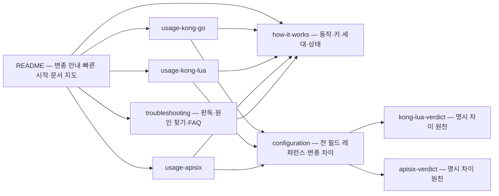

# 변종별 사용·설정 문서와 도움말 확충

## Goal Capsule

- **Objective:** 게이트웨이 운영자와 첫 기여자가 문서만 읽고 자기 환경에 맞는 변종(Kong-Go·Kong-Lua·APISIX-Lua)을 골라 설치·설정·동작 확인까지 갈 수 있다. 확인은 문서 밖에서 가능하다 — 문서의 예제를 따라 했을 때 `X-Cache-Status`가 Miss→Hit로 나오면 됐다.
- **Means:** docs/에 문서 6종(동작·설정 레퍼런스·변종별 사용 3종·문제 해결)을 신설하고 README를 문서 지도로 재구성한다. 집필·검증은 doc-experts 체인(de-work → de-visualize → de-review → humanize)으로 돌린다 (KTD1).
- **Authority:** 세션에서 확정된 구조·범위·윤문 결정(Key Decisions)이 최우선이고, 그 아래는 소스 코드와 검증된 설정 파일이 계약이다 — 문서의 모든 기본값·예제·동작 서술은 원천 파일에서 재확인한 것만 쓴다 (KTD6).
- **Stop conditions:** 집필 중 소스와 조사 기록이 충돌하면(동시 세션의 코드 변경 등) 해당 절을 멈추고 보고한다 — 사실 오류를 문서화하는 꼴이 되므로. de-visualize가 mermaid로 담기 어려운 구조면 제안 단계에서 다른 형식을 제안한다.
- **Execution profile:** 대화형. de-work·de-visualize·de-review가 갖는 확인 게이트를 사용자가 통과시키는 전제로 돌아간다. 커밋·푸시는 유닛 완료 후 사용자 최종 지시로(저장소 세션 패턴).

---

## Product Contract

### Summary

세 변종의 사용·설정 예제와 도움말을 문서 세트로 갖추고 README를 문서 지도로 재구성한다. 검증된 설정 원천(`config_v1.yml`·`config_lua.yml`·`config_apisix.yaml`)과 소스에서 뽑은 사실만 쓰고, 집필부터 윤문까지 doc-experts 체인으로 품질을 잡는다.

### Problem Frame

README는 Go판 시점으로 짜여 있고 설정 예시가 redis 전략 하나뿐이다. docs/의 문서는 판정·기록 문서라 "이 게이트웨이에 이 플러그인을 처음 붙이는 사람"이 물어야 할 질문 — 무엇을 골라, 어떻게 설치하고, 어떻게 확인하나 — 에 답하는 문서가 없다. 사용자에게 가치가 있는 정보가 판정 문서 안에 갇혀 있는 경우도 있다: `docs/apisix-verdict.md`의 운영 관찰 절은 fill-lock 꼬리 지연 회피 권장과 priority 충돌 경고 같은 운영 지침을 스스로 "운영 가이드가 필요하다"고 적어 두며 품고 있다.

### Requirements

**변종별 사용 문서**

- R1. Kong-Go·Kong-Lua·APISIX-Lua 각각의 사용 문서가 설치 → 최소 설정 → 동작 확인(curl) → 변종 주의점 순서로 제 길을 완결한다.
- R2. 문서의 모든 설정 예제와 명령어는 검증된 원천(선언형 설정 3종, make 타깃, scripts/ 스모크)에서 발췌하거나 그 축소본이며, 원천 파일을 링크한다.

**공통 도움말**

- R3. 설정 레퍼런스가 전 필드의 기본값·단위·검증 규칙·변종 차이를 한 곳에 담는다.
- R4. 동작 문서가 요청 판정·저장 흐름, 캐시 키·세대, X-Cache-Status 정의를 설명한다.
- R5. 문제 해결 가이드가 X-Cache-Status 판독·Bypass 원인 찾기·자주 묻는 질문을 담는다.

**README**

- R6. README가 변종 선택 안내·빠른 시작·문서 지도로 재구성되고, 하위 문서로 이관한 내용의 이중 나열이 없다.
- R7. README 전체에서 형식적 3중 불릿·장식 기호·수식어·같은 말의 반복이 제거된다.

**다이어그램·품질**

- R8. mermaid 다이어그램은 이해가 바뀌는 지점에만 들어가고, de-visualize의 제안-확인 게이트를 거친다.
- R9. 신규·수정 문서 전부가 집필(de-work) → 다이어그램(de-visualize) → 품질 게이트(de-review) → 윤문(humanize) 체인을 통과한다.
- R10. 용어는 CONCEPTS.md와 정합하고, 변종 표기는 Kong-Go·Kong-Lua·APISIX-Lua로 통일한다.

### Success Criteria

- 처음 온 독자가 README → 자기 변종의 사용 문서만 따라가서 설치와 Miss→Hit 확인을 마칠 수 있다.
- de-review가 전 문서에 "게시 가능" 판정을 내린다.
- 리뷰·검증에서 기본값·예제의 사실 오류 반려가 0건이다.

### Key Decisions

- KD1. 문서는 docs/에 변종별 파일로 둔다. (session-settled: user-directed — chosen over README 한 파일 확장·docs/usage.md 단일 문서: 변종별 완전한 설치→설정→검증 경로를 담기 위해서다.) Governs R1, R6.
- KD2. 도움말 범위는 설정 레퍼런스·흐름 구조 다이어그램·문제 해결·설치 실행 4종 전부다. (session-settled: user-directed — 축소하지 않는다.) Governs R3, R4, R5.
- KD3. AI 문체 제거는 이번에 건드리는 문서 + README 전체에 적용한다. (session-settled: user-directed — chosen over 기존 문서 전체 스윕: CONCEPTS.md·docs/testing.md 등은 이번에 고치는 부분만 손댄다.) Governs R7.

### Scope Boundaries

- 코드·설정 파일 변경 없음 — 이 플랜의 산출물은 문서만이다.
- 판정·기록 문서(docs/kong-lua-verdict.md, docs/apisix-verdict.md, bench 3종, verification, solutions)는 재집필하지 않고 링크로 참조한다. 예외: APISIX 사용 문서가 apisix-verdict 운영 관찰의 권장·경고를 흡수한다 (KTD4).
- Kubernetes 예제 제외 — README TODO의 별도 항목으로 남긴다.
- run.sh·test.sh 등 레거시 도구의 교체·삭제 없음(안내 문서에서 레거시임을 밝히기만 한다).

#### Deferred to Follow-Up Work

- markdownlint·mermaid CI 게이트 신설 — 현재 pre-commit·CI에 문서 검증이 전무하다(부록 A.5). 도구 추가는 이번 범위 밖이고, 문서 품질은 체인과 최종 검증으로 잡는다.

---

## Planning Contract

### Key Technical Decisions

- KTD1. 집필·검증은 doc-experts 체인을 그대로 쓴다 — de-work(장별 방향 확인 루프, 문체 plain-prose) → de-visualize(제안 5요소·확인 게이트·mermaid 공식 파서 검증) → de-review(한국어 문서 품질 게이트) → humanize(마지막 한 번). 근거: de-visualize·de-review 스킬이 정의한 체인 순서와 팀 문서 규약(의미 작업 먼저, 윤문 마지막).
- KTD2. 다이어그램은 문서 세트가 초안을 마친 뒤 de-visualize 한 번으로 배치한다 — 문서마다 돌리지 않는다(게이트 회수가 늘어난다). 후보: 코어+어댑터 구조(README), 요청 판정 시퀀스(how-it-works), X-Cache-Status 판정(troubleshooting). de-visualize가 함께 만드는 SVG 대표 그림은 저장소 문서 성격상 제외하고 mermaid만 쓴다.
- KTD3. README 재구성 원칙 — 변종 표·빠른 시작은 유지하되 축소하고, 캐시 전략·캐시 동작 규칙·설정 예시는 하위 문서로 이관한 뒤 한 단락 요약+링크로 남긴다. 빠른 시작과 테스트 절의 이중 나열은 docs/testing.md 링크로 수렴한다. TODO는 미완료 항목만 남긴다.
- KTD4. APISIX 사용 문서가 apisix-verdict 운영 관찰의 사용자 가치(fill-lock 꼬리 지연 라우트엔 `fill_lock.enabled: false` 권장, priority 99 미만 커스텀 플러그인과의 Hit 단락 충돌 경고)를 흡수한다.
- KTD5. 문서 하나가 하나의 논리 커밋이다 — Conventional Commits 한국어(`docs: ...`).
- KTD6. 사실 원천 고정 — 설정 스키마는 `internal/sonic_boom.go`·`internal/redis_config.go`·`internal/in_memory_config.go`·`internal/log.go`·`lua/kong/plugins/sonic-boom-lua/schema.lua`·`lua/apisix/plugins/sonic-boom-lua.lua`, 예제는 `config_v1.yml`·`config_lua.yml`·`config_apisix.yaml`, 흐름은 `internal/sonic_boom.go`(Access/Response)와 `lua/sonic_boom/flow.lua`. 집필 시점에 해당 파일에서 수치·기본값을 재확인한다(부록 A가 지도다).

### Assumptions

- 집필 중에는 소스가 바뀌지 않는다. 동시 세션이 감지되면 HEAD를 재확인한 뒤 반영한다(팀 규약).
- de-work·de-visualize·de-review의 확인 게이트에 사용자가 응답한다 — 체인이 대화형이라는 전제.
- 플러그인 동작 자체의 검증은 이번 범위 밖이다. 문서는 현행 코드를 반영할 뿐이고, 코드를 고치는 일은 별도 플랜이다.

### High-Level Technical Design

문서 세트의 구조와 읽는 길. 화살표는 문서 간 링크 방향이다.



집필 순서는 의존 그래프를 따른다: 웨이브 1에서 U1·U2(공통 기반), 웨이브 2에서 U3·U4·U5·U6(병렬 가능), 웨이브 3에서 U7(README, 링크 대상이 다 있어야), 웨이브 4에서 U8(품질 체인 마감).

---

## Implementation Units

### U1. 동작 문서 신설 — docs/how-it-works.md

**Goal:** 요청 하나가 지나가는 길과 세 변종이 공유하는 구조를 한 문서로 설명한다.
**Requirements:** R4, R10
**Dependencies:** 없음
**Files:** `docs/how-it-works.md` (신설)
**Approach:** 목차 — ① 요청 수명주기: Access(설정 검증 → 메서드 → cache_control 가드 → 필터 → 캐시 키 → 조회 → fill-lock → Hit/Refresh/Miss)와 Response(저장 게이트 → 저장), 각 단계가 어느 조건에서 어느 상태를 내는지 ② 코어와 어댑터: 판정은 `lua/sonic_boom/flow.lua`(Go는 `internal/`)에 있고 어댑터는 PDK 접속만 담당 ③ 캐시 키와 세대: 키 성분(유효 TTL 포함), 값 단위 길이 접두 직렬화, sha256, cache_version 처리의 변종 차이(Go는 Hit 시 비교 purge, Lua는 키 접두로 세대 분리) ④ X-Cache-Status 4상태 정의. 핵심 메시지: "판정 규칙은 세 변종이 같고, 차이는 목록화된 명시 차이일 뿐이다". 논거 원천은 KTD6의 흐름 파일과 부록 A.2.
**Execution note:** de-work으로 집필한다(이 유닛의 목차·핵심 메시지가 de-work 입력이다). 문체는 plain-prose.
**Verification:** 판정 순서와 상태 전이가 소스와 일치한다(부록 A.2 대조). 변종 차이 서술은 두 verdict 문서의 명시 차이 목록과 정합한다.

### U2. 설정 레퍼런스 신설 — docs/configuration.md

**Goal:** 전 필드를 한 곳에서 찾아보고 변종 차이를 표로 확인한다.
**Requirements:** R3, R10
**Dependencies:** 없음 (U1과 병렬)
**Files:** `docs/configuration.md` (신설)
**Approach:** 목차 — ① 공통 필드 표(필드·타입·기본값·검증 규칙) ② 전략별 하위 설정: redis·redis-cluster·in-memory(ristretto)·client_side_cache·fill_lock·log ③ 필터와 규칙: 필터 TTL의 전역 상속, 정규식의 설정 시점 컴파일과 RE2/PCRE 차이 ④ 변종 차이 표: redis.host 기본값 3종, Lua 스키마 미선언 필드(선언형 로드 거부), cache_ttl 0 처리 3종, APISIX standalone의 check_schema 미강제·encrypt_fields ⑤ 캐시 동작 규칙(README에서 이관): content_type 대소문자 무관 정확 매치, Set-Cookie·Cache-Control private/no-store/no-cache 미저장, 가드 기본 on. 각 절 머리에 원천 파일 링크를 건다. 핵심 메시지: "기본값은 세 변종이 같고, 차이는 이 표에 전부 있다".
**Verification:** 필드 누락이 없다(스키마 정의 6개 파일 전수 대조 — KTD6). 기본값·검증 규칙이 부록 A와 일치한다.

### U3. Kong-Go 사용 문서 신설 — docs/usage-kong-go.md

**Goal:** Kong OSS 운영자가 바이너리를 등록하고 선언형 설정으로 동작을 확인까지 간다.
**Requirements:** R1, R2, R10
**Dependencies:** U1, U2
**Files:** `docs/usage-kong-go.md` (신설)
**Approach:** 목차 — ① 이 변종을 고르는 이유(외부 플러그인 서버 모델, 벤치 문서 링크) ② 설치: `make build` → 바이너리 배치, kong.conf 환경변수 4종(`KONG_PLUGINS=bundled,sonic-boom`, `KONG_PLUGINSERVER_NAMES`, `..._SONIC_BOOM_START_CMD`, `..._SONIC_BOOM_QUERY_CMD` — docker-compose.yaml·Dockerfile이 원천) ③ 최소 설정: `config_v1.yml`의 `/redis` 라우트에서 필수 필드만 발췌 ④ 동작 확인: `make e2e` 또는 curl로 Miss→Hit(포트 8000), `X-Cache-Key`로 키 확인 ⑤ 주의점: go-pdk 런타임 규율 링크(패닉 금지·설정 불변·TTL 0), OTel 메트릭·트레이스(부록 A.4), `cacheable_body_max_size` 기본 0(무제한) 경고.
**Verification:** 설치 절차가 `docker-compose.yaml`·`Dockerfile`과 일치한다. curl 예시에 기대 응답(`X-Cache-Status` 값)이 명시돼 있다.

### U4. Kong-Lua 사용 문서 신설 — docs/usage-kong-lua.md

**Goal:** Lua 번들로 운영하는 Kong에 sonic-boom-lua를 붙인다.
**Requirements:** R1, R2, R10
**Dependencies:** U1, U2
**Files:** `docs/usage-kong-lua.md` (신설)
**Approach:** 목차 — ① 고르는 이유(별도 플러그인 서버 프로세스가 없다, 벤치 링크) ② 설치: `lua/`를 Kong 기본 Lua 트리 밖(예: `/kong-lua/`)에 배치, `KONG_PLUGINS=bundled,sonic-boom-lua`, `KONG_LUA_PACKAGE_PATH`, nginx include로 `lua_shared_dict sonic_boom_cache 32m`·`redis_cluster_slot_locks 1m` 주입(`conf/kong-lua-extra.conf`가 원천 — env/kong.conf는 반복 선언이 안 되고 `KONG_NGINX_HTTP_INCLUDE`로 건다) ③ 최소 설정: `config_lua.yml` 라우트 발췌 ④ 확인: `make e2e-lua`(포트 8010) ⑤ 주의점: 스키마에 미선언 필드는 선언형 로드가 거부된다(log·in_memory 튜닝·client_side_cache·재시도 계열), 존 크기는 nginx.conf에서 관리, `redis.host` 기본 localhost, 명시 차이는 verdict 문서 링크.
**Verification:** env·include 지시문이 `Dockerfile.kong-lua`·`conf/kong-lua-extra.conf`와 일치한다.

### U5. APISIX 사용 문서 신설 — docs/usage-apisix.md

**Goal:** APISIX standalone 배치로 sonic-boom-lua를 붙인다.
**Requirements:** R1, R2, R10
**Dependencies:** U1, U2
**Files:** `docs/usage-apisix.md` (신설)
**Approach:** 목차 — ① 고르는 이유 ② 설치: `lua/` → `/opt/sonic-boom/`, `conf/apisix-config.yaml`을 config.yaml로 굽기(`extra_lua_path`·`custom_lua_shared_dict`·plugins 목록), `APISIX_STAND_ALONE=true` ③ 라우트: `config_apisix.yaml` 발췌, YAML은 반드시 `#END`로 끝나야 한다는 요구, `encrypt_fields`(redis 비밀번호) ④ 확인: `make e2e-apisix`(포트 8020) ⑤ 주의점: standalone YAML 배치는 check_schema가 강제되지 않아 설정 오류가 런타임 fail-open(Miss)으로 드러난다, priority 99와 그 아래 커스텀 플러그인의 Hit 단락 충돌, fill-lock 꼬리 지연 — 꼬리 지연 민감 라우트엔 `fill_lock.enabled: false` 권장 (KTD4, apisix-verdict 운영 관찰 흡수).
**Verification:** 배치 절차가 `Dockerfile.apisix`·`conf/apisix-config.yaml`과 일치한다. `#END` 요구가 서술돼 있다.

### U6. 문제 해결 가이드 신설 — docs/troubleshooting.md

**Goal:** "캐시가 안 돼요"를 문서만 보고 혼자 진단할 수 있다.
**Requirements:** R5, R10
**Dependencies:** U1
**Files:** `docs/troubleshooting.md` (신설)
**Approach:** 목차 — ① X-Cache-Status 판독 표: 4값의 뜻과 함께 미묘점(본문 크기 초과는 Bypass가 아니라 Miss 유지, 세대 불일치는 Go=Bypass/Lua=Miss) ② Bypass 원인 찾기 체크리스트: 판정 순서 그대로(설정 검증 실패 → Error 로그 확인, 메서드, cache_control 가드, 필터 미매치, 저장 게이트 탈락) 각각의 확인 방법 ③ FAQ: 캐시가 안 됩니다 / TTL이 기대와 다릅니다(필터 TTL 상속) / 캐시를 지우고 싶습니다(cache_version 세대 갈아탐 — 변종별 차이) / 큰 본문도 저장됩니다(`cacheable_body_max_size` 기본 0) / `X-Cache-Key`가 외부에 보입니다(수용된 기본값, 앞단 제거 권장).
**Verification:** 판독 표의 각 행이 소스의 판정 지점과 일치한다(부록 A.2).

### U7. README 재구성

**Goal:** 첫 화면이 안내·지도 역할을 하고, 이중 나열과 문체 흔적이 사라진다.
**Requirements:** R6, R7, R10
**Dependencies:** U1, U2, U3, U4, U5, U6
**Files:** `README.md`
**Approach:** 유지 — 변종 표, 빠른 시작(축소). 이관 — 캐시 전략·캐시 동작 규칙·설정 예시를 `docs/configuration.md`·`docs/how-it-works.md`로 보내고 README엔 한 단락 요약+링크. 수렴 — 빠른 시작과 테스트 절의 이중 나열을 `docs/testing.md` 링크로 합친다. 제거 — TODO의 ✅·날짜 장식(미완료 항목만 남김), 형식적 개발 워크플로우 번호 단계, "고성능/고가용성/포괄적인" 류 수식어, 캐시 전략 3중 불릿(각 전략 한 줄 표로). 신설 — 문서 지도(이번 6종 + 기존 docs 링크). 위치는 부록 A.3의 목록을 따른다.
**Verification:** README에서 사라진 내용이 전부 하위 문서에 존재하고 링크가 유효하다. 부록 A.3의 slop 후보 전량이 처리(제거·수정·유지 사유)된다.

### U8. 품질 체인 마감 — 다이어그램·리뷰·윤문·최종 검증

**Goal:** 문서 세트가 체인을 통과하고 저장소에 안착한다.
**Requirements:** R8, R9
**Dependencies:** U1, U2, U3, U4, U5, U6, U7
**Files:** U1–U7 산출 문서 전부, `CHANGELOG.md`
**Approach:** 순서 — (1) de-visualize 실행: KTD2 후보에 대해 제안(위치·형식·미리보기·근거·우선순위) → 확인 → mermaid 생성·공식 파서 검증 (2) de-review를 문서별로 실행(autofix는 자동, 구조 변경은 게이트)하고 Verdict를 기록 (3) humanize를 전체 문서에 마지막 한 번 (4) 최종 검증: 상대 링크 전수 순회, 변종 표기·CONCEPTS.md 용어 정합 점검 (5) `CHANGELOG.md` Unreleased에 항목 반영, 유닛별 논리 커밋.
**Verification:** de-review Verdict가 전 문서 "게시 가능". humanize 1회. 깨진 상대 링크 0.

---

## Verification Contract

- **사실 정합** — 각 문서의 기본값·예제·헤더 동작이 KTD6 원천 파일과 일치하는지 집필·de-review 단계에서 대조한다. 근거 지도는 부록 A.
- **mermaid** — de-visualize의 공식 파서 검증을 통과하고, 저장소 관례인 fenced ```mermaid 블록 형태다(GitHub 렌더).
- **링크** — 최종 검증에서 상대 링크를 전수 순회한다. 문서 검증 자동 게이트는 없다(부록 A.5) — 수동 순회가 계약이다.
- **품질 게이트** — de-review Verdict "게시 가능" 전 문서, humanize 정확히 1회.
- **저장소 영향** — 산출물이 *.md뿐이므로 빌드·CI 게이트에 닿지 않는다(build.yml는 *.md를 제외한다). `make test`·e2e는 이 플랜의 검증이 아니라 문서가 인용하는 명령의 원천이다.

## Definition of Done

- 문서 6종(how-it-works·configuration·사용 문서 3종·troubleshooting) 신설, README 재구성 완료
- 체인 4단계(de-work → de-visualize → de-review → humanize) 통과 기록이 세션에 남는다
- 변종 표기가 Kong-Go·Kong-Lua·APISIX-Lua로 통일되고 용어가 CONCEPTS.md와 정합한다(신규 용어 3종 — fill-lock·저장 게이트·cache_control 가드 — 은 플랜 작성 시점에 CONCEPTS.md에 추가했다)
- README에 이중 나열·장식 기호·형식적 불릿 잔존이 없다
- 유닛별 논리 커밋(Conventional Commits 한국어), CHANGELOG.md Unreleased 반영
- 원천 코드·설정 파일·verdict 문서 본문의 변경 없음

---

## Appendix — 조사 원천 지도

실행자가 소스를 다시 읽을 때 쓸 지도다. 조사 시점은 2026-10-28, HEAD 기준.

### A.1 주제별 원천 파일

- 설정 스키마(Go): `internal/sonic_boom.go`(Config 구조체·configValidator·checkConfig), `internal/redis_config.go`(redis·redis-cluster·client_side_cache), `internal/in_memory_config.go`(in-memory), `internal/log.go`(LogConfig·FileLogConfig)
- 설정 스키마(Lua): `lua/kong/plugins/sonic-boom-lua/schema.lua`, `lua/apisix/plugins/sonic-boom-lua.lua`
- 요청 흐름: `internal/sonic_boom.go`(Access·Response), `lua/sonic_boom/flow.lua`, `internal/fill_lock.go`, `internal/cache_key.go`, `lua/sonic_boom/key.lua`
- 예제 원천: `config_v1.yml`(Kong 선언형, Go판, 21 서비스), `config_lua.yml`(Kong-Lua, `/lua-*` 경로 미러), `config_apisix.yaml`(APISIX standalone, 같은 경로 미러), `conf/apisix-config.yaml`(APISIX config.yaml 원형), `conf/kong-lua-extra.conf`(nginx include)
- 설치 원천: `Dockerfile`·`Dockerfile.kong-lua`·`Dockerfile.apisix`, `docker-compose.yaml`(포트 8000·8010·8020, profile `lua`·`apisix`, 선언형·바이너리 마운트)
- 동작 확인 도구: `scripts/smoke_lib.sh`(공통 단언+gzip suite), `scripts/smoke_lua_*.sh`(GW=kong-lua|apisix), `scripts/parity_replay.sh`(PARITY_PAIR=go-lua|lua-apisix), `scripts/bench_gw.sh`, `scripts/common.sh`(gw_env 헬퍼)
- 변종 차이 원천: `docs/kong-lua-verdict.md`·`docs/apisix-verdict.md`의 명시 차이 목록(번호 불릿 형태)

### A.2 문서가 놓치기 쉬운 함정

- 본문 크기 초과는 Bypass로 바꾸지 않고 Miss 라벨을 유지한다(Go Response, Lua body_filter). 판독에서 가장 혼동되는 지점.
- 세대(cache_version) 불일치 라벨은 Go=Bypass, Lua=Miss 폭로다. Lua는 저장값 decode 실패도 Miss로 폭로한다.
- in-memory 전략은 store가 SetIfNotExists를 지원하지 않아 fill-lock이 구조적으로 항상 fail-open이다(메트릭 라벨 `unsupported`).
- redis 타임아웃 0은 무제한이고 -1은 비활성이다(`config_v1.yml`의 `dial_timeout: 0` 등).
- cache_ttl 0 처리가 변종마다 다르다: Go는 요청 시점 검증 거절 → 전 요청 Bypass, Kong-Lua는 선언형 로드 거부, APISIX standalone은 강제 불가(런타임 fail-open).
- redis.host 기본값이 변종마다 다르다: Go는 required(미선언 시 전 요청 Bypass), Kong-Lua는 localhost, APISIX standalone은 런타임 fail-open.
- Kong-Lua 스키마에 미선언 필드(max_retries·retry backoff·pool_timeout·client_side_cache·log·in_memory 튜닝)는 선언형 로드가 거부된다. APISIX는 additionalProperties=false로 같은 계약, redis 비밀번호는 encrypt_fields로 가려진다.
- 유효 TTL이 캐시 키 성분이다 — 필터 TTL이 다르면 다른 키가 나온다.
- credential_vary: vary_headers에 Authorization이 이미 선언돼 있으면 principal을 중복 추가하지 않는다. Authorization 조회 실패는 fail-closed, 로그·키 덤프는 redacted 처리다.
- 쿼리 다중값 처리: Go는 값까지 정렬한다(단일값 `x=a,b`와 다중값 `x=a&x=b`가 키 분리), Lua는 원순서를 쓴다.
- Lua의 redis·cluster 저장은 log 페이즈 타이머(비동기)라 응답 반환 직후의 아주 빠른 후행 요청은 미저장을 볼 수 있다.
- APISIX YAML은 `#END` 종결이 없으면 라우트를 조용히 로드하지 않는다.
- priority가 변종마다 다르다: Go 1, Kong-Lua 100, APISIX 99 — APISIX에서 99 미만 커스텀 플러그인과 Hit 단락이 겹칠 수 있다.

### A.3 README 문체 정리 위치(절 기준)

- 캐시 전략 절: 용도/특징/설정 3중 불릿, "고성능·고가용성" 수식어, Redis 절의 "클러스터 지원"(Redis Cluster 절과 중복)
- TODO 절: `[x]`+✅+날짜 3중 장식 9곳, "포괄적인 테스트 커버리지" 표현
- 개발 워크플로우 절: 정보 없는 번호 단계(1. 코드 변경 … 4. 커밋 및 푸시)
- 빠른 시작 절 ↔ 테스트 절: 사실상 같은 make 명령의 이중 나열

### A.4 관찰성(Go만, Lua는 product.label 접두 로그만)

- 메트릭(OTel, meter scope `sonic-boom`): `sonicboom_cache_requests`(labels: strategy, status), `sonicboom_cache_lookup_duration`(strategy), `sonicboom_fill_lock_degraded`(reason=unsupported|error)
- 트레이스: OTLP gRPC, span `sonic-boom.Access`/`sonic-boom.Response`, `OTEL_SDK_DISABLED=true`로 전체 비활성
- 로그(zerolog): 설정 검증 실패(Error), cache miss/hit(Debug), 세대 불일치 purge(Warn), 저장 실패(Error)

### A.5 저장소 게이트 현황

- pre-commit: trailing-whitespace·end-of-file-fixer·check-yaml·check-added-large-files + golangci-lint(Go 전용). markdown·mermaid 훅은 없다.
- CI(`ci.yml` 잡 6종, `build.yml`): 문서 검증 없음. `build.yml`의 push paths가 `!*.md`를 제외한다 — 산출물이 빌드를 건드리지 않는 근거.
