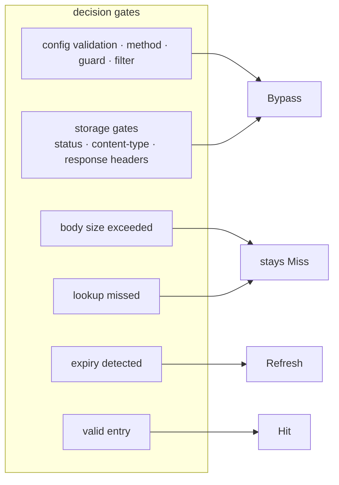

# Troubleshooting guide

Two response headers are where diagnosis starts: `X-Cache-Status` tells you what happened, and `X-Cache-Key` shows which key decided it. This document goes in the order of reading the status → finding the cause → the FAQ. [how it works](./how-it-works.md) explains the decision point that produces each status.

## Reading X-Cache-Status

| Value | Meaning | When it appears | What to try next |
|----|-----|-------------|----------------|
| `Miss` | Not in the cache, so the request went upstream. Will be saved | cacheable, but the lookup missed | Resend the same request and see whether it becomes `Hit`. If not, work through the checklist below |
| `Hit` | Served the cached response | — | Normal |
| `Bypass` | Excluded from the cache | failed a request-side decision (config validation, method, guard, filter) or a storage gate | Narrow down the cause with the checklist below |
| `Refresh` | Was in the cache but past its validity, so it was refetched from the upstream | re-accessed after the TTL passed | Normal. Consider whether to raise the TTL |

*Figure 1. Status values are the product of the decision gates; different gates converge into the same status.*

Three things that are easy to misread (the gates behind each status are in Figure 1):

- **Exceeding the body size keeps `Miss`.** When the body is larger than `cacheable_body_max_size` and the save is skipped, the request goes out as `Miss`, not `Bypass`. This is the first answer to "why do I keep getting only Miss?"
- **The generation-mismatch label differs per variant.** Right after changing `cache_version`, an access to an old entry shows `Bypass` in Go and `Miss` in Lua.
- **The Lua variants save to redis and redis-cluster asynchronously.** If you re-request the moment the response arrives, the save may not be finished yet and you can see `Miss`. Wait a moment, request again, and judge from that.

## Finding the cause of a Bypass

Check in the plugin's own decision order, top to bottom. Failing an earlier step means the later ones never run.

1. **Config validation failure** — suspect this first. Check: one Error line from sonic-boom in the gateway log. Common causes are `cache_ttl: 0` (Go bypasses every request, Kong-Lua rejects the load), `strategy: redis` with `redis.host` undeclared (Go), and an invalid `log_level`. APISIX standalone does not enforce validation, so a config error shows up as `Miss` on every request rather than `Bypass`; for this variant, a behavioral check is the validation.
2. **Method** — whether it is in the `request_method` list. The default is only GET and HEAD. Add POST to the list to cache it.
3. **cache_control guard** — strip the `Cache-Control: no-store/no-cache` and `Authorization` headers from the request and send it again. If it still bypasses, move to the next step. If the guard is the cause, that is by design (on by default). To turn it off, set `cache_control: false`, and review whether you then need [principal key isolation](./how-it-works.md#principal-key-isolation--credential_vary).
4. **Filter mismatch** — on a route that declares `filters`, the default behavior is exclusion. Check that the path regexes and header rules actually match the request. Also check the regex engine difference (Go uses RE2, Lua uses PCRE); patterns that require backtracking are rejected by RE2.
5. **Storage gates** — inspect the **response** headers with `curl -i`. Is the status outside the `response_code` list? Is the content type an exact entry in the `content_type` list (case-insensitive but exact; a `charset` variant must also be in the list)? Is there a `Set-Cookie`, or does `Cache-Control` carry `private`, `no-store`, or `no-cache`? The last two protect personalized responses and are not something to work around.
6. **Body size** — see the subtlety above. The default `cacheable_body_max_size` of 0 is unlimited, but if you set a limit, check whether the response body exceeds it.

If something that was `Hit` starts coming back `Bypass`, a different request got mixed into the same key. Compare `X-Cache-Key`. Different vary headers, method, or body mean a different key.

## FAQ

**Caching does nothing at all.**
Start with `X-Cache-Status`. If the header is missing, the plugin is not attached to the route (check the declarative config and the plugins list; on APISIX, also suspect a missing `#END`). If it is `Bypass`, use the checklist above. If only `Miss` repeats, check body size, the Lua variants' async save, and APISIX config errors (fail-open), in that order.

**Why am I seeing stale data on a Hit?**
A cached response is served as-is until its TTL runs out. Shorten the TTL or switch the generation to invalidate. If `Refresh` and `Miss` keep appearing and the data is still stale, suspect the upstream itself.

**The TTL does not look like what I expected.**
A filter `cache_ttl` of 0 or omitted inherits the global `cache_ttl`. If a filter is matching but a different TTL applies, another filter may be matching first; across filters, the first match wins. Also remember that the effective TTL is an ingredient of the cache key: configs with different TTLs split into entirely different caches.

**I want to clear the cache.**
Change the `cache_version` value; switching the generation is the standard way to invalidate. In Go, the first access to an old entry performs the purge as `Bypass`; in Lua, the generation lives in the key prefix, so requests start in a new key space from the next one onward. On redis, `FLUSHDB` also works, but a generation switch needs only a config change and no restart.

**Are large bodies stored too?**
By default, yes: `cacheable_body_max_size: 0` means unlimited. Routes that cache bodies must set a limit; when unset, a body of any size gets buffered into memory.

**`X-Cache-Key` is visible externally.**
Exposing the internal cache key as-is is accepted for debugging convenience. If external exposure is a concern, remove this header in front of the gateway (load balancer or proxy).
