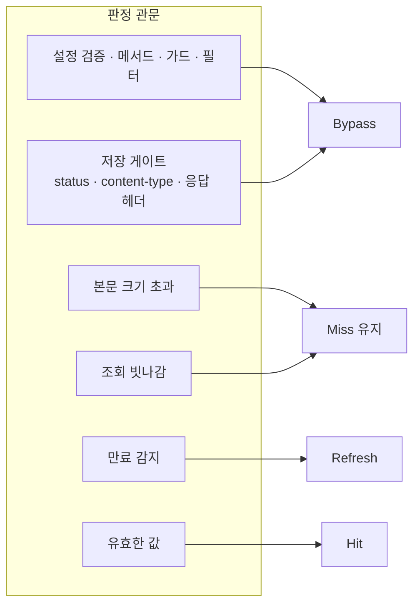

# 문제 해결 가이드

진단의 출발점은 응답 헤더 두 개다 — `X-Cache-Status`가 무슨 일이 있었는지 말하고 `X-Cache-Key`가 어떤 키로 판정했는지 보여준다. 이 문서는 상태 판독 → 원인 찾기 → 자주 묻는 질문 순서로 간다. 각 상태가 나오는 판정 위치는 [동작 방식](./how-it-works.md)이 설명한다.

## X-Cache-Status 판독

| 값 | 뜻 | 나오는 조건 | 다음에 해볼 것 |
|----|-----|-------------|----------------|
| `Miss` | 캐시에 없어 업스트림으로 갔다. 저장될 예정 | 캐시 대상인데 조회가 빗나감 | 같은 요청을 다시 보내 `Hit`이 되는지 본다. 안 되면 아래 체크리스트 |
| `Hit` | 캐시된 응답을 돌려줬다 | — | 정상이다 |
| `Bypass` | 캐시에서 제외됐다 | 요청 판정 탈락(설정 검증·메서드·가드·필터) 또는 저장 게이트 탈락 | 아래 체크리스트로 원인을 좁힌다 |
| `Refresh` | 캐시에 있지만 유효 기간이 지나 업스트림에서 다시 받았다 | TTL 경과 후 재접근 | 정상이다 — TTL을 늘릴지 검토 |

*그림 1. 상태값은 판정 관문의 산물이다 — 서로 다른 관문들이 같은 상태로 모인다.*

판독할 때 혼동하기 쉬운 세 가지:

- **본문 크기 초과는 `Miss`를 유지한다.** `cacheable_body_max_size`보다 커서 저장을 건너뛰면 그 요청은 `Bypass`가 아니라 `Miss`로 나간다. "Miss만 계속 나오는데 왜?"의 첫 번째 답이다.
- **세대 불일치 라벨은 변종마다 다르다.** `cache_version`을 바꾼 직후의 낡은 값 접근은 Go가 `Bypass`, Lua가 `Miss`로 표시된다.
- **Lua 변종의 redis·redis-cluster 저장은 비동기다.** 응답을 받자마자 재요청하면 저장이 아직 끝나지 않아 `Miss`를 볼 수 있다. 잠시 뒤 다시 요청해 보고 판단한다.

## Bypass 원인 찾기

플러그인의 판정 순서 그대로 확인한다. 위에서부터 — 앞 단계에서 탈락하면 뒤는 아예 실행되지 않는다.

1. **설정 검증 실패** — 가장 먼저 의심한다. 확인: 게이트웨이 로그에서 sonic-boom의 Error 한 줄. 자주 나오는 원인은 `cache_ttl: 0`(Go는 전 요청 Bypass, Kong-Lua는 로드 거부), `strategy: redis`인데 `redis.host` 미선언(Go), 잘못된 `log_level`. APISIX standalone은 검증이 강제되지 않아 설정 오류가 `Bypass`가 아니라 전 요청 `Miss`로 나타난다 — 이 변종은 동작 확인이 곧 검증이다.
2. **메서드** — `request_method` 목록에 있는지. 기본값은 GET·HEAD뿐이다. POST를 캐시하려면 목록에 넣는다.
3. **cache_control 가드** — 요청에서 `Cache-Control: no-store/no-cache` 헤더와 `Authorization` 헤더를 떼고 다시 보내본다. 그래도 Bypass면 다음 단계로. 가드 때문이라면 의도적인 것이다(기본 on) — 끄려면 `cache_control: false`, 대신 [주체 키 분리](./how-it-works.md#주체-키-분리--credential_vary)가 필요한지 검토한다.
4. **필터 미매치** — `filters`를 선언한 라우트는 기본 동작이 '제외'다. 경로 정규식·헤더 규칙이 실제 요청과 맞는지 확인한다. 정규식 엔진 차이(Go는 RE2, Lua는 PCRE)도 점검한다 — 되돌림이 필요한 패턴은 RE2에서 거부된다.
5. **저장 게이트** — `curl -i`로 **응답** 헤더를 본다. `response_code` 목록 밖의 status인지, `content_type` 목록에 정확히 있는지(대소문자 무관이지만 정확 매치 — `charset` 변형도 목록에 있어야 한다), `Set-Cookie`가 있거나 `Cache-Control`에 `private`·`no-store`·`no-cache`가 있는지. 마지막 둘은 개인화 응답 보호라 우회 대상이 아니다.
6. **본문 크기** — 위 미묘점 참조. `cacheable_body_max_size` 기본 0은 무제한이지만 상한을 둬 놨다면 응답 본문이 그 값을 넘는지 본다.

`Hit`인데 `Bypass`로 바뀌는 순간이 있다면 같은 키로 다른 요청이 섞였다는 뜻이다 — `X-Cache-Key`를 비교해본다. vary 헤더·메서드·본문이 다르면 키가 다르다.

## 자주 묻는 질문

**캐시가 아예 안 돼요.**
`X-Cache-Status`부터 본다. 없으면 플러그인이 라우트에 안 붙은 것이다(선언형 설정·plugins 목록 확인 — APISIX는 `#END` 누락도 의심). `Bypass`면 위 체크리스트, `Miss`만 반복되면 본문 크기·Lua 비동기 저장·APISIX 설정 오류(fail-open)를 차례로 본다.

**`Hit`인데 오래된 데이터가 왜요.**
캐시된 응답은 TTL이 지나기 전까지 그대로 서빙된다. TTL을 짧게 하거나 세대를 바꿔 무효화한다. 단 `Refresh`·`Miss`가 계속 나오는데도 오래된 데이터라면 업스트림 자체를 의심한다.

**TTL이 기대와 다른 것 같아요.**
필터 `cache_ttl`을 0이나 생략으로 두면 전역 `cache_ttl`을 상속한다. 필터가 매치되고 있는데도 다른 TTL이 적용된다면 다른 필터가 먼저 매치하고 있을 수 있다 — 필터 간에는 첫 매치가 승자다. 또 유효 TTL은 캐시 키의 성분이다 — TTL이 다른 설정은 아예 다른 캐시로 나뉜다는 점도 기억한다.

**캐시를 지우고 싶어요.**
`cache_version` 값을 바꾼다 — 세대를 바꾸는 게 무효화의 정석이다. Go는 낡은 값에 첫 접근이 `Bypass`로 purge를 수행하고 Lua는 키 접두에 세대가 있어 다음 요청부터 새 키 공간에서 시작한다. redis라면 `FLUSHDB`도 되지만 세대 교체가 설정만으로 되고 재시작도 필요 없다.

**큰 본문도 저장되나요?**
기본값은 그렇다 — `cacheable_body_max_size: 0`은 무제한이다. 본문을 캐시하는 라우트는 반드시 상한을 정한다. 미설정 시 어떤 크기의 본문도 메모리에 버퍼링된다.

**`X-Cache-Key`가 외부에 보여요.**
내부 캐시 키를 그대로 노출하는 것은 디버깅 편의로 수용된 동작이다. 외부 노출이 우려되면 게이트웨이 앞단(로드밸런서·프록시)에서 이 헤더를 제거한다.
